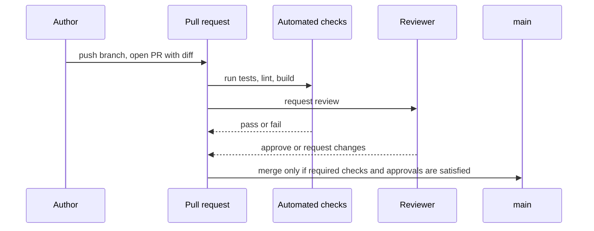
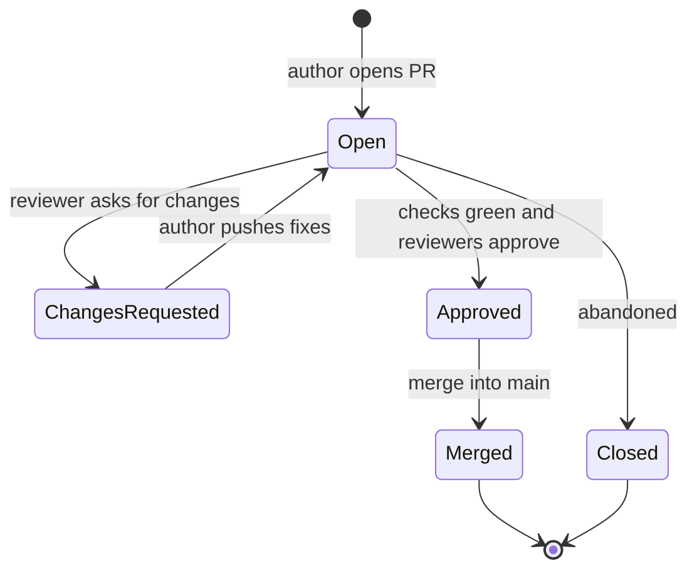

import Scenario from "../../../components/Scenario.astro";
import LevelIntro from "../../../components/LevelIntro.astro";
import PracticeCheck from "../../../components/PracticeCheck.astro";

export const unit = {
  track: "git-teamwork",
  unitSlug: "prs",
};

<Scenario label="All existing tests passed. The discount still went negative.">
  <Fragment slot="facts">
    

      
✅ <strong>CI</strong> — every existing test passes

      
🙋 <strong>Reviewer's question</strong> — "what if the discounts stack past 100%?"

      
💸 <strong>Answer</strong> — the price goes negative

    

  </Fragment>

An engineer adds a "member discount" that stacks on top of any active
coupon. `applyDiscount(price, discountPercent)` hasn't changed, and
every existing test still passes. None of them happens to combine a
60% member discount with a 50% coupon. A reviewer, reading the diff
rather than running anything, asks one question: "what happens if the
combined discount goes over 100%?" Nobody had tested that combination
because nobody could produce it before this PR. **The tests were real and
they all passed. What did the tests structurally have no way of catching,
and why did a person reading the diff catch it instead?**

</Scenario>

<LevelIntro
  items={[
    "The PR flow, start to merge",
    "What CI gating and review each catch",
    "Key terms: PR, blocking check, diff review",
  ]}
/>

## Where does a PR sit in the journey of a change?

A change does not jump from one laptop to `main`. It passes through a
checkpoint, and that checkpoint has two very different kinds of inspector:

A PR can also be in several states while this happens:

| Word       | Meaning in this unit                                                     |
| ---------- | ------------------------------------------------------------------------ |
| `main`     | The shared branch the team treats as the integrated version              |
| Branch     | The author's temporary line of work                                      |
| Author     | The person proposing the change                                          |
| Reviewer   | A teammate who reads the change before it joins `main`                   |
| Merge      | Bringing the PR's branch into `main`                                     |
| Test suite | The automated checks that exercise expected behavior across the codebase |

<PracticeCheck track={unit.track} unitSlug={unit.unitSlug} topicId="pr-flow" />

## Why two inspectors and not one?

The two inspectors look at the world in opposite ways:

| Inspector        | Looks at                                 | Strength                                | Blind spot                                                        |
| ---------------- | ---------------------------------------- | --------------------------------------- | ----------------------------------------------------------------- |
| CI (automated)   | The whole codebase, against known checks | Exhaustive, tireless, runs on every PR  | Anything nobody wrote a check for yet                             |
| Review (a human) | The diff, plus the reasoning behind it   | Can ask a brand-new "what if?" question | Only sees what the diff shows, only as carefully as someone looks |

A team with only one of them has a real blind spot, not just a slower
process.

## Key terms

- **Pull request (PR)** — a proposed change, presented for review and
  automated checks before it is merged into the shared branch.
- **CI (continuous integration) gating** — configuring the shared
  branch so a PR cannot merge until its automated checks (tests, lint,
  build) pass. It turns "please run the tests" from a request into an
  enforced requirement.
- **Blocking check** — an automated check configured to prevent a merge
  on failure, as opposed to one that only reports a warning.
- **Review culture** — the shared norms about what reviewers actually
  check and how feedback is given: skim-and-approve, or real engagement
  with what changed and why.
- **Diff review** — reading the lines that changed (and the reasoning
  behind them), as opposed to re-running the test suite and trusting a
  green checkmark.

<PracticeCheck
  track={unit.track}
  unitSlug={unit.unitSlug}
  topicId="review-vs-ci-roles"
/>

## What the next levels cover

L2 works through what CI gating and human review each structurally can and
cannot catch, and why blocking checks exist. L3 reproduces the discount bug
from the opening, shows why the suite passed anyway, and then shows the
reverse: a bug only CI's full suite catches.
