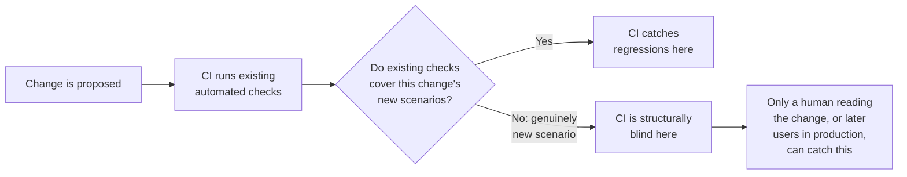
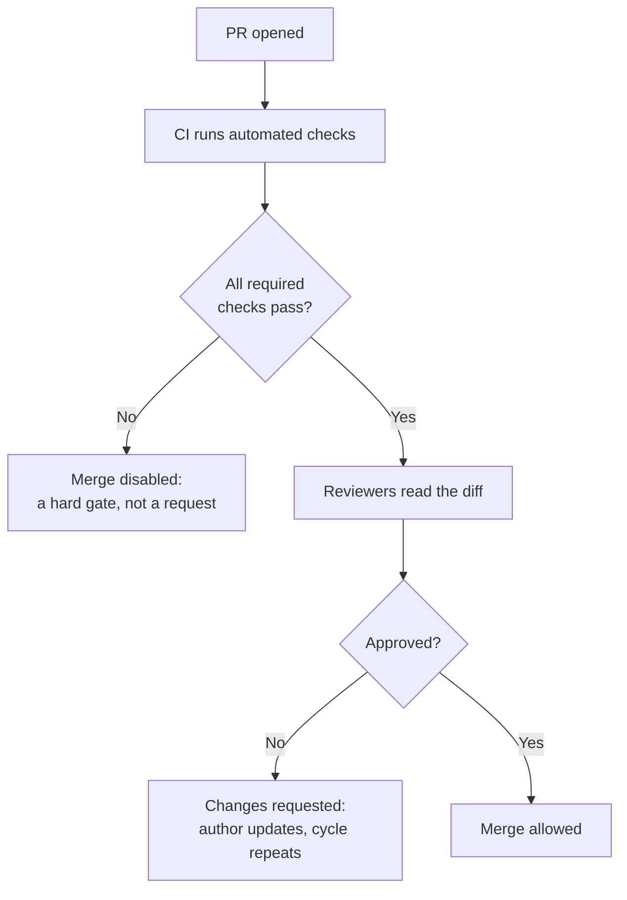

import LevelIntro from "../../../components/LevelIntro.astro";
import Checkpoint from "../../../components/Checkpoint.astro";
import PracticeCheck from "../../../components/PracticeCheck.astro";

export const unit = {
  track: "git-teamwork",
  unitSlug: "prs",
};

L1 named CI gating and human review as two different kinds of scrutiny a PR
passes through before it reaches `main`. L2 works out exactly what each one
structurally can and cannot catch, and why blocking checks exist instead of
just asking people to run tests.

<LevelIntro
  items={[
    "Why passing tests isn't the same as correct",
    "What a reviewer should spend attention on",
    "Why blocking checks beat a polite request",
  ]}
/>

## Why "the tests passed" isn't the same as "this is correct"

**If CI ran every test and every test passed, what is left for a human
reviewer to check?** Precisely the things no test happens to check yet. A
passing suite proves the code does what the _existing_ tests expect, and
says nothing about a scenario nobody encoded:

**Does this make CI less valuable than review?** No, because they cover
almost entirely different territory. CI is exhaustive over what it knows to
check and runs every time. Review is the only mechanism that can catch
something nobody thought to check yet, but it depends on a person actually
engaging, which does not scale the same way.

<Checkpoint question="A PR adds a new function and every existing test in the suite passes. Does that tell you the new function is correct, or only that it didn't break anything already being checked?">

Only the second. A green CI run confirms the change did not regress behavior
the existing tests exercise. It says nothing about inputs nobody wrote a
test for. "Nothing broke" and "this is correct" are different claims, and CI
can only make the first one, which is why review exists as a separate step
instead of a second pass at the same thing.

</Checkpoint>

<PracticeCheck
  track={unit.track}
  unitSlug={unit.unitSlug}
  topicId="tests-vs-correct"
/>

## What should a reviewer spend attention on?

**If CI already handles regressions, where is a reviewer's limited attention
best spent?** On the questions no automated check can ask:

| Reviewer question                                     | Why it catches what CI may miss                                  |
| ----------------------------------------------------- | ---------------------------------------------------------------- |
| What new scenario does this change enable?            | New behavior may not have any tests yet                          |
| What happens at zero, empty, huge, or invalid inputs? | Edge cases often reveal assumptions hidden in normal examples    |
| Is there a simpler way to express this?               | Correct code can still be hard for the next person to understand |
| Are tests added for the new behavior?                 | Review can turn a human insight into future automated protection |
| Could this break callers outside the diff?            | The changed lines may not show every dependency in the codebase  |

A reviewer who re-verifies what CI already checked (does it build, do the
old tests pass) spends attention on territory that is already covered.

Good review culture is also specific and collaborative: "What should happen
if both discounts apply?" helps the author reason, while "bad approach"
gives them nowhere to go. A useful review leaves the code safer and leaves
the author clearer about the system.

<PracticeCheck
  track={unit.track}
  unitSlug={unit.unitSlug}
  topicId="review-focus"
/>

## Why does the merge button get disabled instead of asking nicely?

**If a team asks engineers to run tests before merging, why do teams still
configure CI to physically block a merge on failure?** Because a request
that depends on someone remembering, under deadline pressure, will
eventually be skipped. Not from bad faith, but because "I'm confident this
is fine" is always available in the moment. A **blocking check** removes
the decision: the merge button is disabled, not discouraged.

Real tools often run CI and review in parallel, or rerun CI after the
author pushes review fixes. The invariant is not the exact order. It is
that before merge, the required checks have passed and the required
reviewers have approved the **final** version of the change.

<Checkpoint question="A team sets a linter to only post a warning comment on each PR instead of blocking the merge. What is likely to happen to that warning under deadline pressure?">

It will eventually be ignored, the same way an unenforced "please run the
tests" gets skipped. A non-blocking check still depends on someone choosing
to act on it, and under pressure "I'll clean this up later" is always
available. Nothing stops the merge if they don't. A check that can be
ignored will be, which is why visibility-only checks behave very differently
in practice from checks that gate the merge button.

</Checkpoint>

<PracticeCheck
  track={unit.track}
  unitSlug={unit.unitSlug}
  topicId="blocking-checks"
/>

## Failure modes at this level

- **Treating a green checkmark as "this PR is correct."** CI only confirms
  nothing already-tested broke.
- **Review as a formality (rubber-stamp approval).** It adds latency
  without adding the scrutiny it exists to provide.
- **Non-blocking checks "for visibility" expected to act like blocking
  ones.** Without enforcement they get skipped.
