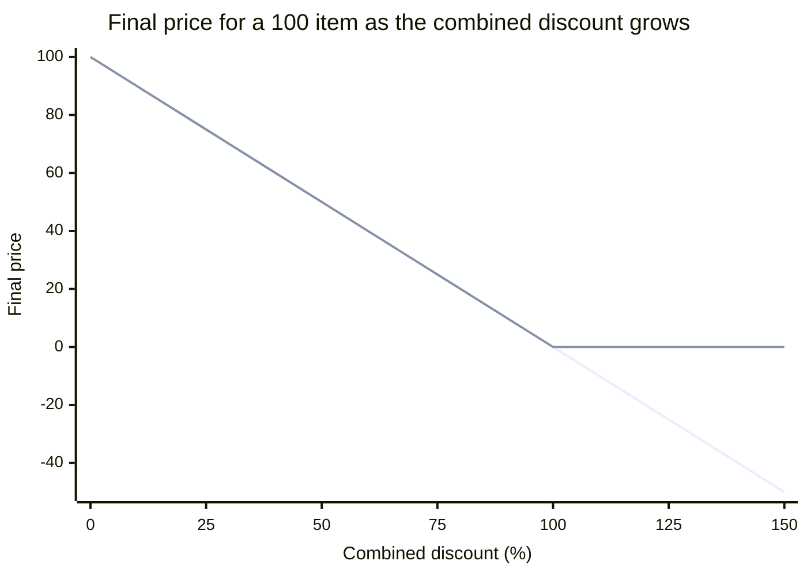
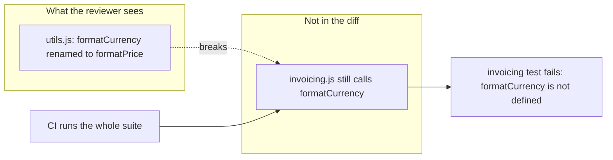

import Scenario from "../../../components/Scenario.astro";
import LevelIntro from "../../../components/LevelIntro.astro";
import Checkpoint from "../../../components/Checkpoint.astro";
import PracticeCheck from "../../../components/PracticeCheck.astro";

export const unit = {
  track: "git-teamwork",
  unitSlug: "prs",
};

<Scenario label="Two PRs, two different safety nets, two different misses">
  <Fragment slot="facts">
    <div class="not-prose flex flex-col gap-2 text-sm text-slate-700 dark:text-slate-300">
      <div class="flex items-center gap-1.5"><span>💸</span> <strong>PR 1</strong> — new discount path; CI green, reviewer catches it</div>
      <div class="flex items-center gap-1.5"><span>🏷️</span> <strong>PR 2</strong> — tidy rename; reviewer approves, CI catches it</div>
      <div class="flex items-center gap-1.5"><span>❓</span> <strong>Question</strong> — what does each safety net structurally see?</div>
    </div>
  </Fragment>

The same team, the same week, two PRs. The first adds a discount path that
CI is happy with and a reviewer stops. The second is a rename so small and
clean that a reviewer approves it in seconds, and only CI stops it.
**If both safety nets are competent in both cases, what is it about the
_shape_ of each bug that decides which net catches it?**

</Scenario>

<LevelIntro
  items={[
    "The discount bug only review catches",
    "The rename bug only CI's full suite catches",
    "What neither net catches before merge",
  ]}
/>

## The discount function, and the tests that all pass

**Before anything changes: what does the existing suite actually verify?**
A discount subtracts a percentage from a price. Added together, two
discounts of 60% and 50% make 110%, which would charge the customer a
negative amount:



The first line is the unclamped function; the second clamps the discount
into the 0 to 100 range. They agree everywhere the existing tests look
(10% and 0%) and diverge only past 100%. The interactive demo for this unit
lets you drag across that boundary.

## Why does CI have nothing to say about the new PR?

**What does the PR add, and why does an all-green suite not contradict the
bug?**

```js
function computeCombinedDiscount(memberPercent, couponPercent) {
  return memberPercent + couponPercent;
}
```

Before this PR, nothing in the codebase combined two discounts, so a
combined value over 100 was unreachable. The suite re-runs `applyDiscount`
at 10% and 0%, both still correct. **CI is not malfunctioning.** It checks
exactly what it was told to check, and this PR is what makes the new
scenario reachable for the first time.

<Checkpoint question="CI ran the full existing suite against the PR that adds computeCombinedDiscount and every test passed. Was CI wrong to report green?">

No. CI re-ran every check that existed and confirmed none regressed, which
is true. It cannot invent a check for a scenario nobody encoded, and the
110% case did not exist as a reachable path before this PR. Green here means
"nothing already tested broke," not "this PR is safe." The gap between those
two claims is exactly the territory a human reviewer has to cover.

</Checkpoint>

## What did the reviewer do that CI couldn't?

The reviewer did not re-run anything. They read the new function and asked
what its output range implies when it feeds the existing one:

> "`computeCombinedDiscount` doesn't cap anywhere. What happens if
> `applyDiscount` gets something over 100 from this?"

That one question turned an untested scenario into a bounded one. The fix
is a clamp on the discount before it is applied, and it is exactly the kind
of behavior a test can protect from now on:

```js
const clamped = Math.min(100, Math.max(0, discountPercent));
```

The lasting win is not only the fix. The reviewer's insight becomes new
automated protection once someone adds a test for a combined discount over 100.

<PracticeCheck
  track={unit.track}
  unitSlug={unit.unitSlug}
  topicId="review-catches-ci-misses"
/>

## The reverse: what CI catches that a diff-only review misses

**Is review simply better than CI, then?** No. A later PR renames a shared
helper from `formatCurrency` to `formatPrice` in `utils.js` and updates the
one call site in the same file. The diff is small, clean, and
self-consistent. What it does not show is `invoicing.js`, which still calls
the old name:



A reviewer can only reason about what the diff shows. CI does not read the
diff at all. It re-runs the entire codebase's tests, so `invoicing.js`
fails on contact. A very strong reviewer might search for call sites by
habit, but that depends on human attention, while CI makes the broader
check systematic for every PR.

<Checkpoint question="Why did review catch the discount bug and miss the rename, while CI did the opposite?">

The discount bug was invisible to CI because no test encoded the 110% case.
CI can only re-check what is already written, and this was a new path a
human had to reason about by reading the function. The rename bug was
invisible to review because the changed lines were clean and self-consistent
and hinted at nothing in an untouched file. CI caught it because it ignores
the diff and exercises everything, so the untouched caller failed anyway.

</Checkpoint>

<PracticeCheck
  track={unit.track}
  unitSlug={unit.unitSlug}
  topicId="ci-catches-review-misses"
/>

## This example is a case, not the whole territory

Two bugs, two safety nets: that is a case, not a law covering every defect.
The division generalizes (automated checks are exhaustive but blind to
anything unwritten; review can spot new scenarios but only as carefully as
someone looks). The specific bugs do not.

**Try extending it yourself.** What category of bug would neither CI nor a
normal diff-focused review catch, because it only shows up once the change
is running under real traffic or real data? What would a team need beyond
PRs and CI to catch it?

| Escapes pre-merge checks because...                      | What a team adds after merge                 |
| -------------------------------------------------------- | -------------------------------------------- |
| Timing races that only appear under real concurrency     | Observability, alerts                        |
| Slow queries that only appear with production-sized data | Monitoring, load testing                     |
| Flaky or changed third-party behavior                    | Alerts, graceful degradation                 |
| A correct change that is wrong to release to everyone    | Feature flags, progressive rollout, rollback |

PRs and CI reduce risk before merge; these categories need a second layer
that watches the change once it is running.

<PracticeCheck
  track={unit.track}
  unitSlug={unit.unitSlug}
  topicId="beyond-pre-merge"
/>

## Failure modes

| Failure mode                                                                    | What it gets wrong                                                                                        |
| ------------------------------------------------------------------------------- | --------------------------------------------------------------------------------------------------------- |
| Assuming a green CI run means the reviewer can skim and approve                 | Coverage differs: a passing suite says nothing about the untested scenario the PR just made reachable     |
| A reviewer re-checking what CI already verified instead of asking new questions | Spends scarce attention on covered territory                                                              |
| Assuming a small, clean-looking diff cannot have broken something elsewhere     | Renames, removed fields, and changed return types can break callers the diff never shows                  |
| Treating these two examples as the only categories of catchable bug             | Some defects need production signals; the extension question above is a real gap in a two-mechanism model |
