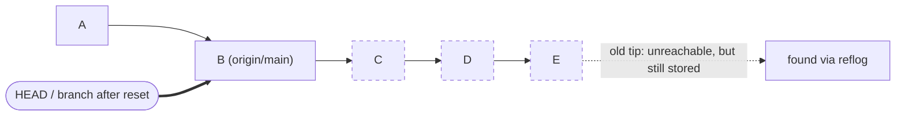
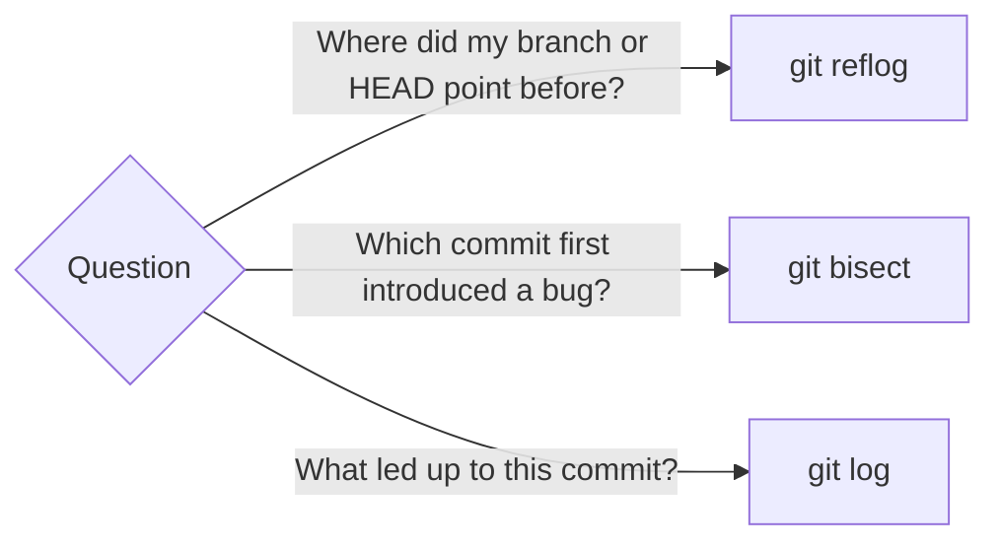

import Scenario from "../../../components/Scenario.astro";
import LevelIntro from "../../../components/LevelIntro.astro";
import PracticeCheck from "../../../components/PracticeCheck.astro";

export const unit = {
  track: "git-teamwork",
  unitSlug: "reflog",
};

<Scenario label="Reset --hard, then panic">
  <Fragment slot="facts">
    

      
💻 <strong>The command</strong>: <code>git reset --hard origin/main</code>, meant to clean up a messy branch

      
📉 <strong>What it did</strong>: moved the branch pointer back, hiding 3 commits (2 days of unpushed work)

      
😰 <strong>The assumption</strong>: "hard" sounds permanent, so the work must be gone

    

    
What git log shows now

    

      

Before
A, B, C, D, E (HEAD)

      

After
A, B (HEAD). C, D, E have vanished from view.

    

  </Fragment>

A teammate wanted to discard a few messy local commits, so they ran
`git reset --hard origin/main`. Three commits and two days of unpushed work
vanished from `git log` instantly. They assume the work is gone for good and
start rewriting it from memory. **Is `reset --hard` as permanent as it
sounds, or did git keep something around that `git log` simply stopped
showing?**

</Scenario>

The commits are still there. `git log` only shows what you can reach by
walking backward from where a branch points _right now_. After the reset, the
branch points somewhere older, so the three commits are no longer on the walk,
but git did not erase them. A second record, the **reflog**, remembers every
place a ref has pointed.

<LevelIntro
  items={[
    "Reachable vs. merely stored commits",
    "What the reflog records, and its limits",
    "Bisect: a different tool for a different question",
  ]}
/>

## What is the difference between what git log shows and what git still stores?

Think of a library catalogue. `git log` is the catalogue: it lists only what is
filed under the shelf you are standing at. The reflog is the librarian's
checkout diary, a record of every shelf you have ever stood at.

- **Ref**: a named pointer to a commit (a branch, a tag, `HEAD`).
- **Reachable**: you can get to a commit by following parent links from some ref.
- **Dangling (unreachable) commit**: stored in the object store, but no ref leads to it.
- **Reflog**: a local, per-ref diary of where that ref pointed, newest first.

`git reset --hard` moves the branch pointer and rewrites your files to match.
It does not delete commit objects. That is why a mistaken reset is usually
recoverable, as long as the work was ever committed.

<PracticeCheck
  track={unit.track}
  unitSlug={unit.unitSlug}
  topicId="log-vs-reflog"
/>

## Which "lost history" commands are really recoverable?

| What you ran                         | Commit objects deleted?     | Recoverable?                                                  |
| ------------------------------------ | --------------------------- | ------------------------------------------------------------- |
| `git reset --hard <ref>`             | No, only the pointer moved  | Yes, via the `HEAD` reflog                                    |
| `git branch -D <branch>`             | No, only the label          | Yes if `HEAD` ever sat on it; the branch's own reflog is gone |
| `git rebase` that went wrong         | No, the old commits remain  | Yes, via `ORIG_HEAD` or the reflog                            |
| `git push --force` over a remote     | Not locally                 | Yes on your machine; the remote's copy is rewritten           |
| Uncommitted edits wiped by `--hard`  | They were never stored      | No: the reflog tracks commits, not file edits                 |
| `git gc` after the retention expired | Yes, this is the real prune | No, this is the point of no return                            |

<PracticeCheck
  track={unit.track}
  unitSlug={unit.unitSlug}
  topicId="reset-keeps-objects"
/>

## How long does the safety net last?

Not forever. Reflog entries expire (about 90 days by default, 30 for entries
whose commit is otherwise unreachable), and only after that can `git gc`
remove the objects. The reflog is also **local**: it lives in your own `.git`
folder, is never pushed, and does not exist in a fresh clone.

<PracticeCheck
  track={unit.track}
  unitSlug={unit.unitSlug}
  topicId="expiry-and-gc"
/>

## A different question: which commit broke it?

Reflog answers "where was my ref before?" It cannot answer "which of the last
500 commits introduced this bug?" That is `git bisect`, which binary-searches
the history: test the middle commit, discard the half that cannot contain the
culprit, repeat. Five hundred commits take about nine tests.

<PracticeCheck
  track={unit.track}
  unitSlug={unit.unitSlug}
  topicId="bisect-binary-search"
/>

## What the next levels cover

L2 reads a reflog entry piece by piece, explains the two expiry clocks, and
walks bisect's halving step by step. L3 is a full recovery and a full bisect
session, with the failure modes that catch people out.
