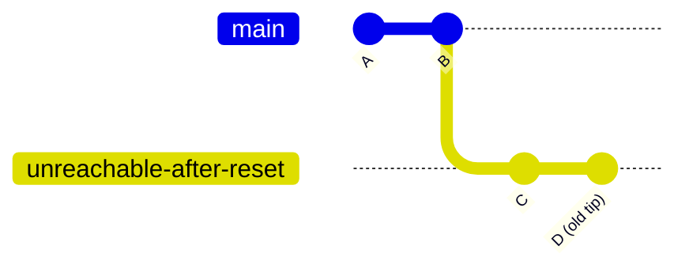
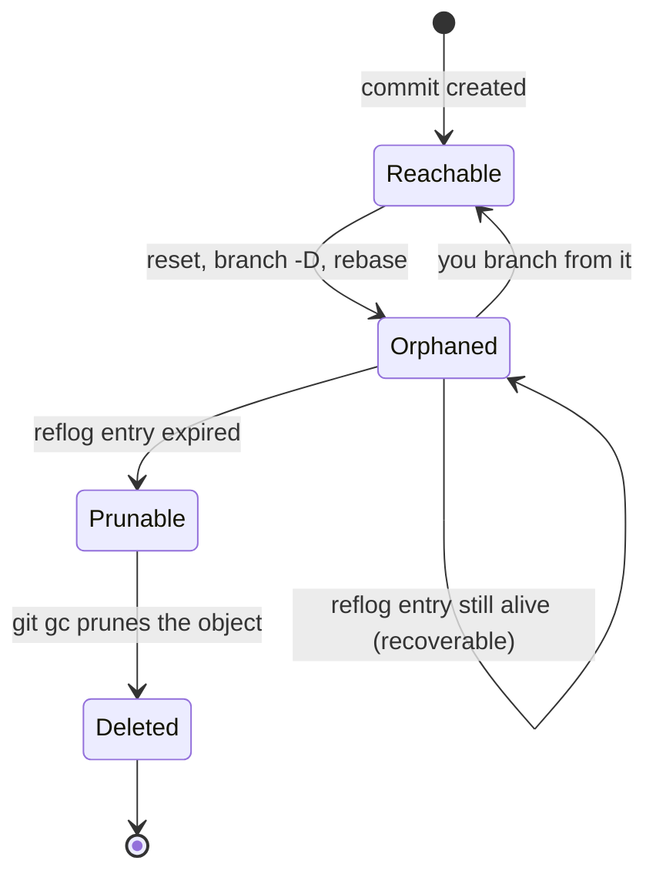
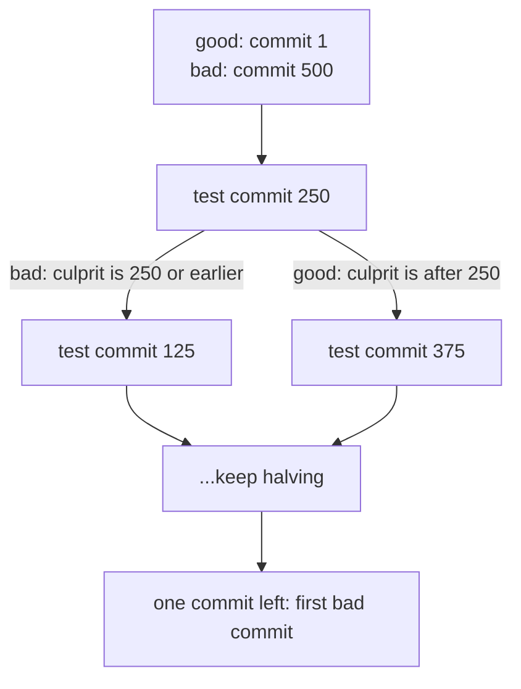

import LevelIntro from "../../../components/LevelIntro.astro";
import Checkpoint from "../../../components/Checkpoint.astro";
import PracticeCheck from "../../../components/PracticeCheck.astro";

export const unit = {
  track: "git-teamwork",
  unitSlug: "reflog",
};

L1 established that `reset --hard` leaves commit objects in place and that the
reflog remembers where a ref used to point. L2 reads a reflog entry piece by
piece, shows how the same history looks to `git log` and to the reflog, and
works out why the safety net has an expiry date. It then turns to bisect, which
gets confused with reflog constantly because both are "find the old thing"
tools.

<LevelIntro
  items={[
    "Reading a reflog entry and its notation",
    "Expiry clocks, gc, and the limits of reflog",
    "Bisect's halving, step by step",
  ]}
/>

## If git log already shows history, what does the reflog add?

`git log` shows the graph reachable from where a ref points now. The reflog
shows a timeline of positions, in the order the ref moved there, whether or
not they are still reachable. Same repository, two different views:



Here `main` was reset from `D` back to `B`. The second branch in the picture is
only a drawing aid: in a real repository, nothing names `C` and `D`, and only
the reflog still records that `HEAD` stood on `D`.

| After the reset              | `git log` shows | The `HEAD` reflog shows            |
| ---------------------------- | --------------- | ---------------------------------- |
| Commits `A`, `B`             | Yes             | Yes                                |
| Commits `C`, `D`             | No              | Yes, as earlier positions of HEAD  |
| The reset itself as an event | No              | Yes, as the newest entry           |
| Why each move happened       | No              | Yes (`commit`, `reset`, `pull`...) |

<PracticeCheck
  track={unit.track}
  unitSlug={unit.unitSlug}
  topicId="log-vs-reflog"
/>

## How do you read one reflog line?

Each line is a position, a numbered label for that position, and a reason.

```text
b3f2a91 HEAD@{0}: reset: moving to b3f2a91
e7c9d14 HEAD@{1}: commit: add integration tests
a48f0c2 HEAD@{2}: commit: fix off-by-one in refill
```

| Part                           | Meaning                                                      |
| ------------------------------ | ------------------------------------------------------------ |
| `e7c9d14`                      | The (abbreviated) commit id HEAD pointed to at that moment   |
| `HEAD@{1}`                     | "Where HEAD was one move ago"; `HEAD@{0}` is where it is now |
| `commit:` / `reset:` / `pull:` | The kind of operation that moved HEAD there                  |
| text after the colon           | Detail: the commit message, or the target of the reset       |

Two notations look alike and mean different things, and mixing them up is the
classic recovery mistake.

| Notation            | Follows              | Means                                            |
| ------------------- | -------------------- | ------------------------------------------------ |
| `HEAD~1`            | Parent links (graph) | The first parent of the current commit           |
| `HEAD@{1}`          | Reflog (timeline)    | Wherever HEAD pointed one move ago               |
| `main@{2}`          | The `main` reflog    | Where the branch `main` pointed two moves ago    |
| `HEAD@{2.days.ago}` | Reflog timestamps    | Where HEAD pointed two days ago, on this machine |

After the reset above, `HEAD~1` is the parent of `B` (that is, `A`), while
`HEAD@{1}` is `D`, the commit you want back. Also remember that `HEAD@{1}` is
relative: every new move shifts all the numbers by one.

<Checkpoint question="After a reset, you run git commit again. Does the reflog entry you called HEAD at-one (the lost tip) keep that same number?">

No. The index is positional, counting back from the newest move. Making one more commit adds a new entry at position zero, so the lost tip slides from position one to position two. That is why you should read the output of `git reflog` right before you use an index, and why writing down the commit id is safer than remembering the number.

</Checkpoint>

<PracticeCheck
  track={unit.track}
  unitSlug={unit.unitSlug}
  topicId="reading-entries"
/>

## Why does "still recoverable" have an expiry date?

If objects survive a reset, can you wait forever? Two clocks run against them.



| Setting                      | Default | What it governs                                                 |
| ---------------------------- | ------- | --------------------------------------------------------------- |
| `gc.reflogExpire`            | 90 days | Reflog entries whose commit is still reachable from the ref     |
| `gc.reflogExpireUnreachable` | 30 days | Reflog entries whose commit is no longer reachable from the ref |
| `gc.pruneExpire`             | 2 weeks | Grace period before `gc` deletes unreachable loose objects      |

The 30-day clock is the one that matters after a reset, because the lost
commits are, by definition, no longer reachable from the branch. A reset from
two days ago is nowhere near it. The real urgency is different: do not pile
more history-rewriting commands on top of the mistake.

<PracticeCheck
  track={unit.track}
  unitSlug={unit.unitSlug}
  topicId="expiry-and-gc"
/>

## What is the reflog not able to save?

| Situation                                       | Why the reflog cannot help                                  |
| ----------------------------------------------- | ----------------------------------------------------------- |
| Edits never staged or committed, then `--hard`  | No commit or blob was ever created for them                 |
| A teammate's lost commits on their machine      | The reflog is local; yours has no record of their moves     |
| A fresh clone                                   | Reflogs are not cloned; the new repo's log starts empty     |
| `git branch -D feature` (the branch's own log)  | The branch's reflog is deleted with it; `HEAD`'s may remain |
| Commits older than the expiry window, then `gc` | The objects are gone                                        |

A staged-but-never-committed file is an interesting middle case: `git add`
writes the file contents into the object store, so they may be dug out with
`git fsck --lost-found`, but no reflog entry points to them.

<Checkpoint question="Your coworker force-pushed over main and asks you to recover their lost commits from your reflog. When will that work?">

Only if those commits passed through your own repository, for example because you fetched or pulled them before the overwrite. Then your remote-tracking ref (`origin/main`) has a local reflog that still records the old tip. The reflog never travels between machines, so if you never fetched them, your copy has nothing to offer.

</Checkpoint>

<PracticeCheck
  track={unit.track}
  unitSlug={unit.unitSlug}
  topicId="reflog-limits"
/>

## Bisect: a different problem, a different mechanism

Reflog answers "where has this ref been." A bug report now says "something in
the last 500 commits broke the rate limiter." Reflog cannot help: those commits
were merged normally, no ref movement went wrong. That is a search problem, and
`git bisect` solves it by binary search. You supply one known-good and one
known-bad commit, and git checks out the midpoint for you to test.



Each test halves the remaining range, so n commits need about log base 2 of n
tests: 500 commits take roughly nine tests, not 500. The interactive demo for
this unit lets you push the range up to 2000 commits to see how slowly the
test count grows.

<Checkpoint question="Bisect tests commit 250 of 500 and finds it bad. Is commit 250 therefore the culprit?">

Not necessarily. A bad midpoint means the first bad commit is at 250 or earlier, so bisect keeps the lower half, including 250, and tests the middle of it next. The answer is only declared when the range has shrunk to a single commit whose parent was good.

</Checkpoint>

<PracticeCheck
  track={unit.track}
  unitSlug={unit.unitSlug}
  topicId="bisect-binary-search"
/>

## Which tool for which failure?

|                   | `git reflog`                             | `git bisect`                                          |
| ----------------- | ---------------------------------------- | ----------------------------------------------------- |
| Question          | "Where did this ref point before?"       | "Which commit first introduced this bug?"             |
| Needs from you    | Nothing; git records moves automatically | A test per candidate: good or bad                     |
| Scope             | Local, per-ref                           | Any linear-ish range of commits                       |
| Typical trigger   | Recovering after reset, rebase, checkout | A regression report                                   |
| Changes anything? | No, it is read-only                      | Moves HEAD to candidates until you run `bisect reset` |

Neither is an undo button. The reflog tells you where to point a ref; you
still run the `branch` or `reset`. Bisect names the culprit; fixing it is a
separate step. The shared idea: git rarely deletes anything immediately, and
rarely tells you what you need unless you ask the right question.
