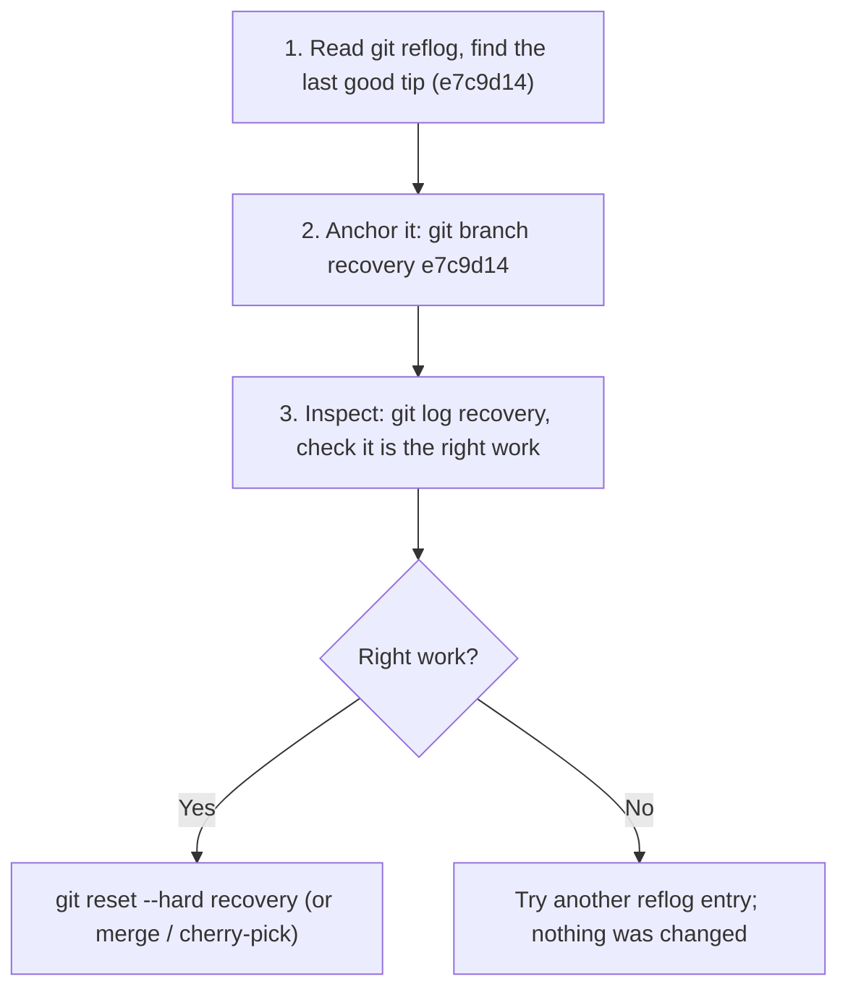
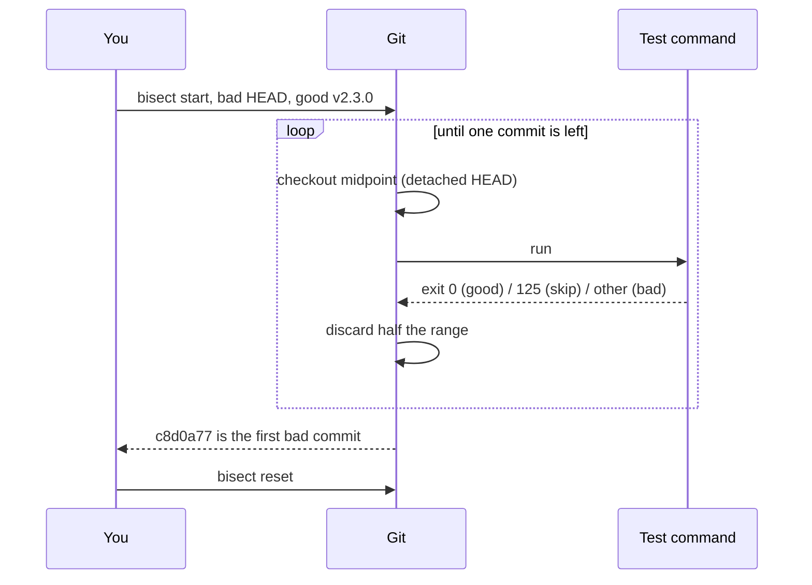

import Scenario from "../../../components/Scenario.astro";
import LevelIntro from "../../../components/LevelIntro.astro";
import Checkpoint from "../../../components/Checkpoint.astro";
import PracticeCheck from "../../../components/PracticeCheck.astro";

export const unit = {
  track: "git-teamwork",
  unitSlug: "reflog",
};

<Scenario label="Two investigations, back to back">
  <Fragment slot="facts">
    <div class="not-prose flex flex-col gap-2 text-sm text-slate-700 dark:text-slate-300">
      <div class="flex items-center gap-1.5"><span>1️⃣</span> <strong>Recovery</strong>: the <code>reset --hard</code> from L1; 3 commits hidden, 2 days of work</div>
      <div class="flex items-center gap-1.5"><span>2️⃣</span> <strong>Regression hunt</strong>: a rate-limiter bug reported today, about 500 commits since the last release tag</div>
      <div class="flex items-center gap-1.5"><span>🧩</span> <strong>Shared habit</strong>: read the evidence git already holds before acting</div>
    </div>
    <p class="not-prose mt-3 mb-1 text-xs font-semibold tracking-wide text-slate-400 uppercase">Effort</p>
    <div class="not-prose text-xs text-slate-600 dark:text-slate-300">
      <div class="mb-1 flex justify-between"><span>Linear scan of 500 commits</span><span>500 tests</span></div>
      <div class="h-2 w-full overflow-hidden rounded-full bg-slate-200 dark:bg-slate-700"><div class="h-full rounded-full bg-rose-500 animate-fill-bar" style="--target-width: 100%"></div></div>
      <div class="mt-2 mb-1 flex justify-between"><span>Bisect</span><span>about 9 tests</span></div>
      <div class="h-2 w-full overflow-hidden rounded-full bg-slate-200 dark:bg-slate-700"><div class="h-full rounded-full bg-emerald-500 animate-fill-bar" style="--target-width: 2%"></div></div>
    </div>
  </Fragment>

Your teammate is still staring at an empty `git log`. **To get their commits
back, do you have to know the lost commit's hash in advance, or can git hand
it to you?** And separately, a bug report arrives: which of 500 commits caused
it, and how do you avoid testing all of them?

</Scenario>

<LevelIntro
  items={[
    "A real recovery, command by command",
    "A real bisect session, and automating it",
    "Where both approaches break",
  ]}
/>

## Recovering from the reset, for real

The reflog hands you the hash. This is the teammate's terminal right after the
accident, where each line is one place HEAD has been:

```bash
$ git log --oneline -1
b3f2a91 Release notes for v2.4

$ git reflog
b3f2a91 (HEAD -> feature/rate-limiter) HEAD@{0}: reset: moving to origin/main
e7c9d14 HEAD@{1}: commit: add rate limiter integration tests
a48f0c2 HEAD@{2}: commit: fix off-by-one in token bucket refill
5d1b6e9 HEAD@{3}: commit: add rate limiter skeleton
b3f2a91 HEAD@{4}: pull: Fast-forward
```

`HEAD@{0}` is the reset itself, the event that caused the damage. `HEAD@{1}` is
the tip of the three lost commits. The recovery has three moves, and the order
matters.



```bash
$ git branch recovery e7c9d14
$ git log --oneline recovery -3
e7c9d14 add rate limiter integration tests
a48f0c2 fix off-by-one in token bucket refill
5d1b6e9 add rate limiter skeleton
$ git reset --hard recovery
HEAD is now at e7c9d14 add rate limiter integration tests
```

Step 2 is the one people skip. A branch name is a permanent anchor; `HEAD@{1}`
is a moving index that shifts with every command. Anchoring first means a typo
or a wrong index in the next command cannot lose the work a second time.

<Checkpoint question="Why create a recovery branch first instead of running reset --hard straight to the old tip?">

Both end up in the same place, but the branch gives the old tip a stable, named ref before anything destructive happens. If the next command targets the wrong entry, or you run something that adds reflog entries and shifts the numbers, the work is already pinned by a name. The extra command costs nothing and removes the risk of damaging your only lead to the lost commits.

</Checkpoint>

<PracticeCheck
  track={unit.track}
  unitSlug={unit.unitSlug}
  topicId="recovery-procedure"
/>

## Finding the culprit with bisect, for real

A different day: the rate limiter now rejects valid requests, and nobody knows
which of the ~500 commits since tag `v2.3.0` caused it.

```bash
$ git bisect start
$ git bisect bad                       # current commit is broken
$ git bisect good v2.3.0               # last known-good release
Bisecting: 249 revisions left to test after this (roughly 8 steps)
[7a1c3d0] refactor: extract token bucket into its own module

$ npm test -- rateLimiter.spec.js      # tests pass here
$ git bisect good
Bisecting: 124 revisions left to test after this (roughly 7 steps)
[9e4f21b] perf: switch token bucket storage to a Map

$ npm test -- rateLimiter.spec.js      # tests fail here
$ git bisect bad
...
c8d0a77 is the first bad commit
$ git bisect reset
```

About nine answers for 500 commits. The same session can run unattended:

```bash
$ git bisect start HEAD v2.3.0
$ git bisect run npm test -- rateLimiter.spec.js
```

`bisect run` reads the exit status of your command. Zero means good, 125 means
"cannot test this commit, skip it", and 1 to 127 (except 125) means bad. While
it runs, HEAD is detached and moves between candidates, which is also why the
session leaves a trail of `checkout` entries in your reflog. `git bisect reset`
returns you to where you started.



<PracticeCheck
  track={unit.track}
  unitSlug={unit.unitSlug}
  topicId="bisect-binary-search"
/>

## When does the halving logic stop being trustworthy?

Bisect's correctness rests on one assumption: there is exactly one flip from
good to bad, and everything after the flip stays bad.

| Situation                                  | What happens to the search                          | What to do                                                |
| ------------------------------------------ | --------------------------------------------------- | --------------------------------------------------------- |
| Bug fixed, then reintroduced later         | Two flip points; bisect may land on either          | Bisect each range separately                              |
| Flaky test reports bad on a good commit    | One false answer sends the search to the wrong half | Repeat the test per candidate; stabilize before bisecting |
| A commit that does not build or run at all | Cannot be judged good or bad                        | `git bisect skip` (or exit 125 in a script)               |
| Test checks the wrong symptom              | Converges confidently on an unrelated commit        | Verify the first bad commit by reverting it               |

<Checkpoint question="A history has a regression that was fixed and then reintroduced by a later unrelated commit. Does bisect fail with an error?">

No, and that is the danger. It returns a confident answer, but which flip point it finds depends on where the midpoints happened to fall. Nothing in the output warns you. The remedy is to mark a commit between the two flips as good, then bisect each transition on its own.

</Checkpoint>

<PracticeCheck
  track={unit.track}
  unitSlug={unit.unitSlug}
  topicId="bisect-limits"
/>

## Where the reflog stops helping

| Failure mode                                                 | What it gets wrong                                                         |
| ------------------------------------------------------------ | -------------------------------------------------------------------------- |
| Assuming `reset --hard` deleted the commits                  | Only the pointer moved; objects survive until expiry and `gc`              |
| Resetting again instead of anchoring the old tip first       | The recovery rides on a shifting `HEAD@{n}` index                          |
| Expecting recovery of never-committed edits                  | No commit exists, so no reflog entry can point to it                       |
| Treating the reflog as shared                                | It is local-only; it is absent in a fresh clone and on teammates' machines |
| Running `git gc --prune=now` or `reflog expire --expire=now` | Deliberately removes the safety net immediately                            |

<PracticeCheck
  track={unit.track}
  unitSlug={unit.unitSlug}
  topicId="reflog-limits"
/>

## Beyond these cases

The two sessions above are worked cases, not the whole territory. Questions to
test whether the model transferred:

- The accident here was `reset --hard` on one branch. What changes if the
  damage was `git branch -D` on a branch you had never checked out? Which
  reflog could still help, if any?
- Bisect assumed a clean yes/no oracle. What would you change if the test is
  flaky or takes forty minutes per run? Does the nine-step estimate still
  matter?
- The 30-day unreachable window is a default. If your team sets
  `gc.reflogExpireUnreachable` to "now" on a CI machine, which of your
  recovery habits stop working there?

<PracticeCheck
  track={unit.track}
  unitSlug={unit.unitSlug}
  topicId="expiry-and-gc"
/>
