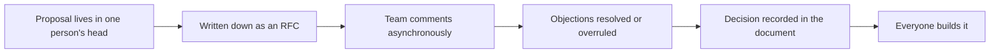

import Scenario from "../../../components/Scenario.astro";
import LevelIntro from "../../../components/LevelIntro.astro";
import PracticeCheck from "../../../components/PracticeCheck.astro";

export const unit = {
  track: "git-teamwork",
  unitSlug: "rfcs",
};

<Scenario label="Three days, one thread">
  <Fragment slot="facts">
    

      
💬 <strong>One Slack thread</strong> — three days, dozens of replies

      
🧑‍💻 <strong>Priya</strong> — move the job queue from Redis to SQS (built-in retries, dead-letter queue)

      
🧑‍💻 <strong>Marco</strong> — keep Redis, add retries (migration cost, no AWS experience on the team)

      
🚫 <strong>Missing</strong> — a decision, an owner, a deadline

    

  </Fragment>

Priya and Marco disagree about whether the team's background job queue
should move from Redis to SQS. It starts as a two-line Slack exchange
and grows into a thread that runs for three days. Priya keeps citing
SQS's built-in retries and dead-letter handling; Marco keeps citing the
migration cost and the team's lack of AWS experience. Neither argument
changes. Nobody outside the thread can tell what is being decided, and
other engineers have quietly stopped reading the channel. **Both of them
have a real point. So why does the conversation make things worse
instead of better?**

</Scenario>

Not because either engineer is wrong. Nothing about a chat thread pushes a
disagreement toward an ending. There is nowhere to hold the full context,
no way to close on one option, and no rule for what happens when reasonable
people still disagree after every argument has been heard.

<LevelIntro
  items={[
    "Live thread versus written proposal",
    "When a proposal is worth writing",
    "Disagree-and-commit",
  ]}
/>

## What does a live thread lack that a written proposal has?

A live argument is excellent at surfacing objections fast. It is poor at
ending. The picture is scattered across messages, each reply answers only the
last one, and the conversation can only stop by going quiet, which looks
the same as agreement and the same as exhaustion.

An **RFC** (Request for Comments, also called a design doc) is the
alternative: one written document holding the problem, the options
considered, the trade-offs, and a recommendation. People comment on it
asynchronously, and it ends with a decision written into the document
itself.

| Format                | Good at                                       | Bad at                                             |
| --------------------- | --------------------------------------------- | -------------------------------------------------- |
| Live thread / hallway | Fast back-and-forth, almost no cost to start  | Closing: no natural end, context scatters          |
| RFC / design doc      | Holding the whole picture, forcing a decision | Speed: writing one takes real time before any code |

<PracticeCheck
  track={unit.track}
  unitSlug={unit.unitSlug}
  topicId="live-vs-written"
/>

## Does every disagreement need a document?

Imagine Priya and Marco had instead argued for three days about whether a
lint rule should warn or fail. Writing an RFC for that would cost more than
the decision could ever be worth, and a wrong call is a one-line revert.

The question to ask is how expensive the choice is to undo.

| Choice                                         | Cost to reverse                     | Right format                         |
| ---------------------------------------------- | ----------------------------------- | ------------------------------------ |
| Variable naming, a lint rule's severity        | Minutes                             | Quick chat, then pick one            |
| Which library wraps date formatting            | Days, contained to a few files      | Short written note or PR description |
| Data store, public API shape, service boundary | Weeks, touches other teams and data | RFC                                  |

<PracticeCheck track={unit.track} unitSlug={unit.unitSlug} topicId="when-rfc" />

## What if everyone has been heard and still disagrees?

Writing the proposal down does not make people agree. If it only surfaced
objections it would be a better thread, not a better process. The missing
piece is a rule for the moment when hearing everyone out has stopped producing
new information. That rule is **disagree-and-commit**: a named decision-maker
listens to the objections, decides, and everyone, including whoever argued
against, builds the decision at full effort instead of re-arguing it in every
later conversation.

Disagreeing productively is not the same as staying quiet. A blocking
objection caught during review costs far less than the same mistake found in
production. The goal is objections that are **written down, specific, and
resolved by a decision**, not repeated in real time forever.

<PracticeCheck
  track={unit.track}
  unitSlug={unit.unitSlug}
  topicId="disagree-commit"
/>

## What the next levels cover

L2 lays out the stages an RFC passes through, what goes in the document,
what separates a blocking objection from noise, and who decides. L3 follows
one RFC from first draft to recorded decision, including the objection that
nearly shipped a bug.
