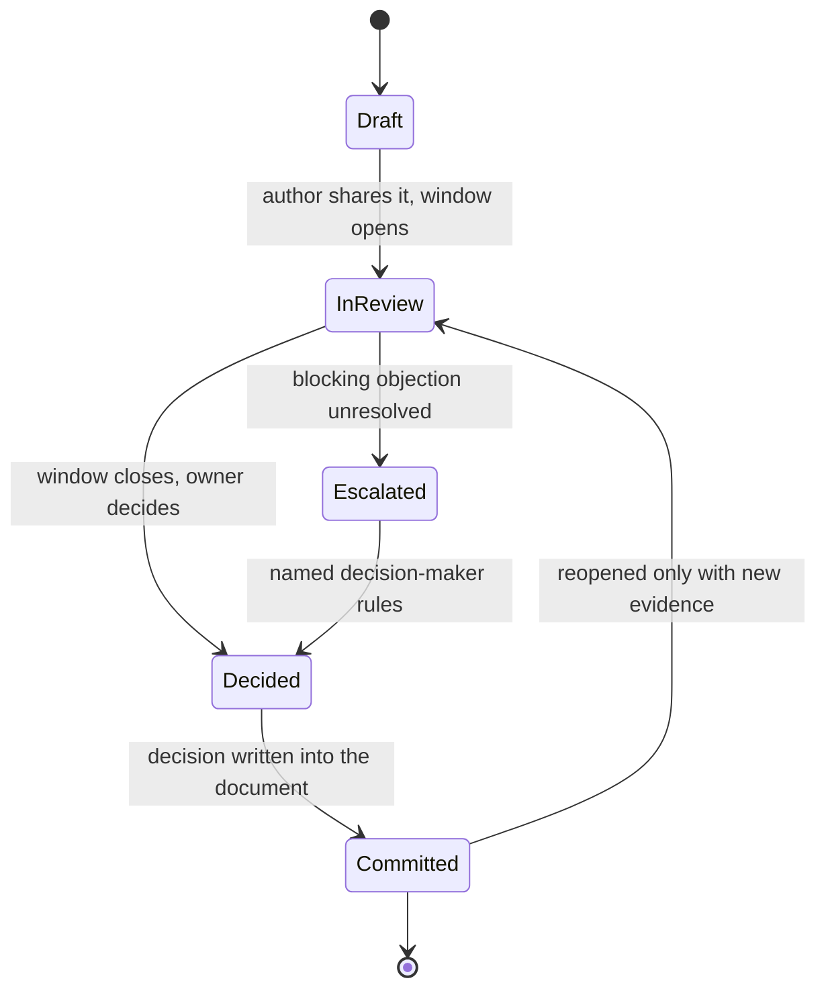
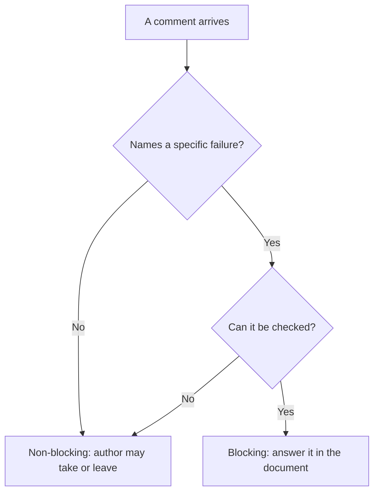

import LevelIntro from "../../../components/LevelIntro.astro";
import Checkpoint from "../../../components/Checkpoint.astro";
import PracticeCheck from "../../../components/PracticeCheck.astro";

export const unit = {
  track: "git-teamwork",
  unitSlug: "rfcs",
};

L1 showed that a chat thread has no way to end, and that an RFC plus
disagree-and-commit supplies one. L2 works out the mechanics: the stages a
proposal moves through, what the document must contain, how to tell a
blocking objection from noise, and who decides.

<LevelIntro
  items={[
    "Lifecycle stages and exit conditions",
    "Blocking objection versus nit",
    "Decision owner and what commit requires",
  ]}
/>

## What forces a proposal to close?

**If a thread fails because it never ends, what does an RFC process add
that makes it end?** A short list of named stages, each with an exit
condition. The document cannot sit in "discussion" forever because the
process itself says when discussion is over.

| Stage     | What happens                                              | Exit condition                                          |
| --------- | --------------------------------------------------------- | ------------------------------------------------------- |
| Draft     | The author writes the proposal alone or with a few people | The author believes it is ready for wider eyes          |
| In review | The team comments inline for a stated window              | The window closes, or every blocking thread is answered |
| Decided   | The named owner accepts, rejects, or amends               | The decision and reasoning are written in the document  |
| Committed | Everyone builds it, including those who objected          | Reopening requires new evidence                         |

A stated window length (many teams use a few working days) matters because
open-ended review never ends for the same reason a thread never ends: there is
no moment when silence can be read as "no objection" instead of "I have not
got to it yet."

<Checkpoint question="A proposal has been open for two weeks with no new comments, but the author never wrote a decision into the document. Has the process finished?">

No. Silence is not the exit condition; a recorded decision is. Without an explicit "accepted" or "rejected, and here is why" in the document, the next person who asks "did we actually agree to this?" has nothing to point at. The team is back in the chat-thread failure mode with extra steps, because the document went quiet instead of closing itself.

</Checkpoint>

<PracticeCheck
  track={unit.track}
  unitSlug={unit.unitSlug}
  topicId="lifecycle"
/>

## What goes in the document?

**Does an RFC have to be long?** No. It has to contain what a reviewer needs
in order to form an opinion, and nothing that is narrative padding.

| Section               | Question it answers                                                         |
| --------------------- | --------------------------------------------------------------------------- |
| Context / problem     | What is broken or missing now, and why it matters                           |
| Options considered    | At least two real alternatives, not one option dressed up as two            |
| Trade-offs            | Cost, risk, and what is given up, for every option including the chosen one |
| Recommendation        | Which option the author proposes, and why                                   |
| Non-goals             | What this proposal deliberately does not try to solve                       |
| Decision (added last) | The outcome, who decided, and the date                                      |

**Why list options the author already rejected?** A document with a single
option is not asking for review; it is asking for approval of something
decided elsewhere. Showing the alternatives and why they lost lets a reviewer
check the reasoning, and it is often where a real error is caught: a reviewer
who sees why option B was rejected can notice that the author got a fact
about B wrong.

<PracticeCheck
  track={unit.track}
  unitSlug={unit.unitSlug}
  topicId="doc-contents"
/>

## What makes a comment a blocking objection?

**If everyone may comment, how does an author avoid drowning in opinions
that change nothing?** By sorting comments into two kinds that are treated
differently.

| Type               | Looks like                                                      | Needed before commit                                  |
| ------------------ | --------------------------------------------------------------- | ----------------------------------------------------- |
| Blocking objection | A specific failure with evidence, ideally with an alternative   | Must be answered: resolved, or overruled with reasons |
| Non-blocking note  | A preference, a question with no concern attached, a naming nit | The author may take it or leave it                    |

"I don't love this" is not blocking: no failure is named, so there is nothing
to check or answer. "Our jobs run for 90 seconds but this queue redelivers
unacknowledged messages after 30, so every job would run twice" is blocking,
whoever says it, because anyone can verify it.

<Checkpoint question="One reviewer comments only 'I'm not convinced.' A newer teammate comments 'this doubles the monthly bill, here is the arithmetic from the pricing page.' Which is the blocking objection?">

The newer teammate's. What makes an objection blocking is a concrete claim that can be checked, not the rank of whoever raises it. "I'm not convinced" is a feeling the author cannot investigate or answer. The arithmetic names a consequence the author can verify, dispute with other numbers, or accept and revise around. Letting vague discomfort outweigh worked-out math is the very failure a written process exists to prevent, because it makes objections earn their weight through content.

</Checkpoint>

<PracticeCheck
  track={unit.track}
  unitSlug={unit.unitSlug}
  topicId="blocking-objections"
/>

## Who decides, and what does commit require?

**If reviewers disagree with each other, who breaks the tie?** A **named
decision owner**, stated in the document before review opens: usually the
author, or for proposals crossing team lines, a tech lead or small
architecture group. Without one, "decision" quietly becomes "whoever argues
longest."

**Does commit mean the loser must pretend to agree?** No, and treating it
that way is why the rule fails in practice. Commit means stating the
objection once, clearly, in the document; letting the owner decide with it
on the record; and then building the decision at full effort, without a
deliberately slow implementation and without re-raising the same point in
the next three decisions. The objection stays in the record. It simply stops
being an active blocker.

<PracticeCheck
  track={unit.track}
  unitSlug={unit.unitSlug}
  topicId="decision-owner"
/>

## What L3 covers

L3 follows one real-feeling RFC, including a blocking objection that turned
out to matter, and ends with the ways this process quietly breaks.
