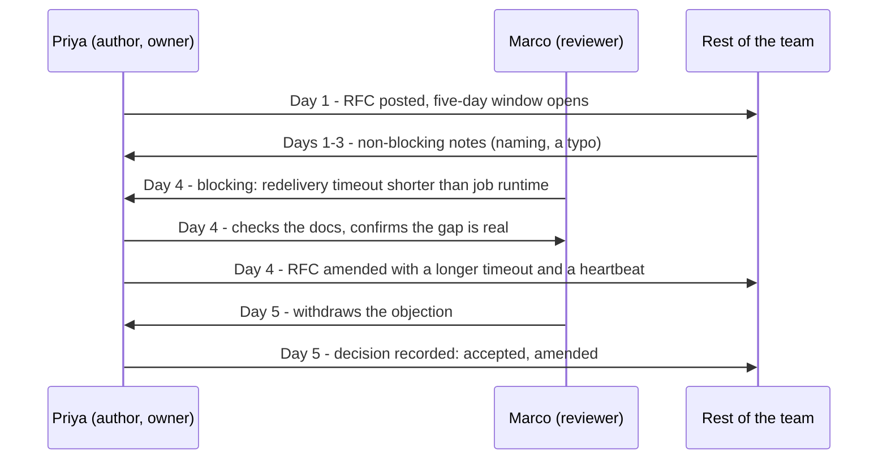

import Scenario from "../../../components/Scenario.astro";
import LevelIntro from "../../../components/LevelIntro.astro";
import Checkpoint from "../../../components/Checkpoint.astro";
import PracticeCheck from "../../../components/PracticeCheck.astro";

export const unit = {
  track: "git-teamwork",
  unitSlug: "rfcs",
};

<Scenario label="RFC-014, start to finish">
  <Fragment slot="facts">
    

      
📄 RFC-014: move the job queue from Redis to SQS

      
👤 Owner: Priya (author and decision owner)

      
🗓️ 5-day review window

      
🚧 Day 4: Marco raises one blocking objection

      
✅ Day 5: amended, objection withdrawn, accepted

    

  </Fragment>

L1's three-day thread produced nothing. Priya now takes the same proposal
through the process from L2: she writes it up, names herself owner, opens a
five-day window, and waits. **What exactly does the written format change
about how Marco's concern gets handled?**

</Scenario>

<LevelIntro
  items={[
    "The document, section by section",
    "The objection and its resolution",
    "Ways the process quietly breaks",
  ]}
/>

## What did Priya actually write?

Priya's RFC, condensed to its load-bearing parts:

| Section        | Content                                                                                                                                                                 |
| -------------- | ----------------------------------------------------------------------------------------------------------------------------------------------------------------------- |
| Context        | The Redis-backed queue has lost in-flight jobs twice after Redis restarts, because it has no built-in redelivery. Both times a person noticed and re-ran them by hand.  |
| Options        | A: move to SQS. B: keep Redis and build a durability layer on top (record jobs in the database, detect lost ones, requeue). C: do nothing and rely on manual detection. |
| Recommendation | Option A. Migration cost is real but bounded; B means building and maintaining the very class of bug being removed; C only postpones the next incident.                 |
| Non-goals      | Scheduled (cron-style) jobs are a separate queue with different needs, covered elsewhere.                                                                               |
| Owner          | Priya, named before review opened.                                                                                                                                      |

Her trade-off table treats all three options the same way:

| Option                  | Cost                                               | Risk                                                                 | What is given up                               |
| ----------------------- | -------------------------------------------------- | -------------------------------------------------------------------- | ---------------------------------------------- |
| A: SQS                  | A few engineer-weeks, plus ongoing AWS cost        | Nobody on the team has run a managed queue in production             | Easy local development (needs an emulator)     |
| B: Redis plus own layer | Somewhat more engineer-time, no new infrastructure | Homegrown durability code is easy to get subtly wrong and under-test | Time, plus a permanent maintenance burden      |
| C: do nothing           | Almost none now                                    | The third incident is a matter of when, and may be worse             | Nothing now; the risk is deferred, not removed |

**Why does the recommended option get a risk and a "given up" column like
the others?** A table that scrutinizes only the rejected options is a sales
pitch in the shape of a comparison. Rating Option A as harshly as the rest
is what lets Marco judge the options himself instead of reacting to Priya's
conclusion.

## How did the blocking objection play out?

Marco's comment, left inline on the trade-offs section, read in substance:
"Blocking. This queue's default visibility timeout is 30 seconds: if the
worker has not deleted the message by then, the queue assumes the worker
died and hands the message to another one. Our image-processing jobs run
60 to 90 seconds. As written, every image job would be picked up a second
time while the first worker is still running. This is in the SQS
documentation under visibility timeout, and the RFC does not address it."

Priya replied within hours. She confirmed the gap, then amended the RFC with
two changes: a longer timeout set well above the slowest normal job, and a
heartbeat in which a running worker keeps extending the message's timeout so
slow jobs are never silently duplicated. She marked the thread resolved once
the document reflected it. The decision line, "Accepted (amended)", went into
the document the next day.

Notice what made this work. Marco's comment named a mechanism, quoted a
number, cited a source, and pointed at the exact section. Priya could verify
it in minutes instead of defending against a mood.

<Checkpoint question="The objection delayed acceptance by a day, and the final design is close to the original. Was raising it still worth the cost?">

Yes, and the small size of the change is the point rather than a mark against it. The objection was cheap to fix because it was caught before anything was built. Had Marco stayed quiet, the same gap would have appeared after launch as image jobs processed twice, found only when customers noticed duplicates, and fixed under pressure with a rollback. A day of review set against a production incident is not a close call. The value of an objection is measured by where the bug gets caught, not by how much the document changed.

</Checkpoint>

<PracticeCheck
  track={unit.track}
  unitSlug={unit.unitSlug}
  topicId="objection-worked"
/>

## What if the owner had disagreed with Marco?

Priya could still have proceeded: an owner may overrule a blocking
objection. Disagree-and-commit then requires her to answer it on the record,
for example: "timeout mismatch confirmed, but these jobs already write
idempotently, so double-processing costs compute and is not a correctness
bug; accepting that." The objection is not allowed to disappear by silence.

Overruling and conflict also have a limit. If the objection comes from outside
the team, or two reviewers raise conflicting blocking objections that no
single design can satisfy, the author should not settle it alone.

| Situation                                        | Who resolves it                                   | What gets written down                    |
| ------------------------------------------------ | ------------------------------------------------- | ----------------------------------------- |
| Owner agrees the objection is valid              | Owner amends the document                         | The change and the thread marked resolved |
| Owner disagrees, objection stays inside the team | Owner overrules                                   | The reasoning for overruling              |
| Reviewers' blocking objections conflict          | A decision-maker above both                       | Which objection prevailed and why         |
| Objection from another team the proposal affects | The named escalation path, with that team's input | The concern, the ruling, and who made it  |

<Checkpoint question="An owner reads a blocking objection, privately decides it is wrong, and simply proceeds without replying. Is that disagree-and-commit?">

No. Disagree-and-commit assumes the objection was weighed and answered where everyone can see it. Proceeding in silence leaves the reviewer unable to tell whether the concern was understood, rejected, or ignored, and it leaves the record with an unanswered blocker. A reasoned overrule keeps the owner's authority intact while keeping the document trustworthy; a silent one is the outvote-by-stamina pattern the process was meant to replace.

</Checkpoint>

<PracticeCheck
  track={unit.track}
  unitSlug={unit.unitSlug}
  topicId="overrule-escalate"
/>

## How does the process quietly break?

| Failure                       | Looks like                                                                      | Why it breaks the process                                                  |
| ----------------------------- | ------------------------------------------------------------------------------- | -------------------------------------------------------------------------- |
| Silent disagreement           | A reviewer has doubts, says nothing, and criticizes the decision after it ships | The objection was never on the record, so nobody could weigh or answer it  |
| Relitigating without evidence | The same rejected argument returns in an unrelated meeting weeks later          | Without a new-evidence rule every decision stays provisional               |
| Vague objection               | "I don't think this is right," with no failure named                            | Nothing to verify or answer                                                |
| Approval theater              | A thumbs-up seconds after posting, with the trade-offs unread                   | The document gets a stamp instead of scrutiny, and a Marco-style gap ships |
| No named owner                | The RFC is posted to a channel with no decision-maker                           | The decision defaults to whoever argues longest                            |

<Checkpoint question="A teammate approved an RFC with 'looks good to me' but says in the retro that they doubted the cost estimate all along. What went wrong, separately from whether the estimate was right?">

The process failed at review. An approval is read as "I checked the trade-offs and found no blocking issue." This teammate's approval actually meant "I did not want to raise it," so it misinformed everyone relying on it. A stated objection that turns out wrong is recoverable, because someone can check the numbers. An unstated one stays invisible until it resurfaces as after-the-fact blame, which costs the team more than the disagreement would have.

</Checkpoint>

<PracticeCheck
  track={unit.track}
  unitSlug={unit.unitSlug}
  topicId="process-failures"
/>

## Beyond this one example

RFC-014 is a case, not the whole territory. It had a cooperative author, one
objection, and a fact that could be checked in an afternoon. **What changes
if the objection concerns data handling, such as whether queued messages are
encrypted at rest, and Priya believes it does not matter for this data? What
changes if two reviewers raise blocking objections, each with solid evidence,
that no single design can satisfy?** Neither is answered by what happened
above. The basics still hold (name it, check it, amend or overrule with
reasons), but both cases need the escalation path from L2 rather than the
author deciding alone, and both raise a further question the example never
tested: how does the team decide that a disagreement has stopped producing
new information?
