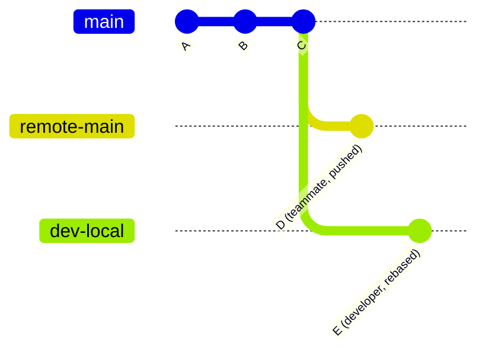

import Scenario from "../../../components/Scenario.astro";
import LevelIntro from "../../../components/LevelIntro.astro";
import PracticeCheck from "../../../components/PracticeCheck.astro";

export const unit = {
  track: "git-teamwork",
  unitSlug: "shared-history",
};

<Scenario label="“I only cleaned up my own commits.” A teammate's pushed commit vanished from the shared branch.">
  <Fragment slot="facts">
    

      
🧹 <strong>What the developer did</strong> — rebased their own local commits, then ran <code>git push --force</code>

      
⏱️ <strong>What they didn't know</strong> — a teammate had pushed to the same branch after their last fetch

      
💥 <strong>The result</strong> — the teammate's commit silently stopped being part of the branch

    

  </Fragment>

A developer rebases their own local commits to tidy them up, a normal
everyday habit, and runs `git push --force` on a shared branch. A few
minutes later a teammate notices that the commit they pushed to that same
branch is gone. No error, no warning, no conflict. **The developer only
touched their own commits. So how did someone else's already-pushed work
disappear?**

</Scenario>

<LevelIntro
  items={[
    "What a force-push really moves",
    "Why a stale view of the remote is the danger",
    "The safer alternative, previewed",
  ]}
/>

## What does a force-push actually do?

**If the developer never edited the teammate's commit, what could have removed it?**
Look at the two histories side by side. The server's branch has the
teammate's commit `D`. The developer's rebased branch has their own commit
`E`, built on the older `C`:

Git has no merge step here. A branch on the remote is only a **named
pointer to one commit**. `git push --force` says "make that pointer point
at my commit", and the server obeys. `D` is no longer reachable from the
branch, so it drops out of the branch's history.

| Step                  | Remote branch points at | Is `D` reachable from the branch? |
| --------------------- | ----------------------- | --------------------------------- |
| Before the push       | `D`                     | Yes                               |
| After `push --force`  | `E`                     | No                                |
| After a normal push\* | `D` (push rejected)     | Yes                               |

\*A normal push is refused here, which is the whole point of the next
sections.

<PracticeCheck
  track={unit.track}
  unitSlug={unit.unitSlug}
  topicId="force-push-replaces-ref"
/>

## Why did the developer not see it coming?

**Where did the developer's picture of the remote go wrong?** Three copies
exist, and only one of them was out of date:

| Place                | What it holds                                           |
| -------------------- | ------------------------------------------------------- |
| Your local branch    | Your commits, rebased and tidy                          |
| Your `origin/<name>` | The last position of the remote **you fetched**         |
| The real remote      | The truth, which the teammate has already moved forward |

Your machine only learns about the teammate's push when you **fetch**.
Until then `origin/<name>` still says "the remote ends at `C`". A
force-push built on that old picture overwrites a remote that has moved on.
The danger is neither rebasing nor force alone; it is **force combined with
a stale view of a shared branch**.

<PracticeCheck
  track={unit.track}
  unitSlug={unit.unitSlug}
  topicId="stale-remote-view"
/>

## Key terms

- **Remote** — the shared copy of the repository on a server.
- **Tip** — the latest commit a branch points at.
- **Reachable** — a commit is reachable from a tip if you can walk backward
  through parent links and arrive at it.
- **Fetch** — download what the remote has now and update `origin/<name>`,
  without touching your own branches.
- **Shared history** — commits on a branch that more than one person pushes
  to or builds on.
- **Force-push (`--force`)** — overwrite the remote branch pointer with
  yours, with no check that you have seen what is there.
- **`--force-with-lease`** — a force-push that first checks the remote still
  points where you last saw it, and refuses otherwise.

If a lease-protected push is refused, do not add more force. Fetch, read
what arrived, reconcile, and only then decide whether a rewritten push is
still appropriate.

## What the next levels cover

L2 explains the check a normal push performs, how `--force-with-lease`
differs from it, and what teammates experience when pushed history is
rewritten. L3 walks the whole incident as a timeline, then looks at where
the lease can itself be fooled and how lost commits are recovered.
