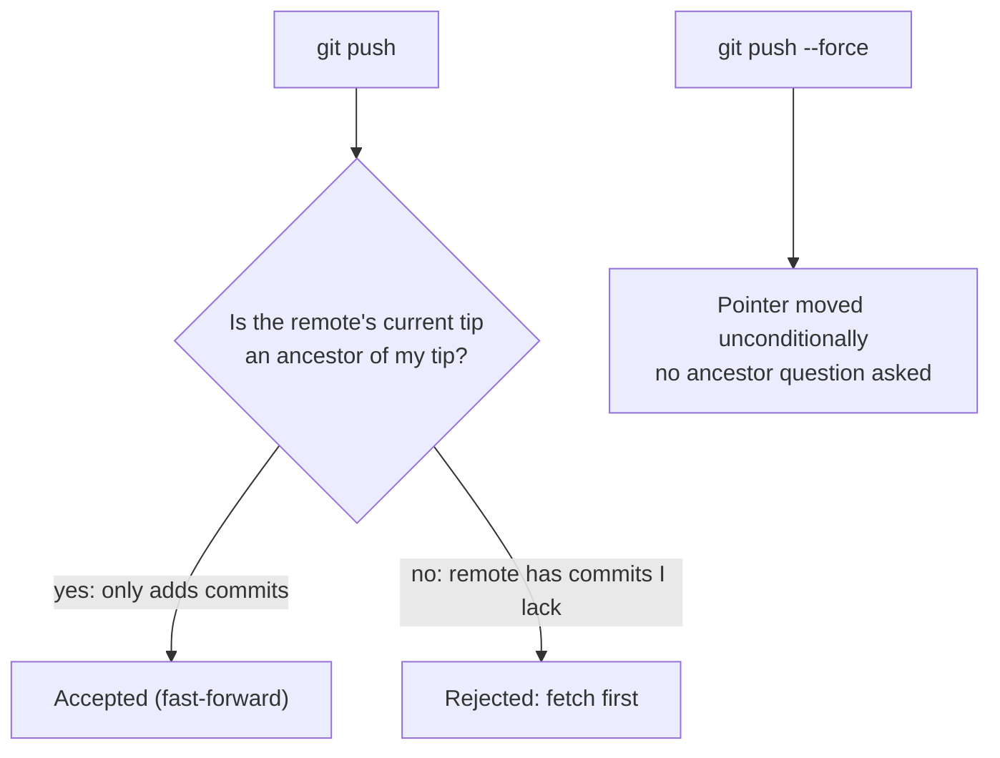
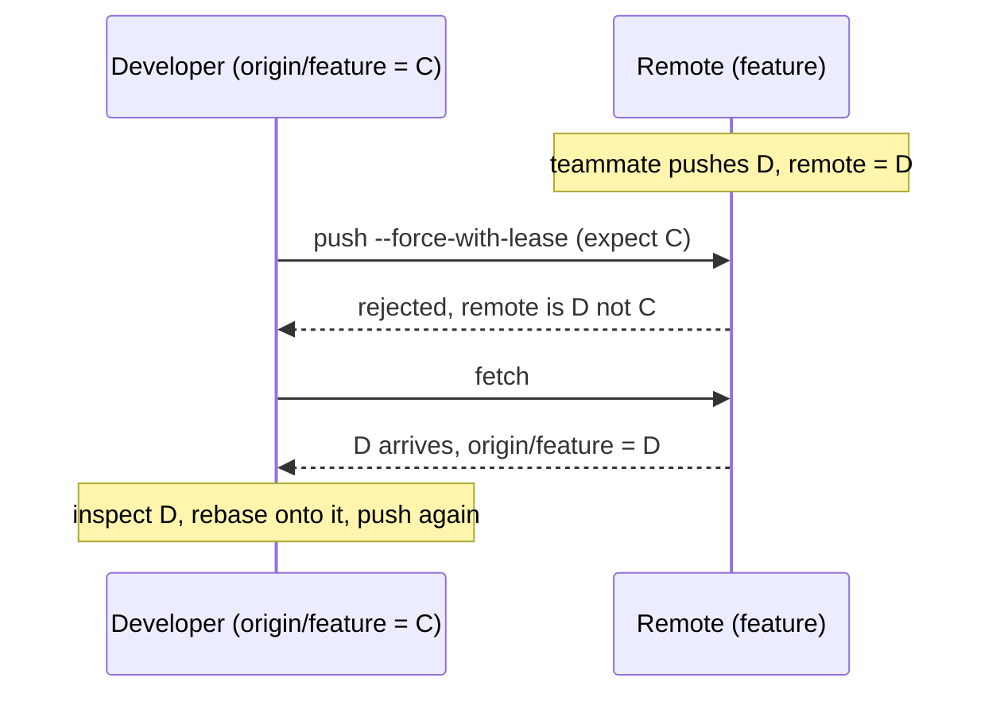
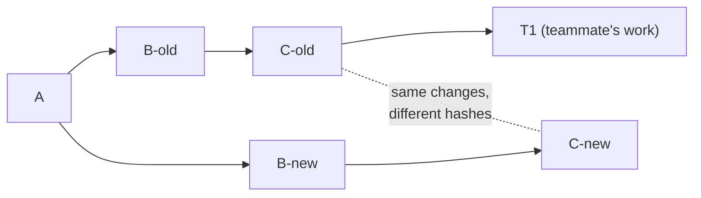

import LevelIntro from "../../../components/LevelIntro.astro";
import Checkpoint from "../../../components/Checkpoint.astro";
import PracticeCheck from "../../../components/PracticeCheck.astro";

export const unit = {
  track: "git-teamwork",
  unitSlug: "shared-history",
};

L1 showed that a force-push moves the remote's branch pointer and that a
stale view of the remote turns that into data loss. L2 asks the next
questions: why a normal push would have refused, what the lease adds, and
what everyone else experiences when pushed history is rewritten.

<LevelIntro
  items={[
    "The fast-forward check of a normal push",
    "How the lease differs from that check",
    "What teammates see after a rewrite",
  ]}
/>

## What does a normal push check?

**If force-push is this dangerous, why does a plain `git push` not do the
same damage?** Because the server asks one question before moving the
pointer: is the branch's current tip an **ancestor** of what you are
sending? If yes, the move only adds commits (a fast-forward) and nothing
is lost. If no, the server holds commits you do not have.

A rejection is not a broken repository. It is the protection doing its
job, and the correct reaction is to fetch and integrate, not to add
`--force`.

<Checkpoint question="You rebased commits you had already pushed, and a plain push is now rejected. The remote has nothing new from teammates. Why is it still rejected?">

Rebasing replaced your old commits with new ones that have different
hashes. The remote's tip is one of the old commits, and it is no longer an
ancestor of your rewritten tip, so the ancestor check fails even though no
teammate pushed anything. That is the legitimate case for a force-push, and
exactly where the lease belongs instead of a plain `--force`.

</Checkpoint>

<PracticeCheck
  track={unit.track}
  unitSlug={unit.unitSlug}
  topicId="fast-forward-check"
/>

## How does `--force-with-lease` change the picture?

**If a rewrite legitimately needs force, can the push still refuse when
someone else got there first?** Yes. The lease swaps "is the remote an
ancestor of mine?" for a different question: **is the remote still exactly
where I last saw it?** Your `origin/<name>` records that last-seen position.

| Command                       | Question asked before moving the pointer     | Rewrites allowed?     |
| ----------------------------- | -------------------------------------------- | --------------------- |
| `git push`                    | Is the remote tip an ancestor of mine?       | No                    |
| `git push --force`            | None                                         | Yes, blindly          |
| `git push --force-with-lease` | Is the remote tip still what I last fetched? | Yes, if nothing moved |

<Checkpoint question="A lease-protected push is rejected. Is the right next step to run it again with --force?">

No. The rejection means the remote holds something you have not seen.
Fetching shows you what it is, and then you decide how to include it in
your rewritten branch. Repeating the push with plain `--force` throws away
exactly the safety the rejection just gave you.

</Checkpoint>

<PracticeCheck
  track={unit.track}
  unitSlug={unit.unitSlug}
  topicId="force-with-lease"
/>

## What happens to teammates when pushed history is rewritten?

**Suppose the rewrite succeeds and nobody lost anything. Is everyone fine?**
Not yet. Each commit is identified by a 40-character SHA-1 hash computed
from its content, its message, and its **parent's hash**. Change anything
early in the chain and every later commit gets a new hash. A rebase
therefore produces brand-new commits that merely look the same.

A teammate who already built `T1` on `C-old` still has the old chain. If
they now `git pull` (a fetch plus merge), git merges the old and the new
copies together and the same changes appear twice. The tidy fix is for them
to move only their own commits onto the new history, for example with
`git rebase --onto`. Better, rewrite only commits that nobody else has yet
based work on.

<Checkpoint question="You amend only the message of a commit that is already pushed and force-push. Does anyone else's history change?">

Yes. The message is part of what the hash is computed from, so that
commit gets a new hash, and every commit after it gets one too because each
includes its parent's hash. Anyone who had the old commits now holds a
parallel history. "Only the message" is still a full rewrite as far as
shared history is concerned.

</Checkpoint>

<PracticeCheck
  track={unit.track}
  unitSlug={unit.unitSlug}
  topicId="rewrite-teammate-effects"
/>

## Failure modes at this level

- **Believing "I only rebased my own commits" proves nothing else is
  affected.** The rebase is local; the force-push that follows is what
  reaches other people's commits.
- **Reading a rejection as a git problem.** It is the ancestor check or the
  lease saying the remote knows something you do not.
- **Carrying a personal-branch habit onto a shared branch.** The command
  looks identical; only who else relies on the branch changed.
