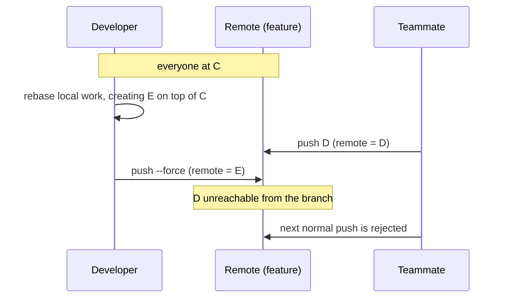
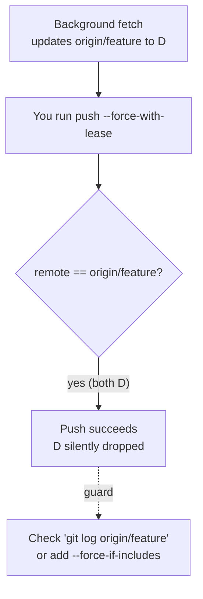

import Scenario from "../../../components/Scenario.astro";
import LevelIntro from "../../../components/LevelIntro.astro";
import Checkpoint from "../../../components/Checkpoint.astro";
import PracticeCheck from "../../../components/PracticeCheck.astro";

export const unit = {
  track: "git-teamwork",
  unitSlug: "shared-history",
};

<Scenario label="The commit is gone from the branch. Is it gone from everywhere?">
  <Fragment slot="facts">
    

      
📌 <strong>Remote branch</strong> — now points at <code>E</code>, the developer's rewrite

      
🕳️ <strong>Missing</strong> — <code>D</code>, the teammate's commit

      
💻 <strong>Teammate's laptop</strong> — still has <code>D</code>, the only clone that made it

      
🧭 <strong>Developer's laptop</strong> — never fetched <code>D</code>, so it was never there

    

  </Fragment>

The team lead finds out an hour later. The pointer has moved, the teammate is
frustrated, and the developer has switched to `--force-with-lease` for next
time. **Would that switch really have prevented it, can anything fool the
lease, and if the damage is already done, where do you get `D` back from?**

</Scenario>

<LevelIntro
  items={[
    "The incident as a timeline",
    "Where the lease can be fooled",
    "Recovering a commit nobody points at",
  ]}
/>

## What exactly happened, in order?

**Which moment made the loss inevitable?** Not the rebase and not the
teammate's push. It was the force-push, which ran against a view that
was already out of date:

| Commit          | Old remote line |  New remote line  |
| --------------- | :-------------: | :---------------: |
| `A`, `B`, `C`   |    reachable    |     reachable     |
| `D` (teammate)  |    reachable    | **not reachable** |
| `E` (developer) |   not present   |     reachable     |

Reachability is the whole story: the loss is every commit reachable from the
old tip but not from the new one. That matches the interactive demo of this
unit, where each unfetched teammate commit is lost one for one. If the
developer had fetched and rebased onto `D`, the new tip would reach `D` and
the loss would be zero.

<Checkpoint question="The developer fetches right before the rebase and rebases onto D, then force-pushes. Is anything lost? And if the teammate pushes yet another commit F seconds after that fetch?">

In the first case nothing is lost: `E` now sits on top of `D`, so every
commit reachable from the old tip is still reachable from the new one.
The second case is different: the fetch narrowed the window but did not
close it. `F` arrived after the developer's last look, a plain `--force`
would drop it, and this is exactly the gap the lease is meant to cover.

</Checkpoint>

## Can the lease itself be fooled?

**If `--force-with-lease` compares against my `origin/<name>`, what if
`origin/<name>` was updated without me looking?** Many editors and tools
fetch in the background. If one fetches `D` into `origin/feature` at 10:00,
a lease push at 10:05 sees "remote is D, I expected D" and succeeds, even
though your rebased branch never included `D`.

| Guard                                                             | What it adds                                                               |
| ----------------------------------------------------------------- | -------------------------------------------------------------------------- |
| Read what changed before every rewritten push                     | Turns the lease from "unchanged since a fetch" into "reviewed"             |
| Spell the expected value out: `--force-with-lease=feature:<hash>` | The lease no longer depends on whatever the tracking ref now holds         |
| `--force-if-includes` alongside the lease                         | Refuses unless your local branch actually contains the remote-tracking tip |

The lease is a seatbelt, not a substitute for knowing what is on the remote.

<Checkpoint question="Your lease push succeeded. Does that prove the remote contained nothing you hadn't incorporated?">

No. It proves the remote matched your `origin/<name>` at push time. If
something refreshed that tracking ref without you incorporating the new
commits, the check passes while commits are dropped. Success means "the
remote hasn't moved since my tracking ref was updated", not "my branch
contains everything on the remote".

</Checkpoint>

<PracticeCheck
  track={unit.track}
  unitSlug={unit.unitSlug}
  topicId="lease-blind-spots"
/>

## Can the lost commit be recovered?

**If nothing on the branch points at `D`, is it deleted?** Not immediately.
The commit object stays in any repository that holds it until garbage
collection eventually removes unreferenced objects. The question is who holds it.

| Where to look                        | Has `D`?                           | Why                                                               |
| ------------------------------------ | ---------------------------------- | ----------------------------------------------------------------- |
| Teammate's clone                     | Yes                                | They created and pushed it                                        |
| Developer's clone                    | **No**                             | Never fetched it, and a reflog only records places a ref has been |
| Remote server                        | Maybe, until garbage collection    | Often not reachable through normal tools for a regular user       |
| CI logs or hosting-provider activity | Often the hash, sometimes the diff | Pushes are logged by hash                                         |

Recovery, in order: tell the team and stop pushing, get the 40-character
hash from the person who has it, and restore the commit with a new branch at
that hash or a cherry-pick onto the corrected branch. On the machine that
did have it, `git reflog` lists where branches and `HEAD` used to point, so
the hash can be found there. Then agree on the intended branch state before
anyone pushes again, or the next overwrite repeats the incident.

<PracticeCheck
  track={unit.track}
  unitSlug={unit.unitSlug}
  topicId="recovering-lost-commits"
/>

## What generalizes, and what doesn't?

This timeline is a **case, not the whole territory**. The core idea,
"last write wins unless the writer checks what it is overwriting", shows
up wherever updates are made from a stale read: overwriting a file, saving
a database row without a version check. The specifics here (ancestors,
reachability, tracking refs) are git's model.

Try extending it yourself. What changes if the shared branch is protected on
the server and rejects force-pushes entirely? What if `D` were a revert of
a production incident rather than ordinary feature work? What if three
teammates, not one, had pushed after your last fetch?

## Failure modes

| Failure mode                                           | What it gets wrong                                                               |
| ------------------------------------------------------ | -------------------------------------------------------------------------------- |
| Re-running a rejected push with plain `--force`        | Discards the one signal that the remote holds unseen work                        |
| Treating `--force-with-lease` as a guarantee           | It checks the tracking ref, which a background fetch can update without review   |
| Fetching, then force-pushing without reading the fetch | Your view is fresh, but your rewritten branch still may not contain the new work |
| Looking for the lost commit in the pusher's reflog     | That clone never held it; the author's clone did                                 |
