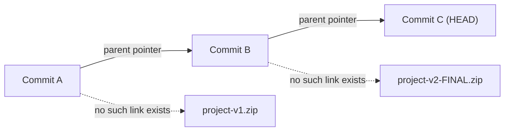
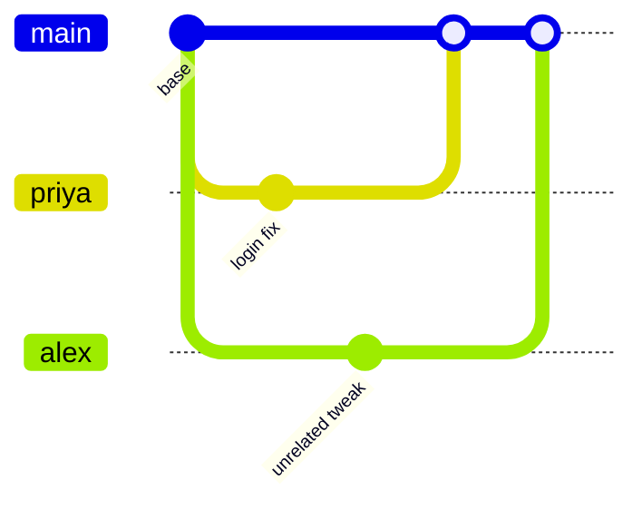

import Scenario from "../../../components/Scenario.astro";
import LevelIntro from "../../../components/LevelIntro.astro";
import PracticeCheck from "../../../components/PracticeCheck.astro";

export const unit = {
  track: "git-teamwork",
  unitSlug: "snapshots-manual-copies",
};

<Scenario>
  <Fragment slot="facts">
    

      
📁 <code>project-v2-FINAL.zip</code> — Priya's copy, has the login fix

      
📁 <code>project-v2-FINAL-REAL.zip</code> — Alex's copy, made without seeing Priya's

      
❓ Neither filename says which fix is inside, or which is newer

    

    
What's missing

    

      0 of 3
      questions a zip file can answer
    

    

      

    

    

      
1️⃣ Why did this change?

      
2️⃣ Which copy has both people's work?

      
3️⃣ Exactly when did the bug appear?

    

  </Fragment>

Priya finishes the login fix and emails `project-v2-FINAL.zip` to Alex. Alex,
working from an older copy he'd already unzipped, makes an unrelated tweak and
saves his own folder back as `project-v2-FINAL-REAL.zip` — without ever
opening Priya's file. Two hours later, nobody can say which zip has both
fixes. Priya's login change is simply absent from Alex's copy: no message
explaining why, no diff showing what's different, no record of when it went
missing.

**Both files are named "final." Neither is complete, and there's no way to tell that from the filenames alone. What information would you need to have been recorded automatically, at the moment each save happened, to answer any of the three questions above?**

</Scenario>

The answer version control gives: record every save as a labeled, comparable,
permanent snapshot — automatically, not by hand.

<LevelIntro
  items={[
    "Why manual copies can't answer basic history questions",
    "Commits, parent links, and what a snapshot is",
    "Branches as labels, and what distributed means",
  ]}
/>

## Why can't manual copies answer the three questions?

Git does **not** record every time you press Save in your editor. Saving changes the file on disk. Git records a checkpoint only when you deliberately build one with `git add` and `git commit`. That deliberate checkpoint is what becomes comparable, nameable, and recoverable later.

| Question a zip file can't answer   | What Git records instead                               |
| ---------------------------------- | ------------------------------------------------------ |
| Why did this change?               | A commit message, written at the moment of the change  |
| Which copy has both people's work? | Parent links, and a merge commit that joins two lines  |
| Exactly when did the bug appear?   | An ordered chain of commits you can inspect one by one |

Manual copies fail on all three at once: no record of _why_, no safe way to combine two people's edits, and no way to find the exact moment a bug arrived. Renaming files more carefully does not fix this, because the missing thing is not a better name. It is a recorded **relationship** between one saved state and the next.

<PracticeCheck
  track={unit.track}
  unitSlug={unit.unitSlug}
  topicId="manual-copy-gaps"
/>

## What is a commit, and what links one to the next?

A **commit** is an immutable snapshot of the whole project plus metadata: who made it, when, why (the message), and a pointer to the commit before it. That pointer is the **parent link**, and the chain of parent links is the entire history. A zip file has no such pointer, which is exactly why Alex's copy and Priya's copy are two dead ends.

Because every commit points to its parent, you can walk backward to _any_ past state, not just undo the last action. Git stores a **full snapshot** per commit rather than a list of edits; unchanged files are not re-copied but referenced by content (L2 shows how). A file Git knows about is **tracked**; one it can see but you have not promised to include is **untracked**.

<PracticeCheck
  track={unit.track}
  unitSlug={unit.unitSlug}
  topicId="commit-parent-chain"
/>

## What are branches, and what does "distributed" add?

Priya and Alex both started from the same past state. Git remembers that shared starting commit, so it can later ask "what did Priya change from the base, and what did Alex change from the same base?" and combine the answers. The `merge` unit teaches that mechanism; here the point is that manual folders never preserve the relationship.

A **branch** is just a movable label pointing at a commit. Creating one copies no files, so it is instant. **Distributed** means every clone carries the _entire_ history, not only the latest snapshot: no single point of failure, and you can commit, branch, and read history offline.

<PracticeCheck
  track={unit.track}
  unitSlug={unit.unitSlug}
  topicId="branches-and-distributed"
/>
