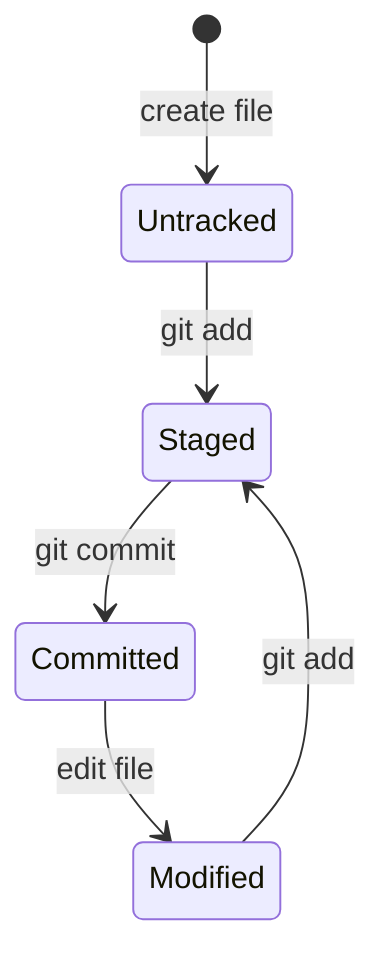
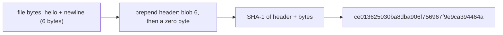
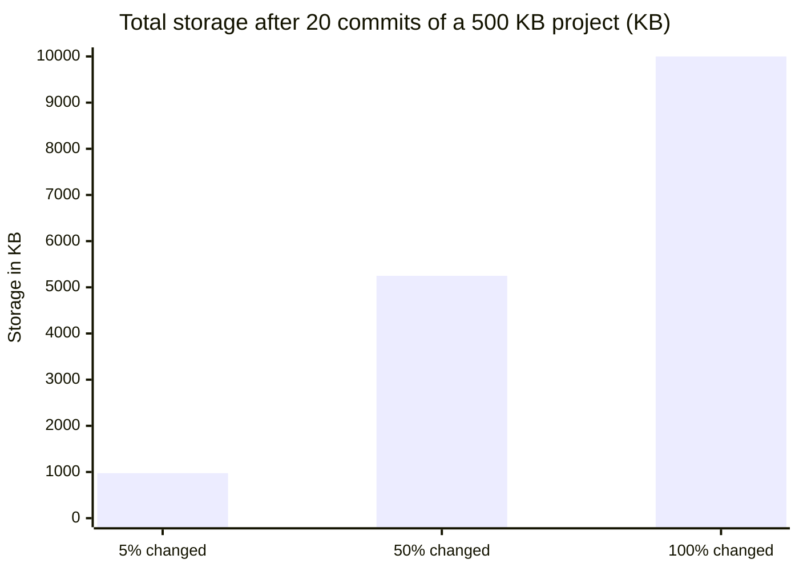

import Scenario from "../../../components/Scenario.astro";
import LevelIntro from "../../../components/LevelIntro.astro";
import Checkpoint from "../../../components/Checkpoint.astro";
import PracticeCheck from "../../../components/PracticeCheck.astro";

export const unit = {
  track: "git-teamwork",
  unitSlug: "snapshots-manual-copies",
};

<Scenario label="The scenario">
  <Fragment slot="facts">
    <div class="not-prose flex flex-col gap-1.5 text-sm text-slate-700 dark:text-slate-300">
      <div class="flex items-center gap-1.5"><span>1️⃣</span> Three-state model — watch <code>git status</code> change with no "undo" involved</div>
      <div class="flex items-center gap-1.5"><span>2️⃣</span> Content-addressing — the hash recipe is just "header + bytes", and <code>git hash-object</code> shows it</div>
      <div class="flex items-center gap-1.5"><span>3️⃣</span> Storage growth — manual copies vs. Git, computed for real numbers</div>
    </div>
    <p class="not-prose mt-3 mb-1 text-xs font-semibold tracking-wide text-slate-400 uppercase">Claim being proven</p>
    <div class="not-prose rounded border border-sky-300 bg-sky-50 p-1.5 text-xs dark:border-sky-800 dark:bg-sky-950">
      Git's storage key is a pure function of content bytes — not a filename, not a timestamp, not which commit asked for it.
    </div>

  </Fragment>

L1 and L2 described the snapshot model. This level checks it against reality: a short terminal session showing the three-state model, the exact recipe behind a stored object's hash, and real numbers for how much smaller Git's storage is than the zip-file approach from L1's opening scenario.

</Scenario>

<LevelIntro
  items={[
    "The three-state model, watched live in a real terminal session",
    "Content-addressing: the hash recipe, and what changes its output",
    "Storage growth with real numbers, and where it breaks down",
  ]}
/>

## Watching the three-state model in a real session: does `git status` really report three different things?

The command sequence is the point here, so this one short transcript is worth reading line by line (output trimmed to the lines that matter):

```
$ echo "hello" > greeting.txt
$ git status            # Untracked files: greeting.txt
$ git add greeting.txt
$ git status            # Changes to be committed: new file: greeting.txt
$ git commit -m "Add greeting"
$ echo "hello again" > greeting.txt
$ git status            # Changes not staged for commit: modified: greeting.txt
```

`git status` reports a _different_ state after each command, though nothing was "undone". The file on disk, what is staged for the next snapshot, and what is permanently committed are three separate pieces of state, and every git command operates on one of them.



<Checkpoint question="Right after `git add greeting.txt`, the file is staged but not committed. If you then overwrite greeting.txt on disk with a third version, without staging again, which version does the next `git commit` record: the staged one, or the one now on disk?">

The staged one: the version that was on disk at the moment `git add` ran. Staging copies the file's content into the staging area at that instant; it does not keep watching the file for later edits. So `git status` would show the same filename in two states at once, "changes to be committed" for the staged version and "changes not staged" for the newer edit. A manual-copy workflow has no way to represent that, and it follows directly from staging being a deliberate snapshot rather than a live mirror of the working directory.

</Checkpoint>

## What is the hash made of, and what changes it?

L2 claimed every stored object is identified by the SHA-1 hash of its own content. This is checkable, because the recipe is public and small: for a file's content (a "blob"), Git hashes the text `blob`, a space, the content's length in bytes, a zero byte, and then the content itself.



Running `printf 'hello\n' | git hash-object --stdin` prints exactly that hash. Nothing in the recipe mentions a filename, a timestamp, an author, or a branch, so none of them can change the key. The only input is bytes. That is the practical proof behind "identical content is stored once".

Bytes, not appearance, are what count. The same visible text saved with Windows line endings (`hello` followed by carriage return and newline) is seven bytes, and `git hash-object` gives it a completely different hash, `ef0493b2...`. Two files that look identical on screen are two different objects if their bytes differ.

<Checkpoint question="Two files on different branches both contain the visible text 'hello'. One was typed by hand, the other pasted from a different editor. Does Git store one object or two, and what would you check if you saw two?">

If the bytes are identical, one object: the hash recipe only sees the header and the bytes, so it cannot know which editor produced them, which branch they live on, or when they were typed. Seeing two objects means the bytes differ somewhere invisible, most often line endings (a carriage return before the newline), a trailing newline at the end of the file, or a byte-order mark at the start. Comparing the two hashes, or the byte lengths, is the fastest way to confirm which invisible difference you are looking at.

</Checkpoint>

<PracticeCheck
  track={unit.track}
  unitSlug={unit.unitSlug}
  topicId="hash-recipe"
/>

## Turning the L2 storage claim into real numbers: how much does content-addressing save?

L2's chart covered the easy case where nothing changed. Real projects change a little each commit. The model is two lines: manual copies cost `saves x project size`, while Git costs one full project for the first commit plus, for each later commit, only the slice that changed.

| Scenario (500 KB project)                      | Commits | Changed per commit | Manual copies | Git       |
| ---------------------------------------------- | ------- | ------------------ | ------------- | --------- |
| Typical small edits                            | 20      | 5%                 | 10,000 KB     | 975 KB    |
| Heavy churn                                    | 20      | 50%                | 10,000 KB     | 5,250 KB  |
| Everything rewritten each time (e.g. a binary) | 20      | 100%               | 10,000 KB     | 10,000 KB |



The 975 KB row is 500 KB for the first commit plus 19 commits x 500 KB x 5%. The last row is the important warning: the savings are not magic, they are proportional to how little changes. When every byte changes every time, Git's advantage disappears and its growth matches the zip folder's.

<PracticeCheck
  track={unit.track}
  unitSlug={unit.unitSlug}
  topicId="storage-math"
/>

## What does "undo" become once every state is a snapshot?

With manual copies, undo means "hope you kept a copy from before the mistake, then work out what else changed since". With snapshots, going back is a lookup of a past commit by its hash:

```
$ git log --oneline            # list past snapshots, newest first
$ git checkout a1b2c3d -- greeting.txt   # restore one file from that snapshot
```

This works because every past state is fully addressable. The `checkout` unit covers which restore commands are narrow, which rewrite history, and which can discard uncommitted work; this unit only needs the point that snapshots make restoring possible.

## Failure modes

- **Forgetting to `git add` before committing.** The file is edited but never staged, so `git commit` silently leaves it out. Running `git status` before each commit shows exactly what is staged and what is not.
- **Committing generated or dependency files** (`node_modules/`, build output, a `.env` with real secrets). Content-addressing stores them faithfully and forever, so the repository bloats permanently. A `.gitignore` has to be set up deliberately; Git does not infer what does not belong.
- **Treating uncommitted work as safe.** The working directory and staging area are not part of permanent history. A bad reset or an accidental delete can lose uncommitted changes with no recovery path. The safety net starts at the first commit, so commit early and often; a messy history is fixable later, lost work generally is not.
- **Expecting a large binary to behave like text.** A binary has no meaningful line-based diff, and one changed byte means a whole new blob. Repeatedly committing a changing video or database dump follows the manual-copies growth curve (the 100% row above), which is why large media usually lives outside Git proper, in object storage or Git LFS.

<PracticeCheck
  track={unit.track}
  unitSlug={unit.unitSlug}
  topicId="working-state-risks"
/>

## Beyond this one project

Everything above used one small project, one file, and one flat "percent changed" number. That is a worked case, not the whole territory. Try extending it:

- Suppose a 400 KB video out of the 500 KB project is re-exported and re-committed whole each time while the other 100 KB barely changes. Does one flat changed-percentage still describe the project honestly, or should the estimate treat the video separately? What would the 20-commit total look like?
- Suppose a teammate's editor silently converts line endings on every save. From the hash recipe alone, what would you predict about the diff Git shows, and why does a feature like `.gitattributes` line-ending normalization exist?
- Suppose Priya and Alex were not two people but two laptops of one person. Which of the three opening questions (why, which copy, when) still hurts, and which disappears?
