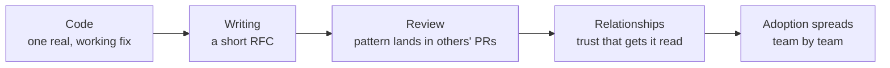

import Scenario from "../../../components/Scenario.astro";
import LevelIntro from "../../../components/LevelIntro.astro";
import PracticeCheck from "../../../components/PracticeCheck.astro";

export const unit = {
  track: "git-teamwork",
  unitSlug: "technical-leadership",
};

<Scenario label="Three retry loops, zero shared code">
  <Fragment slot="facts">
    

      
🧑‍💻 <strong>Dana</strong> — an engineer with no direct reports and no authority over the other teams

      
🔁 <strong>3 teams</strong> — payments, notifications, search-indexing — each hand-wrote its own retry logic

      
🐛 <strong>2 of 3</strong> retry a non-retryable 400 error, hammering a struggling downstream service

      
📅 <strong>6 weeks</strong> — until all three teams used one shared library, with no ticket demanding it

    

  </Fragment>

Dana notices the same bug in three unrelated codebases within a month:
payments, notifications, and search-indexing have each hand-rolled their own
retry logic for calling downstream services, and two of the three retry on
**every** failure, including a `400 Bad Request` that will never succeed no
matter how many times it is sent. During a downstream incident, those doomed
retries keep adding load to a service that is already struggling, so a short
blip turns into a long pile-up. Dana isn't the tech lead of any of the three
teams, doesn't manage anyone on them, and has no way to force a change.

**Six weeks later, all three teams use one shared, well-tested retry
library, and none of them were ordered to. What did Dana do between
noticing the bug and that outcome, and why does "post a Slack message asking
people to be more careful" reliably fail at the same problem?**

</Scenario>

<LevelIntro
  items={[
    "Why announcements change nothing",
    "Four channels of influence",
    "Adoption as the only proof",
  ]}
/>

## Why doesn't "just tell people" work?

A message like "everyone's retry logic should check whether an error is
retryable before retrying" is correct and changes nothing. It has no owner, no
deadline, and no artifact anyone can point back to, and it asks three teams
with their own backlogs and their own working code to do unscheduled work for
a problem they haven't personally been burned by. **The bug is real. The
message has no mechanism for turning "real" into "someone's Tuesday."**

| What Dana has                                        | What Dana doesn't have                           |
| ---------------------------------------------------- | ------------------------------------------------ |
| Deep knowledge of the bug and a working fix          | Authority to assign it to any of the three teams |
| Credibility from past, unrelated good work           | A shared manager over the three team leads       |
| Time to write code, docs, or review other teams' PRs | The ability to block anyone's release on this    |

Leading across teams is usually done from exactly this position: real
expertise and real stakes, with no reporting line to lean on. It isn't a
workaround for a missing title. For anyone whose work touches more than one
team, it is the normal way change happens.

<PracticeCheck
  track={unit.track}
  unitSlug={unit.unitSlug}
  topicId="just-tell-fails"
/>

## What did Dana use instead?

She didn't pull one lever. She used four, in sequence, and each does a job the
others cannot:

- **Code:** a real example running in one codebase. Proof that the fix works,
  not an argument that it should.
- **Writing:** a document other people can read, comment on, and cite later.
- **Review:** nudging the pattern into other teams' code, one pull request at
  a time, when the author is already looking at the relevant lines.
- **Relationships:** the trust built over many unrelated interactions, which
  is why a team lead reads the RFC instead of leaving it in a queue.

<PracticeCheck
  track={unit.track}
  unitSlug={unit.unitSlug}
  topicId="four-channels"
/>

## How do you know the influence worked?

Dana could have felt productive after writing the RFC, after a good thread,
after a round of thumbs-up reactions. **None of those is the outcome. What
would actually show the influence worked?**

Only changed behavior: other teams' code now uses the shared library, and
new code reaches for it by default. Agreement, enthusiasm and praise are all
cheap and all compatible with nothing changing. Adoption is the evidence,
and it is why the six weeks in the scenario end with three merged changes
rather than three people saying "good idea."

| Signal                                      | Is it evidence of influence? |
| ------------------------------------------- | ---------------------------- |
| "Great RFC!" comments                       | No, agreement costs nothing  |
| A team lead promising to look into it       | No, intent, not a change     |
| A merged PR switching a team to the library | Yes, behavior changed        |
| A new PR using it without Dana asking       | Yes, strongest: it spread    |

<PracticeCheck
  track={unit.track}
  unitSlug={unit.unitSlug}
  topicId="adoption-evidence"
/>

## What the next levels cover

L2 explains what each channel does that the others can't, why code comes
before the RFC in this case, and where a limited amount of time pays off
most. L3 walks through Dana's six weeks, including the team lead who pushed
back, and when the order should be reversed.
