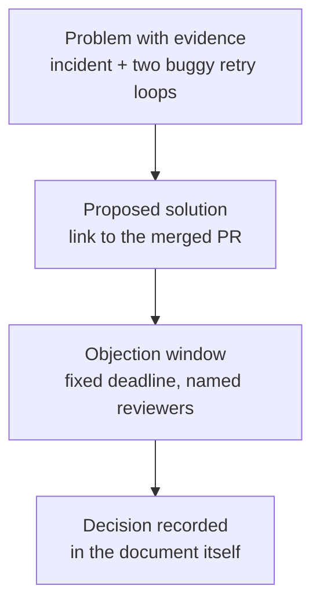

import Checkpoint from "../../../components/Checkpoint.astro";
import LevelIntro from "../../../components/LevelIntro.astro";
import PracticeCheck from "../../../components/PracticeCheck.astro";

export const unit = {
  track: "git-teamwork",
  unitSlug: "technical-leadership",
};

L1 showed Dana getting three independent teams onto one shared retry library
in six weeks with no authority over any of them. L2 breaks that outcome into
the four channels she used and, more importantly, the order she used them in,
because doing them out of order is a common way this kind of push stalls.

<LevelIntro
  items={[
    "What each channel does that others can't",
    "Why code came before the RFC",
    "Where limited time pays off most",
  ]}
/>

## Channel 1: why did Dana write the fix before the proposal?

Before writing a word about the problem, Dana fixed it in payments' own
codebase: a small `withRetry()` wrapper that checks whether an HTTP status is
worth retrying (`429`, `502`, `503`, `504`) before retrying anything, covered
by tests and already running in production. **What does a working
implementation prove that an argument for one cannot?**

It proves the idea survives contact with real code: real edge cases, real
tests, real traffic. An argument can be debated forever in the abstract
("what about idempotency keys?", "should the timeout be configurable?"); a
merged PR answers many of those questions by existing. A proposal with no
working code behind it reads as untested opinion, and busy people are
practiced at deprioritizing untested opinion.

<Checkpoint question="A colleague says Dana should have written the RFC first so all three teams could weigh in before any code existed. What does code-first buy that RFC-first doesn't?">

Code-first turns the RFC from "here's an idea, what do you think?" into
"here's a working fix that already solves this in one codebase, and here's
why the other two should adopt it." The second is far cheaper to evaluate,
because readers judge something concrete instead of speculating about
something that doesn't exist. The design questions also get settled by what
the code actually had to handle, not by hypothetical debate. RFC-first is not
wrong everywhere: when the decision is genuinely open, gathering input before
building is better (L3 covers when to invert the order). But Dana was already
confident about this fix, so building first cut the discussion down to
concrete review.

</Checkpoint>

<PracticeCheck
  track={unit.track}
  unitSlug={unit.unitSlug}
  topicId="code-first"
/>

## Channel 2: what can writing do that a conversation can't?

A Slack thread convinces the people reading it that afternoon. Three days
later it is buried, and a fourth person who joins late can only ask someone to
retype the argument. **What would Dana need so that three people could point
at the same plan weeks later without re-arguing it?** A short document.

Dana's RFC had three parts a conversation lacks structurally: the problem
stated with evidence (the incident, the two other teams' code), the working
fix presented as the proposal rather than an open question, and an explicit
window for objections with a stated deadline.

It stays short on purpose. Its job isn't to be comprehensive; it is to be a
stable reference point. A one-page RFC that everyone finishes does more work
than a long design document nobody does.

<PracticeCheck
  track={unit.track}
  unitSlug={unit.unitSlug}
  topicId="rfc-purpose"
/>

## Channel 3: why did review move the code when the RFC didn't?

The RFC alone moved no code. What moved code was Dana reviewing pull requests
on notifications and search-indexing and, at the moment an author was already
touching retry-adjacent code, pointing at the shared helper: **"There's a
`withRetry()` helper from the payments RFC that already handles this. Want to
pull it in here instead of the manual loop?"** Why does that land better than
a team-wide announcement asking everyone to migrate?

A review comment arrives when the author already has the relevant code open
and is already thinking about the problem, which is the cheapest moment to
change what they do. An announcement asks everyone to remember the request at
some unspecified later point, which is the same unscheduled work that L1
showed never happens. Review-driven adoption is slower per team than a
mandate would be, but it needs no mandate, which is what Dana doesn't have.

<PracticeCheck
  track={unit.track}
  unitSlug={unit.unitSlug}
  topicId="review-timing"
/>

## Channel 4: why did anyone read the RFC at all?

None of the first three channels work if the receiving side doesn't trust
Dana's judgment enough to spend attention on it. That trust wasn't built by
this RFC. It came from the prior year: pairing with the notifications lead on
an unrelated debugging session, giving specific and useful review on
search-indexing's PRs, and being credited for catching a subtle bug months
earlier.

<Checkpoint question="Which channel, if missing, would make the other three fail even if each were done well?">

Relationships. An excellent RFC from someone with no track record competes
with every other unread document in a team lead's queue, while the same RFC
from someone whose past reviews and fixes have held up gets read first,
because trust works as a filter for where limited attention goes. That makes
relationships less a soft extra than the channel that decides whether the
other three get a hearing at all.

</Checkpoint>

| Channel       | What it provides                           | What goes wrong if skipped                               |
| ------------- | ------------------------------------------ | -------------------------------------------------------- |
| Code          | Proof the idea survives reality            | The RFC reads as untested opinion                        |
| Writing       | A stable, citable statement of the plan    | Every discussion re-litigates from scratch               |
| Review        | The pattern reaching code one PR at a time | Adoption depends on everyone remembering an announcement |
| Relationships | Attention for the other three channels     | The RFC sits unread; the review comment reads as pushy   |

<PracticeCheck
  track={unit.track}
  unitSlug={unit.unitSlug}
  topicId="relationships"
/>

## Where should limited time go?

Dana has a fixed number of hours, and teams are not equally worth them.
**Which team gets the review and relationship time first?** The one where the
problem is currently hurting most, and where an endorsement from someone
other than Dana will travel furthest.

| Place to spend time                                   | Why it pays off more                                            |
| ----------------------------------------------------- | --------------------------------------------------------------- |
| The team whose version of the bug is currently costly | Pain makes the fix urgent without Dana having to argue for it   |
| An engineer others on that team already trust         | An endorsement from an insider carries more than one from Dana  |
| A moment when the team is already changing that code  | The change costs them almost nothing extra at that moment       |
| A team whose implementation is already mostly right   | Low payoff: little pain, little reason to prioritize the switch |

This is judgment, not a measured formula, so treat the ordering as a heuristic
about where friction is lowest, not a calculated return.

<PracticeCheck
  track={unit.track}
  unitSlug={unit.unitSlug}
  topicId="leverage-points"
/>

L3 follows Dana's actual six weeks, including the one team lead who pushed
back and what changed the outcome.
