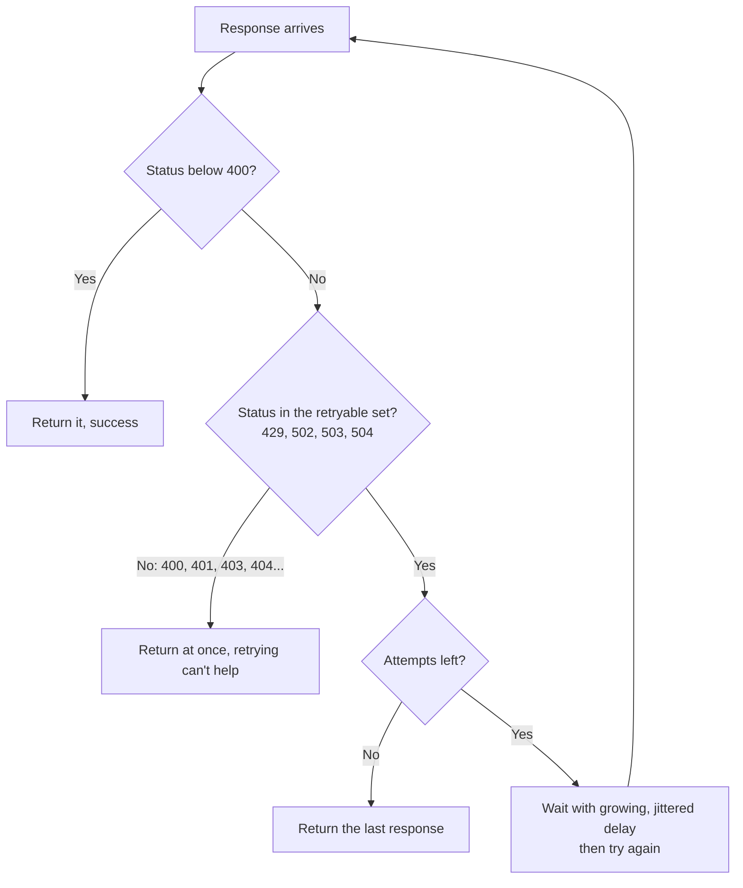
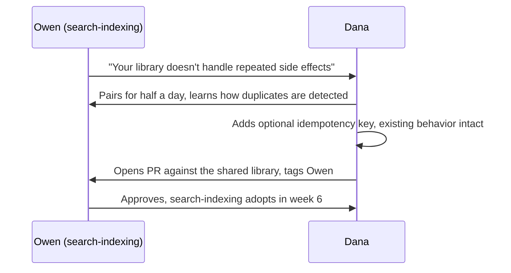

import Scenario from "../../../components/Scenario.astro";
import Checkpoint from "../../../components/Checkpoint.astro";
import LevelIntro from "../../../components/LevelIntro.astro";
import PracticeCheck from "../../../components/PracticeCheck.astro";

export const unit = {
  track: "git-teamwork",
  unitSlug: "technical-leadership",
};

<Scenario label="Week 4: search-indexing's lead says no">
  <Fragment slot="facts">
    

      
📄 <strong>Week 1</strong> — Dana ships the fix in payments, then writes the RFC

      
✅ <strong>Week 2</strong> — Notifications adopts it in one PR, no resistance

      
🚫 <strong>Week 4</strong> — Owen, search-indexing's lead, declines: retries re-run on the same batch, and the library says nothing about that

      
🔧 <strong>Week 6</strong> — Owen's concern is built into the library and search-indexing adopts it

    

  </Fragment>

By week 2, notifications had adopted Dana's library in a single PR with almost
no discussion; the RFC and the working code did the persuading. Week 4 went
differently. Owen read the RFC and replied: **"This looks solid for payments,
but our indexing job re-runs on the exact same batch of documents on retry. If
two retries race, we could double-index a document. Your library doesn't say
anything about that."** Owen wasn't wrong and wasn't being difficult. **What
does Dana do next, and does anything from the payments RFC transfer to a team
whose retry problem has a different failure mode?**

</Scenario>

<LevelIntro
  items={[
    "What the fix actually decides",
    "Treating pushback as design input",
    "When to gather input before building",
  ]}
/>

## What did the shipped fix actually decide?

The wrapper makes one decision per response, and its tests protect that
decision. Every other behavior (backoff with jitter, a cap on attempts) is
secondary to the question that caused the incident.

The most persuasive test in the RFC was the one that asserts a `400` is
attempted exactly once. Without it, a missing check passes every other test.
That one test would have caught both buggy implementations before they
shipped, and it persuades better than a paragraph describing the bug, because
it is a runnable claim, not an assertion.

<Checkpoint question="Notifications adopted the library in week 2 with almost no discussion. Why did the identical RFC and code land so differently for search-indexing?">

The RFC and the code weren't the variable; the underlying problem was.
Notifications had the same shape of bug as payments (retrying everything,
including errors that can't succeed), so the fix mapped over directly and
left nothing to argue about. Search-indexing has a second failure mode on
top: a retried request can re-run a side effect such as indexing a document
again, which the status check does not address. The fix was correct as far as
it went and incomplete for them. Reading every "no" as resistance would have
turned a genuine gap in the proposal into an unnecessary fight.

</Checkpoint>

<PracticeCheck
  track={unit.track}
  unitSlug={unit.unitSlug}
  topicId="pushback-response"
/>

## What does Dana do with Owen's objection?

Owen's point is specific and correct: the library guards against retrying a
request that can't succeed, but says nothing about a request that succeeds
twice with a side effect that isn't safe to repeat. Dana has three options.

| Response                                                  | What it costs                                                    |
| --------------------------------------------------------- | ---------------------------------------------------------------- |
| Argue it away: insist the library is "close enough"       | Spends the trust that made notifications' fast adoption possible |
| Quietly drop search-indexing from the rollout             | Leaves a known bug pattern unfixed in one more codebase          |
| Treat it as design input and extend the library with Owen | About a week of extra work, and a better shared library          |

She takes the third. She pairs with Owen for half a day, and together they add
an optional idempotency key: when set, the library sends the same key on every
attempt so the downstream indexing service, which Owen's team already had hooks
for, can recognize and skip a duplicate. The status check payments needed is
untouched, so this adds a guarantee instead of watering down the original fix.
The same gap matters to payments as well: any retry of a request that charges
or writes something carries the same duplicate risk, so Owen's objection
improved the library for the team it was written for.

**Why did pairing do something a written reply couldn't?** Dana didn't yet
know how search-indexing detects duplicates, and extracting that over written
comments would have taken several slow rounds. Half a day together let her
ask follow-ups in real time and see the actual hook, so the fix rested on
Owen's real constraint instead of a guess at what he meant.

<PracticeCheck
  track={unit.track}
  unitSlug={unit.unitSlug}
  topicId="pairing-value"
/>

## When should the order invert?

L2 made code-first the default because Dana was already confident the bug was
worth fixing and roughly knew the fix. **What property of a decision would make
gathering input first the better order, even for someone with Dana's
credibility?**

Code-first assumes the proposer has enough conviction and context to build
something worth reacting to. When the design space is genuinely open, or the
people affected hold context the proposer lacks, a short options memo and a
conversation before building can redirect work that would otherwise be sunk.
The idempotency piece was a small version of this: pairing with Owen before
writing any key-handling code beat building a guess and pitching it.

| Decision property                                     | Better order           |
| ----------------------------------------------------- | ---------------------- |
| Strong evidence and a fix the proposer already trusts | Code first, then RFC   |
| Several defensible directions, unclear which wins     | Input first, then code |
| The people affected have context the proposer lacks   | Input first, then code |

<PracticeCheck
  track={unit.track}
  unitSlug={unit.unitSlug}
  topicId="invert-order"
/>

## Extending past Dana's example

Dana's six weeks is one case, not the whole territory. It assumed a proposer
with a year of earned credibility, three teams, and a purely technical
objection from the one team that pushed back. Real situations vary on all
three.

<Checkpoint question="Suppose Dana were six months into the org with no track record. Which channel gets more weight in week 1, and why?">

Relationships and review would carry more of the early weight, and code would
need to be even more visibly solid. Without earned trust, an RFC is easy to
ignore, so Dana would lean on small, useful reviews and a fix that is
undeniably working in her own team's code before asking anyone to read a
proposal. The timeline would stretch accordingly, which is the same
relationship the unit's interactive demo lets you drag: less trust, longer
adoption.

</Checkpoint>

Try these on your own. **First, suppose Owen's real objection in week 4 wasn't
idempotency but "my team already spent two sprints building our own retry
logic, and adopting yours makes that look wasted." That is a status concern
dressed as a technical one. Does review-and-pairing still work, or does it
call for a different channel?** **Second, suppose the shared library had to be
adopted by a team that is hostile to Dana personally. Who else could carry the
message, and which channel does that move you toward?**
