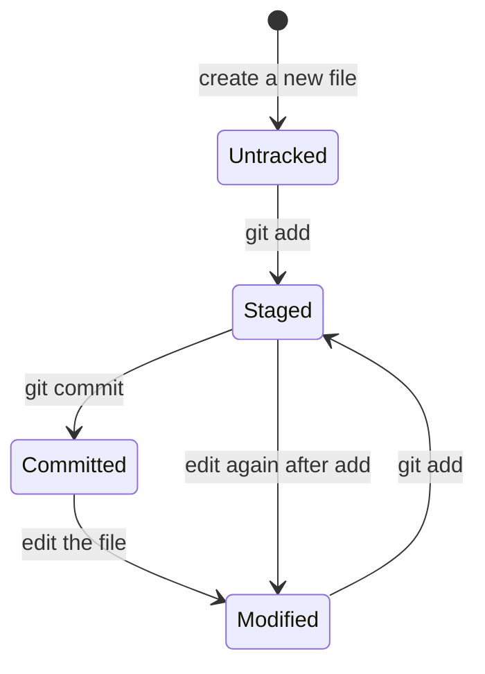
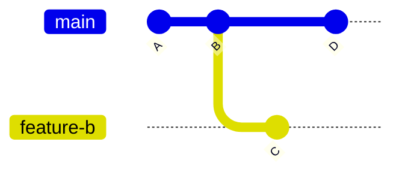

import Scenario from "../../../components/Scenario.astro";
import LevelIntro from "../../../components/LevelIntro.astro";
import PracticeCheck from "../../../components/PracticeCheck.astro";

export const unit = {
  track: "git-teamwork",
  unitSlug: "working-tree",
};

<Scenario label="The edit that followed you, then vanished">
  <Fragment slot="facts">
    

      
✏️ <strong>On feature-a</strong> — edited `shared-config.js`, never committed

      
🔀 <strong>Switched to feature-b</strong> — no warning, no conflict — the edit came along

      
🧹 <strong>On feature-b</strong> — ran a cleanup command, unrelated to `shared-config.js` in their mind

      
😱 <strong>Back on feature-a</strong> — the edit is just gone

    

    

      

        
Assumption

        "My edit belongs to feature-a"
      

      

        
Reality

        The edit belonged to nothing — it was never committed anywhere
      

    

  </Fragment>

A developer edits `shared-config.js` on `feature-a` — a real, useful tweak — but doesn't
commit it yet. They switch to `feature-b` to check something unrelated. Git doesn't
complain; the switch goes through cleanly, and the edit is still sitting right there in the
file. On `feature-b`, they run a routine cleanup command to discard some other, unrelated
scratch changes before testing something. They switch back to `feature-a`. **The edit to
`shared-config.js` is gone — but they never touched that file on `feature-b`. What
happened?**

The edit was never "on" `feature-a` in the first place. It was sitting in the **working
tree** — a single, branch-independent workspace — and `git checkout` only moves the files
that actually _differ_ between the two branches' last commits. Since `shared-config.js`
was identical on both branches, checkout left it alone and the edit came along for the
ride. The cleanup command on `feature-b` didn't know or care that the edit "belonged" to a
different branch, because it didn't.

</Scenario>

<LevelIntro
  items={[
    "The three places Git keeps a file's state",
    "Why uncommitted edits have no branch affinity",
    "When checkout carries an edit vs. refuses",
  ]}
/>

## Where can one file's change actually live?

Right now, a file you edited could be sitting in the folder on disk, in a prepared snapshot, or in permanent history. Git keeps **three separate places**, and `git status` is entirely a report of how they differ.

| Area               | What it holds                           | Updated by             |
| ------------------ | --------------------------------------- | ---------------------- |
| Working tree       | The actual files on disk right now      | Editing files directly |
| Staging area/index | A prepared snapshot for the next commit | `git add`              |
| Repository (HEAD)  | Permanent, committed history            | `git commit`           |

A file moves through four everyday states as it travels between those areas:

Simple analogy: the working tree is the folder open on your desk, the staging area is the stack of pages prepared for the next snapshot, and the repository is the album of snapshots already filed away.

<PracticeCheck
  track={unit.track}
  unitSlug={unit.unitSlug}
  topicId="three-areas"
/>

## Why did the edit have no home?

**If the edit was not on `feature-a`, where was it?** Nowhere in history. A branch is just a name pointing at a commit; an uncommitted edit is not part of any commit, so it has no branch affinity.

Every dot above is a commit; the branch names are only labels on dots. Your unsaved edit is not drawn anywhere on this graph, because it is not in it. It lives in the working tree, which is shared by whichever branch is checked out.

- **`git checkout <branch>` only touches files that differ** between the current commit and the target commit. If `shared-config.js` is identical on both, the edit simply stays where it is. It "follows" you because Git never needed to touch it.
- **If the file differs between branches and has uncommitted changes**, Git either applies your edit cleanly on top of the target version or refuses with "local changes would be overwritten".
- The silent case is the dangerous one: nothing marks the edit as still uncommitted and fragile.
- The habit this unit builds: before switching with unfinished work, commit or stash it. Do not trust it to "stay behind".

<PracticeCheck
  track={unit.track}
  unitSlug={unit.unitSlug}
  topicId="no-branch-affinity"
/>
