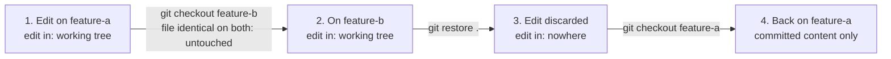

import Scenario from "../../../components/Scenario.astro";
import LevelIntro from "../../../components/LevelIntro.astro";
import Checkpoint from "../../../components/Checkpoint.astro";
import PracticeCheck from "../../../components/PracticeCheck.astro";

export const unit = {
  track: "git-teamwork",
  unitSlug: "working-tree",
};

<Scenario label="The full incident, start to finish">
  <Fragment slot="facts">
    <div class="not-prose flex flex-col gap-2 text-sm text-slate-700 dark:text-slate-300">
      <div class="flex items-center gap-1.5"><span>1️⃣</span> Edit `shared-config.js` on `feature-a`, uncommitted</div>
      <div class="flex items-center gap-1.5"><span>2️⃣</span> `git checkout feature-b` — succeeds silently, edit carries over</div>
      <div class="flex items-center gap-1.5"><span>3️⃣</span> On `feature-b`, run `git restore .` to clean up something unrelated</div>
      <div class="flex items-center gap-1.5"><span>4️⃣</span> `git checkout feature-a` — the edit is gone, no trace, no error</div>
    </div>
    <div class="not-prose mt-3 grid grid-cols-2 gap-2 text-xs">
      <div class="rounded border border-slate-300 bg-slate-50 p-1.5 dark:border-slate-700 dark:bg-slate-900">
        <p class="font-semibold text-slate-600 dark:text-slate-300">What was lost</p>
        An uncommitted edit, never staged, never committed
      </div>
      <div class="rounded border border-rose-300 bg-rose-50 p-1.5 dark:border-rose-800 dark:bg-rose-950">
        <p class="font-semibold text-rose-600 dark:text-rose-400">Recoverable?</p>
        Not by Git — it was never in any commit
      </div>
    </div>
  </Fragment>

This incident was reproduced against a real two-branch repository, not invented. **Before reading the transcript, predict:
at which of the four numbered steps does the edit actually get lost — the switch to
feature-b, the restore on feature-b, or the switch back to feature-a?**

</Scenario>

<LevelIntro
  items={[
    "The incident reproduced command by command",
    "Exactly which step actually destroys the edit",
    "Why a genuinely diverged file can't fail this way",
  ]}
/>

## The incident, step by step

The whole command sequence is the point here, so one short block carries it:

```
git checkout feature-a      # edit shared-config.js, leave it uncommitted
git checkout feature-b      # succeeds silently
git restore .               # "clean up" unrelated scratch changes
git checkout feature-a      # shared-config.js is back to its committed content
```

The useful question at each step is **where does the edit live right now?**



| Step | Command              | Edit location | Anything destroyed?                                                                  |
| ---- | -------------------- | ------------- | ------------------------------------------------------------------------------------ |
| 1    | edit, no commit      | Working tree  | No                                                                                   |
| 2    | `checkout feature-b` | Working tree  | No: file not touched because it was identical on both commits                        |
| 3    | `restore .`          | Nowhere       | **Yes**: every uncommitted change in this working tree is discarded, with no warning |
| 4    | `checkout feature-a` | Nowhere       | No: there was nothing left to lose                                                   |

Git cannot recover the edit, because it was never in a commit or a stash. An editor's local history or an OS snapshot might have a copy, but that is outside Git. From Git's point of view the safety net starts when work enters the repository.

<Checkpoint question="Of the four numbered steps in this incident — edit, checkout feature-b, restore ., checkout feature-a — which one actually destroyed the edit, and why do the two checkouts get blamed anyway?">

Step 3, `git restore .` on `feature-b`, is the only command that discarded anything. It wiped every uncommitted change in the working tree it ran against, including an edit that had nothing to do with why the developer ran it. Both checkouts get blamed instead because they are the commands that visibly moved the developer between branches, and the loss only becomes visible after the second one. By then the destructive command is two steps back and easy to forget. The lesson generalizes: when uncommitted work disappears around a branch switch, the switch itself is rarely the culprit, because checkout only overwrites files it can prove differ between two commits. A bare `restore`, `checkout -- .`, or `reset --hard` run on either branch is what actually throws work away.

</Checkpoint>

<PracticeCheck
  track={unit.track}
  unitSlug={unit.unitSlug}
  topicId="what-destroys-edit"
/>

**Extend the incident: what if `shared-config.js` had already diverged between the two branches before the edit?** Then step 2 would most likely have been refused, and the loss could not have happened this way. The incident was only possible because the file happened to be identical on both branches. The "protected" case is the safer one; the "convenient" case quietly set up the loss.

## What actually would have prevented this

**Given that the edit was real, useful work, what single habit — not a different Git
command — would have prevented losing it?** Committing it (even as a disposable
`git commit -m "wip"`) or stashing it (`git stash`) before switching branches at all would
have moved the edit into the repository or a dedicated stash entry — both of which
`git restore .` on a _different_ branch cannot touch. The failure wasn't a Git bug or a
missing safety net; the working tree genuinely has no per-branch memory for uncommitted
content, and the fix is to stop relying on it having one.

Use this before changing branches when work is unfinished:

| What `git status` shows                 | Safer next action                                                          |
| --------------------------------------- | -------------------------------------------------------------------------- |
| It belongs to the current branch        | `git add` + `git commit`                                                   |
| It is useful but not ready to commit    | `git stash` before switching                                               |
| It is scratch you truly want to discard | `git restore <file>` with an exact file path                               |
| You are not sure                        | Do not run `git restore .`, `git checkout -- .`, or `git reset --hard` yet |

<Checkpoint question="Suppose the developer had run git stash right after the edit on feature-a, then switched to feature-b and back. Would git restore . on feature-b still have destroyed the edit?">

No. `git stash` moves the uncommitted edit into a dedicated stash entry, which lives in the repository's stash list, not in the working tree. At that point the edit is no longer uncommitted work sitting on disk that a bare `restore .` can see or touch. `git restore .` only discards uncommitted changes present in that working tree at the time it runs, so a stashed edit survives and can be reapplied later with `git stash pop` on whichever branch actually needs it. This is why the advice is to commit or stash before switching, rather than relying on the working tree's silent carry-over to keep an edit safe.

</Checkpoint>

<PracticeCheck
  track={unit.track}
  unitSlug={unit.unitSlug}
  topicId="protect-before-switch"
/>

## This is one case, not the whole territory

The incident above is a single path through a larger space: one file, one cleanup command, two branches. Try changing one variable and re-deriving the outcome. What if the cleanup had been `git reset --hard` instead of `restore .`? What if the edit had been staged before the switch? What if it was a brand-new untracked file and the cleanup was `git clean`? What if a teammate, not you, ran a command in a shared checkout? For each, ask the same two questions: where does the change live right now, and which command can reach that area?

## Failure modes

| Failure mode                                                               | What it gets wrong                                                                                                                                       |
| -------------------------------------------------------------------------- | -------------------------------------------------------------------------------------------------------------------------------------------------------- |
| Assuming uncommitted edits are tied to whichever branch you made them on   | The working tree has no branch affinity — an edit is just sitting on disk until it's committed, regardless of which branch is checked out                |
| Blaming the checkout for a loss that happened on a different branch        | The checkout itself only refuses or silently carries a file over — the actual data loss in this incident came from a cleanup command run afterward       |
| Assuming Git will always warn before discarding uncommitted work           | `checkout <branch>` warns when a file genuinely diverges; `restore .`/`checkout -- .`/`reset --hard` do NOT warn — they discard immediately and silently |
| Treating "no conflict on checkout" as proof nothing risky happened         | A clean, warning-free checkout can still leave uncommitted work sitting somewhere easy to lose track of and later discard by accident                    |
| Relying on memory instead of `git status` before running a discard command | A quick `git status --short` before any `restore`/`checkout --`/`reset --hard` would have surfaced the at-risk file before it was too late               |
