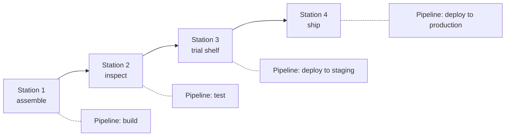

import Scenario from "../../../components/Scenario.astro";
import LevelIntro from "../../../components/LevelIntro.astro";
import PracticeCheck from "../../../components/PracticeCheck.astro";

export const unit = {
  track: "infra-delivery",
  unitSlug: "ci-cd-pipeline-anatomy",
};

<Scenario label="An inspector stamps every toy 'passed', even the broken ones">
  <Fragment slot="facts">
    

      
🔧 <strong>Station 1</strong> — workers assemble the toy

      
🔍 <strong>Station 2</strong> — an inspector tests each toy and stamps it

      
🏪 <strong>Station 3</strong> — a trial shelf that copies the real shop

      
🚚 <strong>Station 4</strong> — the truck to real customers

      
🏷️ <strong>Two weeks ago</strong> — a sticker went on the inspector's desk: "stamp passed even if the toy fails"

    

    

      
The stamp no longer means anything

      every toy gets "passed", so nothing is ever stopped
    

  </Fragment>

A toy factory has four stations in a row. At station 2 an inspector tests
each toy and stamps it "passed" or "failed", and only passed toys move on.
One day the inspector's test gauge kept giving random readings, so a
manager stuck a note on the desk: "stamp passed even if the toy fails,
just for today, we have orders to fill." Nobody ever took the note down.
Weeks later a toy with a snapped wheel reaches the inspector. The gauge
says fail, the inspector stamps it passed, and it ships. **The line was
built to stop exactly this. What went wrong?**

Software teams build the same line, and it is called a CI/CD pipeline. A
real incident of this shape: the test step was told to continue after
failure, the dashboard showed every stage green, and the broken commit
was already live before anyone looked.

</Scenario>

<LevelIntro
  items={[
    "What each pipeline stage catches",
    "CI and CD as two chained concerns",
    "Why a bypass flag needs an expiry plan",
  ]}
/>

- A **commit** is a saved snapshot of a change in Git. If that word is
  still fuzzy, `/git-teamwork/working-tree/` builds the mental model
  underneath it.
- **Production** is the real app users touch; **staging** is a rehearsal
  copy used before production; an **artifact** is the already-built
  package that moves between those places. Later units like
  `/infra-delivery/docker/` go deeper on packaging the artifact.

## What is each stage actually for?

A pipeline is a sequence of stages, and each one exists to catch one
class of problem. A stage is only useful if a failure in it really stops
the line.

| Stage                | Question it answers                           | What a silent bypass costs                               |
| -------------------- | --------------------------------------------- | -------------------------------------------------------- |
| Build                | Does this compile / package correctly?        | Broken artifacts reach later stages                      |
| Test                 | Does this behave correctly?                   | Bugs reach production undetected                         |
| Deploy to staging    | Does this work outside a developer's machine? | Environment-specific bugs reach production               |
| Deploy to production | Is this actually live for users?              | N/A, this is the stage everything else exists to protect |

<PracticeCheck
  track={unit.track}
  unitSlug={unit.unitSlug}
  topicId="pipeline-stages"
/>

## CI and CD: who judges, who delivers?

**CI (continuous integration)** answers "is this change good?". **CD
(continuous delivery or deployment)** answers "how does a change that was
already judged good actually reach production?". In the factory, CI is the
inspector and CD is the truck.

| Concern  | Factory picture                  | Pipeline stages            | Fails when                                           |
| -------- | -------------------------------- | -------------------------- | ---------------------------------------------------- |
| CI       | The inspector's verdict          | Build, test                | A bad change is judged good                          |
| CD       | The truck and the trial shelf    | Staging, production deploy | A judged-good change never arrives, or arrives wrong |
| The gate | The rule "only passed toys move" | Between every stage        | The verdict is ignored, so CI no longer matters      |

A pipeline can have excellent CI and still ship broken code if the
connection between the two, the gate, is not enforced. The same build
artifact should also move through every environment unchanged: built
once, then promoted, so what was tested is provably what ships.

<PracticeCheck track={unit.track} unitSlug={unit.unitSlug} topicId="ci-vs-cd" />

## A bypass flag is a loan, not a setting

`continue-on-error` is a deliberate escape hatch for a specific,
temporary situation, such as a known-flaky, low-stakes check. Left in
place, it silently converts a real safety gate into a step that always
reports success. The practical skill this unit builds: **every
"temporary" override to a gate needs an expiration plan**, meaning a
ticket, an owner, and a date it comes out.

<PracticeCheck
  track={unit.track}
  unitSlug={unit.unitSlug}
  topicId="bypass-expiry"
/>

## What the next levels add

L2 shows what a gate is mechanically, why the artifact is built once,
and why rollback must be planned before the incident.
