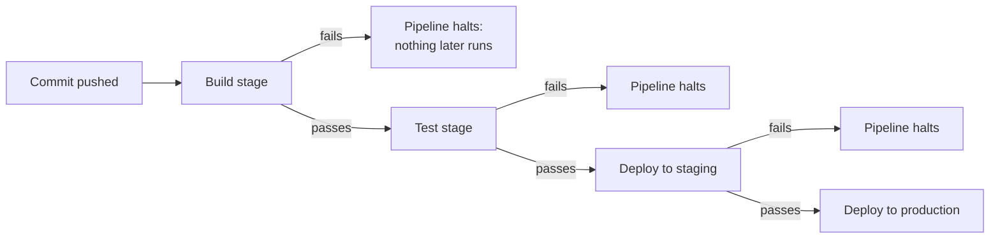
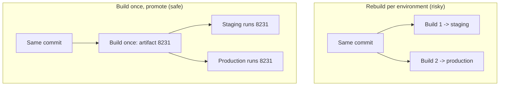
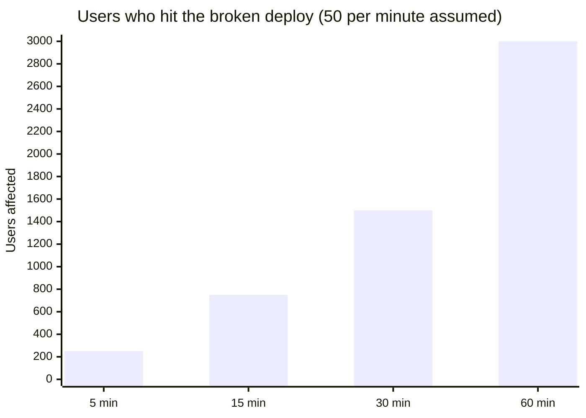

import LevelIntro from "../../../components/LevelIntro.astro";
import Checkpoint from "../../../components/Checkpoint.astro";
import PracticeCheck from "../../../components/PracticeCheck.astro";

export const unit = {
  track: "infra-delivery",
  unitSlug: "ci-cd-pipeline-anatomy",
};

L1 named the stations and showed how one ignored verdict turns "all
green" into a lie. This level builds the model underneath: what a gate
is, how a finished toy (the artifact) should travel between stations,
and why the recall plan cannot be invented after something ships broken.

<LevelIntro
  items={[
    "Gates as what makes a pipeline protective",
    "Build once, promote everywhere",
    "Rollback decided before the incident",
  ]}
/>

## What actually decides whether a commit reaches production?

**Is it enough that "the pipeline finished"?**

"The pipeline finished" and "the pipeline finished because every gate
passed" are different claims. A pipeline that always reaches the final
stage regardless of intermediate results is not a safety mechanism, it
is a list of steps that happen to run one after another. A **gate** is a
door with a condition: if the condition fails, the next room does not
open. The gates between stages, not the stages themselves, are what
protect you.

The unit's own demo flips the same gates. Here is what its model says for
the same four switches:

| Build | Tests | `continue-on-error` on tests | Staging | Result                     |
| ----- | ----- | ---------------------------- | ------- | -------------------------- |
| pass  | pass  | off                          | pass    | Reaches production         |
| pass  | fail  | off                          | pass    | Stops at the test stage    |
| pass  | fail  | on                           | pass    | Reaches production         |
| fail  | pass  | on                           | pass    | Stops at the build stage   |
| pass  | pass  | off                          | fail    | Stops at the staging stage |
| pass  | fail  | on                           | fail    | Stops at the staging stage |

Row 3 is the incident: the same failing tests as row 2, and the only
difference is one flag. Row 6 shows that a bypass does not disable the
other gates, so a later blocking gate can still catch the commit.

<PracticeCheck
  track={unit.track}
  unitSlug={unit.unitSlug}
  topicId="gate-halting"
/>

## Is there ever a legitimate reason to continue past a failure?

Yes: a genuinely flaky, non-blocking check, such as a slow integration
test that sometimes times out for infrastructure reasons, is a real if
imperfect case for tolerating failure temporarily. The incident was not
that the flag exists. It was applied to the test suite itself, the one
gate responsible for catching real bugs, and left there after its
justification disappeared.

| Legitimate temporary use               | What happened instead                     |
| -------------------------------------- | ----------------------------------------- |
| A known-flaky, low-stakes check        | Applied to the actual correctness gate    |
| A ticket to fix it                     | No ticket                                 |
| A plan for when the override comes out | Stayed in place after the reason vanished |

<Checkpoint question="A team adds continue-on-error: true to a linting step that only checks code style, with a ticket filed to remove it once a legacy module is reformatted. Is this the same mistake as the incident described above?">

No. The distinguishing factor is not whether `continue-on-error` is used
at all, it is which gate it is applied to and whether there is a removal
plan. A style check is advisory: a violation does not mean the code is
broken. Tolerating failure there temporarily, with a ticket tracking its
removal, is the legitimate case. The incident happened because the flag
was applied to the test suite, whose entire job is catching bugs, and
nobody tracked its removal.

</Checkpoint>

## If staging and production are separate, is the app rebuilt for each?

A well-structured pipeline builds the deployable artifact exactly once,
then promotes that identical artifact through staging and into
production. Rebuilding per environment reopens the risk that
environment-parity practices exist to close.

"Same commit" guarantees the same source, not the same build output. Two
builds can resolve a dependency to a slightly different version, run on
runners with different tool versions, or pick up different environment
variables. The everyday version: inspect the same sealed box in each
room, not a freshly packed box that only looks similar.

<Checkpoint question="A team's pipeline runs the build command separately inside the staging deploy job and again inside the production deploy job, on the same commit. Does that guarantee staging and production run the same artifact?">

No. Each run resolves its dependencies at that moment, on whatever
runner it landed on, with whatever settings that job has. Any of those
can differ even when the source is identical. Building once and moving
that exact file (or container image) through both environments makes
"it passed in staging" a claim about the literal thing in production.

</Checkpoint>

<PracticeCheck
  track={unit.track}
  unitSlug={unit.unitSlug}
  topicId="build-once"
/>

## Once a bad deploy is live, is "roll back" always straightforward?

Only if the pipeline was built with rollback in mind: the previous
artifact stays readily deployable, and the path back to it has been
rehearsed. Working out how to roll back during an incident, with a team
that has never run the path, is slower and riskier. While the broken
version stays live, every request keeps hitting it. This demo's own
model: affected users = minutes to roll back x users per minute. At the
demo's default of 50 users per minute:

The 50 per minute is the demo's adjustable assumption, not a measurement.
What the chart shows is the shape: cost grows in direct proportion to
rollback time, so shortening that time before an incident is the cheapest
lever. The next unit, `/infra-delivery/deployment-automation/`, continues
the same idea: deployment steps repeatable enough that recovery is not a
guessing exercise.

<PracticeCheck
  track={unit.track}
  unitSlug={unit.unitSlug}
  topicId="rollback-plan"
/>

## The generalizable lesson

**Is the fix "never allow any step to continue past a failure"?** Not
quite. Some checks are advisory, and forcing every failure to halt the
line would make harmless flakiness as disruptive as a real bug. The
skill is being deliberate about which gates may be bypassed and under what
conditions, keeping that list short and reviewed, and treating "we
bypassed a gate" as something that needs a visible, time-bound reason.
