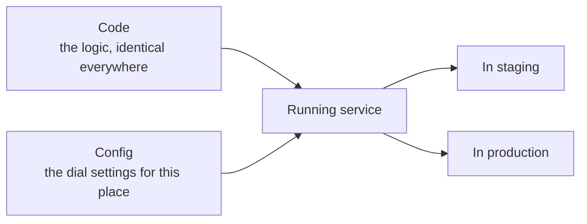
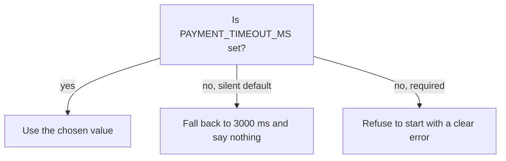

import Scenario from "../../../components/Scenario.astro";
import LevelIntro from "../../../components/LevelIntro.astro";
import PracticeCheck from "../../../components/PracticeCheck.astro";

export const unit = { track: "infra-delivery", unitSlug: "config-management" };

<Scenario label="Two identical heaters, one cold room">
  <Fragment slot="facts">
    

      
🔥 <strong>Heater A</strong> — dial set to 22°C by the installer

      
❄️ <strong>Heater B</strong> — dial never set, uses the factory default of 5°C

      
🏭 <strong>Same factory, same wiring</strong> — only the setting differs

    

    

      

        
Room A

        Warm. Nobody thinks about the heater.
      

      

        
Room B

        Cold. The heater is not broken, nobody chose its setting.
      

    

  </Fragment>

A building has two rooms with the same model of heater, bought in one
order. Room A is warm. Room B is freezing. The repair person opens the
second heater and finds nothing wrong: the same parts, the same wiring,
passing every factory test. The only difference is the dial. Someone set
it in Room A and forgot to set it in Room B, so the heater quietly used
the factory default of 5°C. **If the machine is identical, where did the
difference come from?**

</Scenario>

Software has the same trap. A checkout service passes every test in a
test environment, ships as the identical built package to the live
environment, and starts failing real customers within the hour. Nobody
changed the code. All numbers below are assumptions made up for
illustration:

| Where                   | `PAYMENT_TIMEOUT_MS` | Effective timeout   | Provider's response time (assumed) | Result           |
| ----------------------- | -------------------- | ------------------- | ---------------------------------- | ---------------- |
| Staging (test copy)     | set to `30000`       | 30 seconds          | about 1 second (light traffic)     | Always succeeds  |
| Production (live users) | never set            | 3 seconds (default) | 4 to 8 seconds (real load)         | Times out, fails |

The code and the built package are the same. The one difference is a
setting that lives outside the code, and the code filled the gap with a
default nobody had tested against live load.

<LevelIntro
  items={[
    "Config versus code",
    "Where settings can live",
    "Checking settings at start-up",
  ]}
/>

## What is the line between config and code?

- **Code** is the logic that should behave the same wherever it runs, like
  the heater's wiring.
- **Config** is anything that may legitimately differ by environment:
  a database address, a timeout, a rate limit, a feature switch, a key.
  It is the dial.
- **Build once, configure per environment**: one built package is promoted
  from staging to production unchanged, and each place hands it its own
  settings when it starts.

This is a different problem from _environment parity_ (making the
machinery of two environments match so nothing drifts by accident). Here
the differences are intentional. Staging should use a different database.
The danger is a difference nobody chose.

<PracticeCheck
  track={unit.track}
  unitSlug={unit.unitSlug}
  topicId="config-vs-code"
/>

## What is a silent default?

A **silent default** is a fallback value the code uses when a setting is
missing, with no warning to anyone. It is the factory 5°C. Defaults are
fine for truly optional settings. They are dangerous when the setting
matters and a missing value looks the same as a deliberate choice.

<PracticeCheck
  track={unit.track}
  unitSlug={unit.unitSlug}
  topicId="silent-default"
/>

**Key terms:** config versus code, build once and configure per
environment, silent default, environment variable, secrets manager,
fail-fast validation.

L2 compares the places settings can live, shows how layers of settings
override one another, and explains why checking at start-up beats
discovering a gap under live traffic.
