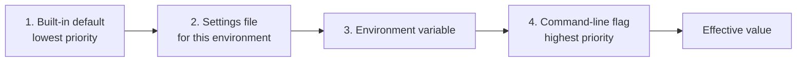
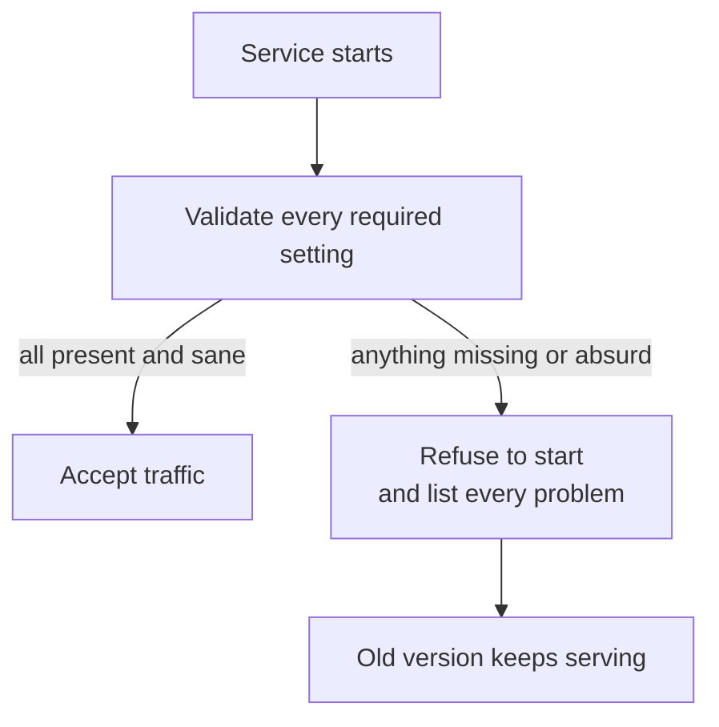

import LevelIntro from "../../../components/LevelIntro.astro";
import Checkpoint from "../../../components/Checkpoint.astro";
import PracticeCheck from "../../../components/PracticeCheck.astro";

export const unit = { track: "infra-delivery", unitSlug: "config-management" };

L1 ended on one idea: the code was identical, and a setting nobody chose
was filled by a silent default. L2 answers three follow-up questions: where
should settings be kept, which one wins when several disagree, and when
should a missing one be noticed.

<LevelIntro
  items={[
    "Three homes for a setting",
    "Layers and which one wins",
    "Checking before serving traffic",
  ]}
/>

## Where should a setting actually live?

**A value must differ per environment. Do you keep it in an environment
variable, a settings file, or a secrets manager?** Each answer buys
something and costs something:

| Home                  | Good for                                | Real cost                                                    |
| --------------------- | --------------------------------------- | ------------------------------------------------------------ |
| Environment variables | Simple, universal, no extra tool        | Nothing enforces that they exist until the code reads them   |
| Per-environment file  | Versioned, diffable, reviewable in a PR | Cannot safely hold secrets, because the repository is shared |
| Secrets manager       | Encrypted, access-audited, rotatable    | A new dependency: no manager reachable, no start-up          |

Most services mix them. Plain settings (a timeout, a flag) sit in a file or
the environment. Secrets come from the manager and are handed to the
service as environment variables at start-up, so the code reads every
setting the same way. No home on its own would have caught L1's bug: an
unset variable and a missing key in a file both stay silent.

<Checkpoint question="A teammate says: if settings may differ between environments on purpose, isn't that just drift, the thing parity tries to prevent?">

No, these are different axes. Parity is about the machinery that runs the
code: operating system, runtime version, libraries. Those should match so
behavior does not depend on where the code runs. Config is the set of
inputs to that identical machinery, and staging and production are
different systems, so some inputs should differ. The failure this unit
targets is a difference nobody chose, such as a forgotten value.

</Checkpoint>

<PracticeCheck
  track={unit.track}
  unitSlug={unit.unitSlug}
  topicId="storage-places"
/>

## When several sources disagree, which one wins?

**The built-in default says 3000, the environment's file says 10000, and
someone also set a variable. What does the service use?** Real services
read settings in layers, where each later layer overrides the earlier
one:

A worked example for one setting, all values made up:

| Default | File  | Variable | Flag  | Effective value | Which layer won |
| ------- | ----- | -------- | ----- | --------------- | --------------- |
| 3000    | unset | unset    | unset | 3000            | default         |
| 3000    | 10000 | unset    | unset | 10000           | file            |
| 3000    | 10000 | 20000    | unset | 20000           | variable        |
| 3000    | 10000 | 20000    | 5000  | 5000            | flag            |

Layering is convenient, and it hides a trap: a forgotten variable on one
server silently overrides the correct value everyone is editing in the
file. The defense is to log, at start-up, each effective value and the
layer it came from, with secrets masked.

<PracticeCheck track={unit.track} unitSlug={unit.unitSlug} topicId="layering" />

## When should a missing setting be noticed?

**A required value is missing. Should the service find out when it
starts, or when the first request needs it?**

Failing at start-up is loud and cheap: the problem shows up in the deploy,
before one user is affected, and the old version keeps serving. A service
that starts anyway looks healthy, passes its health check, and fails only
when real traffic reaches the slow path, exactly as in L1.

<Checkpoint question="The new version passed its health check. Why does that not prove its settings are right?">

A typical health check proves the process is up and can answer a simple
ping. It does not look at whether every setting the service depends on is
present, well-formed or reasonable. L1's production service passed every
health check, because the bad default was only used on the slow payment
path. Started and correctly configured are different claims, and only
start-up validation checks the second.

</Checkpoint>

<PracticeCheck
  track={unit.track}
  unitSlug={unit.unitSlug}
  topicId="fail-fast"
/>

## What L3 adds

L3 walks a start-up validator through the original bug, draws the
line between a legitimate difference and a mistake, shows what
validation can never catch, and has you write the small checking
functions yourself.
