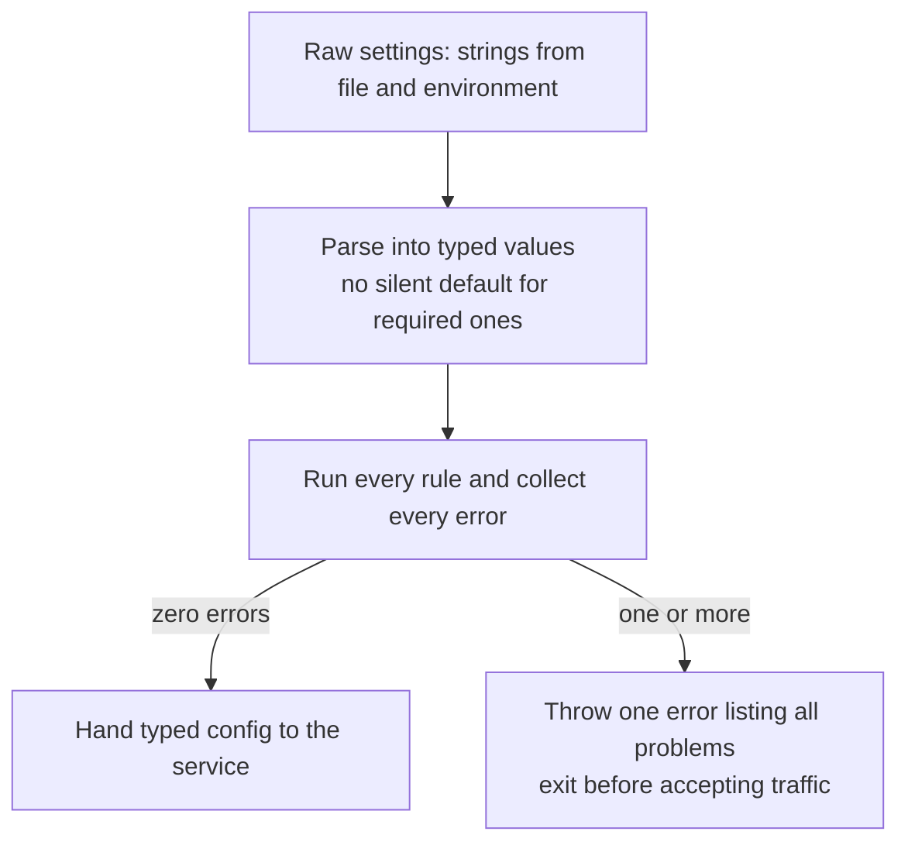
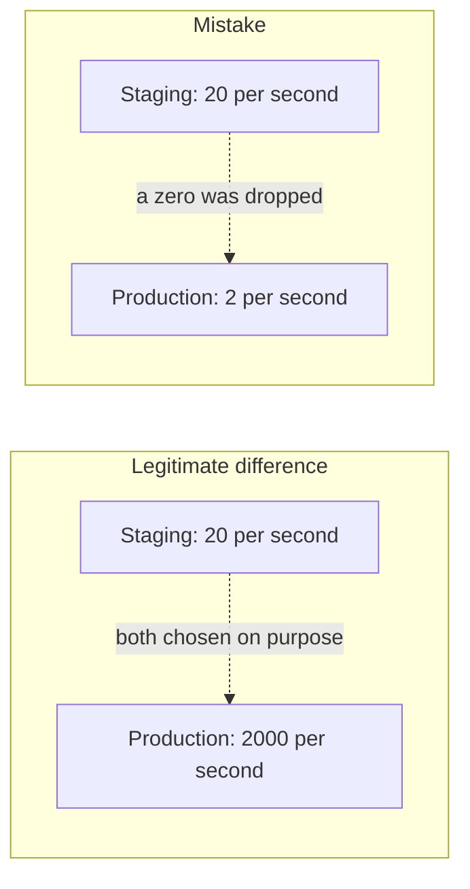

import Scenario from "../../../components/Scenario.astro";
import LevelIntro from "../../../components/LevelIntro.astro";
import Checkpoint from "../../../components/Checkpoint.astro";
import PracticeCheck from "../../../components/PracticeCheck.astro";

export const unit = { track: "infra-delivery", unitSlug: "config-management" };

<Scenario label="Same missing dial, found at two different moments">
  <Fragment slot="facts">
    <div class="not-prose flex flex-col gap-1.5 text-sm text-slate-700 dark:text-slate-300">
      <div class="flex items-center gap-1.5"><span>❌</span> <strong>No check</strong> — a customer finds the cold room</div>
      <div class="flex items-center gap-1.5"><span>✅</span> <strong>Start-up check</strong> — the installer finds it before the room is let</div>
    </div>
    <div class="not-prose mt-3 rounded border border-amber-300 bg-amber-50 p-1.5 text-xs dark:border-amber-800 dark:bg-amber-950">
      Same missing value. The only thing that changed is <em>when</em> someone
      looks for it.
    </div>
  </Fragment>

Back to the two heaters. A landlord who checks every dial before handing
over the keys never gets a call from a freezing tenant. The mistake still
happens, but the installer sees it, in a corridor, with no tenant
involved. L1's missing `PAYMENT_TIMEOUT_MS` is the same mistake. Without a
check, a customer's failed checkout reveals it. With one, the new
container refuses to start and the deploy reports exactly which value is
missing, before it receives a single request.

</Scenario>

<LevelIntro
  items={[
    "A start-up validator and what it catches",
    "Legitimate difference versus mistake",
    "What validation can never prove",
  ]}
/>

## How does a start-up validator catch the original bug?



The logic is small enough that reading it is the point. The key choice is
that a required value has no fallback, so missing and chosen can never
look the same:

```javascript
function validateConfig(env) {
  const errors = [];
  if (!env.PAYMENT_API_KEY) errors.push("PAYMENT_API_KEY is required");
  const timeout = Number(env.PAYMENT_TIMEOUT_MS);
  if (!Number.isFinite(timeout) || timeout < 1000 || timeout > 60000) {
    errors.push("PAYMENT_TIMEOUT_MS must be a number from 1000 to 60000");
  }
  return errors; // the caller refuses to start if this is not empty
}
```

Run against L1's production settings (the timeout absent), it returns one
clear sentence instead of a quiet 3-second fallback. Two details matter.
It collects all errors instead of stopping at the first, so a person fixes
everything in one pass. And the range check catches a typo such as `1`
or `5000000`, which are valid numbers but not values anyone would choose.

<Checkpoint question="Why does the validator report every error at once instead of throwing on the first problem?">

If it stopped at the first, a deploy with three problems takes three
deploy-fail-fix cycles to get through, each costing minutes and one more
chance to give up and bypass the check. Listing everything turns the
failure into a single, complete to-do list. The cost is a slightly longer
function, which is tiny next to repeated failed deploys.

</Checkpoint>

<PracticeCheck
  track={unit.track}
  unitSlug={unit.unitSlug}
  topicId="validator-code"
/>

## Where does legitimate variation end and a mistake begin?

Take `RATE_LIMIT_PER_SECOND`. Suppose, for illustration, staging runs at
20 and production at 2000. Both are right, because the environments are
sized for different loads. A typo that makes production 2 has the same
shape of difference and is wrong.



A validator that demands production match one exact number would catch
the typo, and would also block the correct deploy next month when traffic
doubles and the limit is deliberately raised. A check that blocks correct
work gets bypassed within weeks, after which it protects nothing. So the
rules mark the outer bounds of what a person would ever sanely choose and
leave the exact figure to the humans who plan capacity.

| Question                                     | Can a start-up validator answer it?            |
| -------------------------------------------- | ---------------------------------------------- |
| Is the required value present?               | Yes                                            |
| Is it the right type and inside sane bounds? | Yes                                            |
| Is `pool size` below the database's limit?   | Yes, with a rule that compares two values      |
| Is 2000 per second enough for next month?    | No, that is a capacity decision                |
| Is 2 a typo for 2000?                        | Only if a lower bound or a review rules it out |

<Checkpoint question="Production's limit is set to 2 by a typo and the rule only demands a positive number. Does the validator catch it?">

No. Two is positive and inside the bounds, so every rule passes. The
validator proves a value is well-formed, not that it is right for this
environment. Catching this one needs a tighter lower bound that is still
loose enough to allow legitimate change, a review of the diff, or an
alert on traffic after the deploy. Validation is one layer, not the whole
defense.

</Checkpoint>

<PracticeCheck
  track={unit.track}
  unitSlug={unit.unitSlug}
  topicId="validation-line"
/>

## How much risk does validation actually remove?

The interactive demo on this page models the original scenario. Assume,
for illustration, that 6 values differ between staging and production and
that each independently has a 5 percent chance of an accidental mistake.
The chance that at least one reaches production is one minus 0.95 to the
power of the number of unvalidated values:

| Share of values covered by validation | Unvalidated values | Chance a mistake reaches production |
| ------------------------------------- | ------------------ | ----------------------------------- |
| 0 percent                             | 6                  | 26.5 percent                        |
| 50 percent                            | 3                  | 14.3 percent                        |
| 100 percent                           | 0                  | 0 percent                           |

The 5 percent rate is an assumption, not a measurement, and real mistakes
are not independent. The shape is what carries: every value you bring
under validation removes its share of risk. Coverage of the values that
matter beats cleverness on one value.

## This is a case, not the whole territory

The worked example was a payment timeout and a rate limit. Try the same
reasoning on others before you trust it:

- A feature flag must be switched off during an incident without a
  redeploy. Start-up validation only runs at boot. What would have to
  check a value that changes while the service is running?
- A connection-pool size must stay below the database's own maximum, and a
  timeout must stay shorter than the caller's own timeout. Each value
  passes alone and the pair is still wrong. What kind of rule catches
  that?
- What would change in your validator if a wrong value could cost money
  within seconds instead of causing slow failures?
