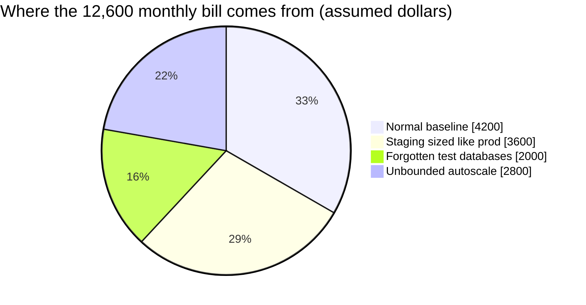
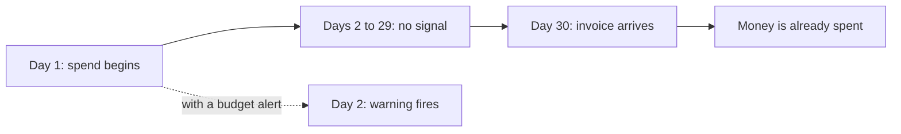

import Scenario from "../../../components/Scenario.astro";
import LevelIntro from "../../../components/LevelIntro.astro";
import PracticeCheck from "../../../components/PracticeCheck.astro";

export const unit = { track: "infra-delivery", unitSlug: "cost-awareness" };

<Scenario label="A tap left running for a month. Who notices, and when?">
  <Fragment slot="facts">
    

      
🚰 <strong>Day 1</strong> — a garden tap is left on a slow drip

      
🔇 <strong>Days 2 to 29</strong> — no sound, no alarm, nothing looks wrong

      
🧾 <strong>Day 30</strong> — the water bill arrives, far higher than usual

    

    

      
Same story in the cloud (round-number assumptions)

      

        Staging sized like prod
        

          

        

        $3,600/mo
      

      

        Forgotten test DBs
        

          

        

        $2,000/mo
      

      

        Unbounded autoscale
        

          

        

        $2,800/mo
      

    

  </Fragment>

You leave a garden tap dripping before a month away. Nothing about a drip
makes a sound. The only signal is the water bill, and it arrives after the
water is already gone. **Would you rather find out on day 2 or on day
30?**

A cloud account behaves like that tap. A server, a database, or a storage
volume keeps billing every hour it exists, whether or not anybody uses it,
and the bill shows up weeks later. Suppose a small team's monthly bill
climbs from $4,200 to $12,600 over six months. No alarm fires, because
nothing is broken. Three quiet choices added $8,400 a month:

| Choice made months ago                    | Why it seemed fine                   | Added cost (assumed) |
| ----------------------------------------- | ------------------------------------ | -------------------- |
| A staging copy sized like production      | "In case we need to load-test it"    | $3,600/month         |
| Five test databases (assumed $400 each)   | Nobody was told to switch them off   | $2,000/month         |
| An auto-scaling group with no upper limit | "It will scale back down afterwards" | $2,800/month         |

All dollar figures in this unit are labelled round-number assumptions, not
real vendor prices. Their sum is exact: 3,600 + 2,000 + 2,800 = 8,400, and
4,200 + 8,400 = 12,600.

</Scenario>

<LevelIntro
  items={[
    "Idle and forgotten resources",
    "Right-sizing to measured usage",
    "Why cost needs its own visibility",
  ]}
/>

Two thirds of this bill (8,400 of 12,600) was added by choices that were
made once and never questioned again.

## What is an idle resource?

**Which of these is still costing money after the project that needed it
has ended?** All of them.

| Resource               | Why it is easy to forget            | Cheap habit that prevents it            |
| ---------------------- | ----------------------------------- | --------------------------------------- |
| Test database          | Created for a task, no one owns it  | Tag an owner and an expiry date         |
| Old staging stack      | Replaced by a new one, left running | Review the list of stacks on a schedule |
| Unattached disk volume | Survives when its server is deleted | Delete volumes together with the server |
| Idle load balancer     | Nothing sends it traffic any more   | Alert on resources with zero traffic    |

An idle resource is one that is still running and billing after the
purpose that justified it has ended. It never breaks anything, which is
exactly why it survives.

<PracticeCheck
  track={unit.track}
  unitSlug={unit.unitSlug}
  topicId="idle-resources"
/>

## What does right-sizing mean?

**Staging was bought as 16 vCPU, which is four times the 4 vCPU of work it
ever did at its busiest. Who was wrong?** Nobody was careless: the size was
a guess made before any usage data existed, and nobody went back once data
did.

| Question                             | Guess at purchase time | Measured later            |
| ------------------------------------ | ---------------------- | ------------------------- |
| Capacity bought                      | 16 vCPU                | 16 vCPU                   |
| Capacity actually needed             | "Maybe a lot"          | 4 vCPU at peak            |
| Monthly cost (assumed $225 per vCPU) | $3,600                 | $900 if sized to the peak |

Right-sizing means buying capacity to match **measured** peak usage plus a
deliberate safety margin, not a number that merely sounded safe.

<PracticeCheck
  track={unit.track}
  unitSlug={unit.unitSlug}
  topicId="right-sizing"
/>

## Why did nobody notice?

A crashed service pages someone within minutes. A cloud bill pages nobody
until the invoice lands. The same team that watches CPU, errors and
latency all day has no equivalent for money.

**Cost visibility** means building the missing signal: a dashboard of spend
by resource, a budget (a ceiling for the month), and an alert that fires
while there is still time to act.

<PracticeCheck
  track={unit.track}
  unitSlug={unit.unitSlug}
  topicId="cost-visibility"
/>

## What the next levels add

L2 turns right-sizing into a repeating loop, compares cost tracking with
the reliability tracking from `infra-observability`, and shows why an
auto-scaling group needs a ceiling. L3 works through the arithmetic of
safety margins and a spend forecast.

**Key terms:** idle resource, right-sizing, safety margin, cost visibility,
budget, budget alert.
