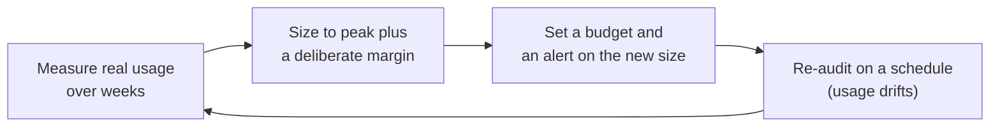
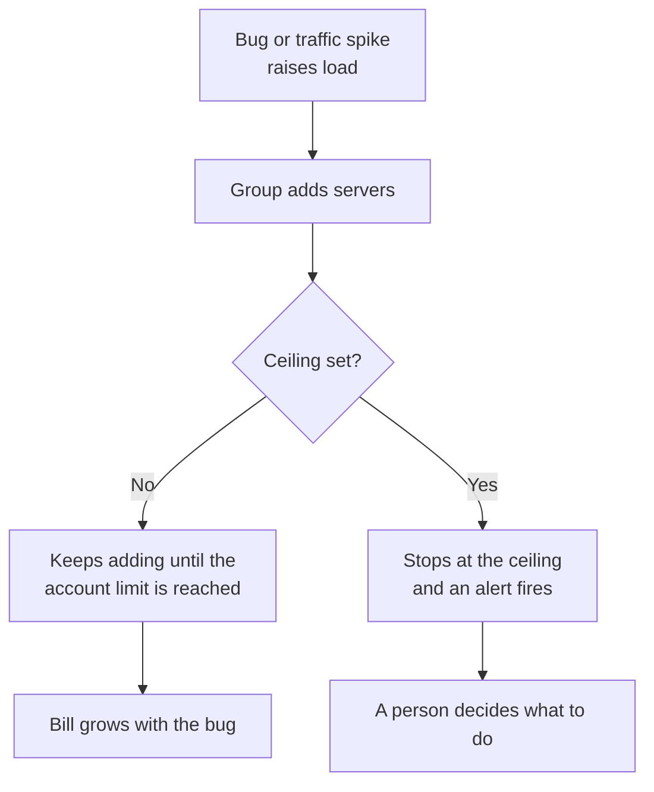

import LevelIntro from "../../../components/LevelIntro.astro";
import Checkpoint from "../../../components/Checkpoint.astro";
import PracticeCheck from "../../../components/PracticeCheck.astro";

export const unit = { track: "infra-delivery", unitSlug: "cost-awareness" };

L1 ended with a bill that tripled without a single incident, because
nothing was watching the running total. L2 explains the machinery that
would have caught it: a loop for sizing, a signal for spend, and a ceiling
for anything that grows by itself.

<LevelIntro
  items={[
    "Right-sizing as a repeating loop",
    "Cost tracking beside reliability tracking",
    "A ceiling and an alert for auto-scaling",
  ]}
/>

## Why is right-sizing a loop and not a one-time decision?

**Staging was sized once, before any usage data existed. What should have
happened the day data did exist?** Someone should have measured, resized,
and then come back later, because usage drifts.

Skip the last arrow and the loop becomes a one-time snapshot. A snapshot
goes stale the way the original guess did.

A rare, predictable peak does not change this. Suppose, as an assumption,
that staging does 4 vCPU of work on a normal day and 12 vCPU of work for two
days each quarter during a load test, at $225 per vCPU-month:

| Plan                                          | Cost per quarter | How it is computed               |
| --------------------------------------------- | ---------------- | -------------------------------- |
| Keep 12 vCPU all quarter "to cover the test"  | $8,100           | 12 x 225 x 3 months              |
| Keep 4 vCPU, add 8 vCPU for the two test days | $2,820           | 4 x 225 x 3, plus 8 x 225 x 2/30 |

<Checkpoint question="The load test really does need 12 vCPU, for two days once a quarter. Does that justify keeping staging at 12 vCPU permanently?">

No. A need that exists for two days is a reason to scale up for two days,
not to pay for the peak on the other 88. Permanent peak sizing is the same
over-provisioning mistake with a more respectable number attached. The
table above shows the gap: $8,100 against $2,820 per quarter, for the same
test.

</Checkpoint>

<PracticeCheck
  track={unit.track}
  unitSlug={unit.unitSlug}
  topicId="sizing-loop"
/>

## How does cost tracking line up with reliability tracking?

**The team already watches errors and latency. What is the money
equivalent of each tool it uses?** Almost every reliability tool has a
cost twin:

| Reliability tool (infra-observability)           | Cost twin                                       |
| ------------------------------------------------ | ----------------------------------------------- |
| Dashboard of the key signals                     | Dashboard of spend by resource and by owner     |
| SLO: a committed target for a period             | Budget: a committed spending ceiling            |
| Burn-rate alert: fires before the budget is gone | Forecast alert: fires before the ceiling is hit |
| Review of targets as traffic changes             | Right-sizing re-audit as usage changes          |

The difference is only the default. Reliability tools get built because
an outage hurts immediately. Spend tools are optional until a bill hurts,
so someone has to decide to build them.

## How can an auto-scaling group run up a bill by itself?

**A retry bug doubles every request. The group adds servers to cope. With
no upper limit, where does it stop?** Only at the limit of the account.

Assume a group runs 4 servers normally, at $200 per server-month. If a
retry storm pushes it to 18 servers and it stays there, the extra cost is
(18 - 4) x 200 = $2,800 a month. A ceiling turns an open-ended risk into a
known worst case:

| Ceiling    | Worst-case monthly cost (all month at the ceiling) |
| ---------- | -------------------------------------------------- |
| 8 servers  | $1,600                                             |
| 12 servers | $2,400                                             |
| 18 servers | $3,600                                             |
| No ceiling | Whatever the account limit allows                  |

A ceiling alone is not enough: if the group quietly sits at its maximum,
nobody learns that demand outgrew it. The ceiling and the alert belong
together.

<Checkpoint question="The group hits its ceiling of 12 servers and an alert fires at 2 a.m. Is the ceiling a failure of the setup, or the setup working?">

The setup working. The ceiling capped the worst-case bill at $2,400 a
month and the alert handed the decision to a person. The cost is that
traffic above 12 servers' capacity is no longer absorbed, which is why the
ceiling should come from an agreed worst case, not from the lowest number
that sounds cheap. L3 returns to that tension.

</Checkpoint>

<PracticeCheck
  track={unit.track}
  unitSlug={unit.unitSlug}
  topicId="autoscale-ceiling"
/>

## What L3 adds

L3 puts numbers on the safety margin, forecasts a month's spend from the
first ten days, and asks what happens when each guardrail is pushed too
far.
