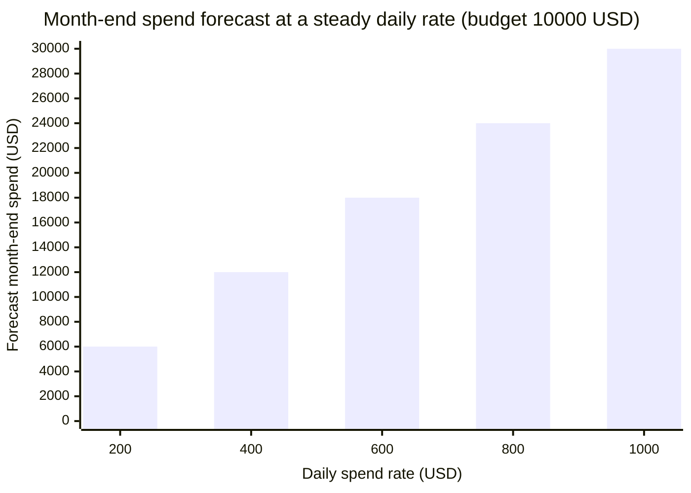

import Scenario from "../../../components/Scenario.astro";
import LevelIntro from "../../../components/LevelIntro.astro";
import Checkpoint from "../../../components/Checkpoint.astro";
import PracticeCheck from "../../../components/PracticeCheck.astro";

export const unit = { track: "infra-delivery", unitSlug: "cost-awareness" };

<Scenario label="10 GB of phone data for the month. On day 10, 8 GB are gone. Is that fine?">
  <Fragment slot="facts">
    

      
📱 <strong>Allowance</strong> — 10 GB for a 30-day month

      
📅 <strong>Day 10</strong> — 8 GB already used

      
🔮 <strong>Pace</strong> — 0.8 GB a day, so 24 GB by day 30

    

    

      

        Used on day 10
        

          

        

        8 GB
      

      

        Allowance
        

          

        

        10 GB
      

      

        Forecast, day 30
        

          

        

        24 GB
      

    

  </Fragment>

You have 10 GB of phone data for a 30-day month and, on day 10, 8 GB are
used. Only 8 of 10 is used, so you are still under the limit. **Is it
safe to relax?**

No. At that pace you burn 0.8 GB a day, which is 24 GB by the end of the
month, far over 10. "How much have I used" cannot answer "will I run out";
only the pace can. A cloud budget works the same way, and the same pace
reasoning also decides how big a safety margin can safely be.

</Scenario>

<LevelIntro
  items={[
    "Forecasting month-end spend from the pace",
    "Sizing the safety margin with real arithmetic",
    "What breaks when a guardrail is pushed too far",
  ]}
/>

## How do you forecast a month's spend from its first days?

**A $10,000 budget, 30 days, $8,000 spent by day 10. What do you compute
first?** The daily pace, then project it to the end of the period:

1. Pace = spend so far divided by days elapsed.
2. Forecast = pace multiplied by days in the period.
3. Compare the forecast, not the spend so far, to the budget.

The thresholds below are an assumption this unit uses: warn at 95 percent
of budget or more, escalate at 110 percent or more.

| Case (budget 10,000, day 10 of 30) | Spent so far | Pace per day | Forecast | % of budget | Verdict  |
| ---------------------------------- | ------------ | ------------ | -------- | ----------- | -------- |
| Healthy month                      | 3,000        | 300          | 9,000    | 90          | On track |
| Runaway pace                       | 8,000        | 800          | 24,000   | 240         | Escalate |
| Quiet drift (worked below)         | 3,200        | 320          | 9,600    | 96          | Watch    |

The break-even pace is 10,000 divided by 30, about $333 a day. Every bar
to the right of it ends the month over budget, and the slider on this page
lets you find that line yourself.

<Checkpoint question="Spend so far is 8,000 against a 10,000 budget on day 10, so the budget is not exceeded yet. Why is that the wrong thing to check?">

Because the budget is not the question; the pace is. At 800 a day the
remaining 20 days add 16,000, so the month ends at 24,000. The raw total
only turns red after the damage is done, while the forecast turns red on
day 10, with 20 days left to act.

</Checkpoint>

**Where does the straight-line pace mislead?** It averages the whole
period, so a recent jump is diluted. Say days 1 to 7 cost 200 a day (1,400
total) and days 8 to 10 cost 600 a day (1,800 total): 3,200 by day 10.

| Method                               | Pace used | Forecast                  | Verdict  |
| ------------------------------------ | --------- | ------------------------- | -------- |
| Whole-period average                 | 320 a day | 320 x 30 = 9,600          | Watch    |
| Trailing 3 days, applied to the rest | 600 a day | 3,200 + 600 x 20 = 15,200 | Escalate |

Same data, two verdicts. The average says "near the limit"; the recent pace
says "heading for 152 percent". A good alert uses both: the long window
avoids noise, the short window catches a change that has just started.

<PracticeCheck
  track={unit.track}
  unitSlug={unit.unitSlug}
  topicId="budget-forecast"
/>

## How big should the safety margin be, and what breaks at the extremes?

**If staging only ever does 4 vCPU of work, why not buy exactly 4?**
Because the next spike will not be polite. Using the L2 assumption of $225
per vCPU-month, with the multiplier applied to the measured 4 vCPU:

| Margin over measured peak | vCPU needed | vCPU bought (whole units) | Monthly cost | Saved against 16 vCPU ($3,600) |
| ------------------------- | ----------- | ------------------------- | ------------ | ------------------------------ |
| 1.0x (no margin)          | 4.0         | 4                         | $900         | $2,700                         |
| 1.3x                      | 5.2         | 6                         | $1,350       | $2,250                         |
| 2.0x                      | 8.0         | 8                         | $1,800       | $1,800                         |
| 4.0x (the original guess) | 16.0        | 16                        | $3,600       | $0                             |

Servers come in whole units, so 5.2 is rounded up to 6. The slider on this
page draws the smooth line (1.3x shows $1,170); the table shows what you
actually pay after rounding.

<Checkpoint question="Rounding 5.2 vCPU to 5 instead of 6 would save another $225 a month. Why would a careful sizing rule round up?">

Rounding down quietly removes margin you decided to keep: 5 vCPU is a 1.25x
margin, not the 1.3x chosen. The $225 saved is small and certain, while the
cost of too little capacity is rare and large. A rule that rounds up makes
the margin a floor, which is the point of having one.

</Checkpoint>

Both guardrails from this unit can be pushed until they cause the very
failure they were meant to avoid:

| Pushed too far                               | What breaks                                                 | Who feels it         |
| -------------------------------------------- | ----------------------------------------------------------- | -------------------- |
| Sizing to the bare measured peak (1.0x)      | One spike above anything seen before saturates the resource | Users, as an outage  |
| An auto-scaling ceiling below real demand    | Legitimate traffic is capped instead of absorbed            | Users, as slowness   |
| Alerting on every small bump in the forecast | The alert is ignored, then the real one is missed           | The team, as fatigue |

Cost and reliability pull in opposite directions. Neither wins by default:
the margin and the ceiling are deliberate compromises, chosen from measured
data and an agreed worst case, not from the lowest number on the page.

<PracticeCheck
  track={unit.track}
  unitSlug={unit.unitSlug}
  topicId="savings-tradeoffs"
/>

## This is a case, not the whole territory

Everything above used one steady staging environment and one steady
budget. **What changes if the load is seasonal, with a predictable spike in
the last week of every month? What changes if the resource is a database
cluster shared by five teams?** For the first, work out why a flat daily
average would raise a false alarm in week 3 and what it should be compared
against instead. For the second, decide who owns the savings from
right-sizing and the overrun from a spike, then compare your answer with a
neighbour's.
