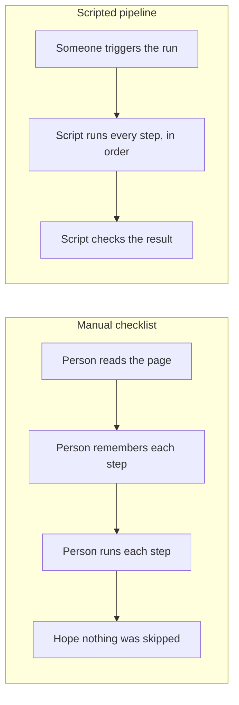

import Scenario from "../../../components/Scenario.astro";
import LevelIntro from "../../../components/LevelIntro.astro";
import PracticeCheck from "../../../components/PracticeCheck.astro";

export const unit = {
  track: "infra-delivery",
  unitSlug: "deployment-automation",
};

<Scenario label="A four-line checklist, and the one line that got skipped">
  <Fragment slot="facts">
    

      
📋 <strong>The checklist</strong> — pull the code, install packages, restart

      
✅ <strong>Releases 1 to 8</strong> — every line done, no incident

      
⚡ <strong>Release 9</strong> — a different person, in a hurry, skips "install packages"

      
💥 <strong>Result</strong> — the service crashes on restart

    

    

      
The checklist did not change

      only the person following it did
    

  </Fragment>

Priya's team releases their app by following a checklist on a wiki page.
Someone logs into the live server, runs `git pull` to fetch the newest
code, runs `npm install` to fetch the outside packages that code needs,
and restarts the service. It has worked eight times in a row. On release
9 a teammate, Tomas, is rushed. The new code needs a new package, but he
skips `npm install` because "it usually doesn't matter." The service
crashes the moment it restarts. **The steps on the page are identical to
the last eight releases. So what actually changed?**

</Scenario>

<LevelIntro
  items={[
    "Why a checklist eventually skips a step",
    "Repeatability, idempotency, atomic switch, rollback",
    "What a script enforces that a page cannot",
  ]}
/>

## The shape of the problem

A deploy is a short sequence of steps that must all happen, in order,
every time. Some plain-language terms first: **SSH** means "log into a
remote machine," the **production server** is the machine real users
depend on, a **dependency** is an outside package the code needs, and
**downtime** is any period when users cannot use the service.

- A written checklist is a **suggestion**: nothing stops a step from being skipped, reordered, or run twice.
- The failure is not about `npm install` in particular. The process is only as correct as the memory of whoever is running it that day.
- Eight clean releases are not evidence the process is safe, only that nobody had a bad day yet.

<PracticeCheck
  track={unit.track}
  unitSlug={unit.unitSlug}
  topicId="manual-failure"
/>

## Why does the risk grow as the checklist gets longer?

Suppose, as an assumption for illustration, that each manual step has a
2% chance of being missed or done wrong. A step that is skipped 2% of
the time sounds harmless. But the chance that **all** steps go right is
0.98 multiplied by itself once per step, so the chance of at least one
miss climbs fast:

| Steps in the checklist | Chance at least one step is missed (assumed 2% per step) |
| ---------------------- | -------------------------------------------------------- |
| 1                      | 2.0%                                                     |
| 5                      | 9.6%                                                     |
| 10                     | 18.3%                                                    |
| 20                     | 33.2%                                                    |

The 2% is an assumption, not a measurement. The point is the shape:
the chance of a miss grows with every step added, and a script's steps
do not get forgotten. The interactive demo on L2 lets you move the rate
and the step count.

## Key terms

| Term              | Plain-language meaning                                                                   |
| ----------------- | ---------------------------------------------------------------------------------------- |
| **Deployment**    | Taking a built version of the code and making it the one users reach                     |
| **Repeatability** | The same steps run the same way every time, whoever starts them                          |
| **Idempotency**   | Running the steps twice, or replaying after a failure, still ends in the same good state |
| **Atomic switch** | Moving users from the old version to the new in one indivisible step                     |
| **Rollback**      | Going back to the last known-good version when the new one fails its check               |

Idempotency has an everyday version: pressing "save" twice should not
create two copies of the same profile.

<PracticeCheck
  track={unit.track}
  unitSlug={unit.unitSlug}
  topicId="deploy-vocabulary"
/>

## What the next levels add

L2 walks through what a scripted pipeline looks like: the fixed step
order, why the health check sits before the switch, and how rollback
becomes automatic. L3 models the pipeline as data and as a small
function, and explores what happens when the health check is flaky.
