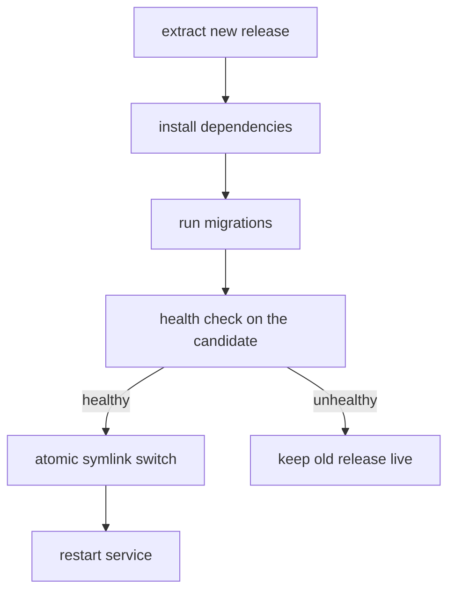
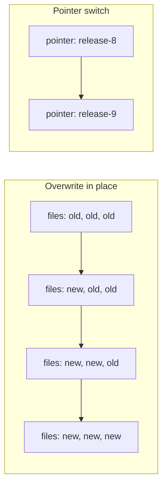

import LevelIntro from "../../../components/LevelIntro.astro";
import Checkpoint from "../../../components/Checkpoint.astro";
import PracticeCheck from "../../../components/PracticeCheck.astro";

export const unit = {
  track: "infra-delivery",
  unitSlug: "deployment-automation",
};

L1 named the failure behind release 9: a checklist depends on a person
remembering and sequencing every step. L2 shows what a scripted pipeline
looks like, step by step, and why each part is something a checklist
cannot guarantee.

<LevelIntro
  items={[
    "The fixed step order of a pipeline",
    "Why the health check precedes the switch",
    "Rollback that runs without anyone remembering",
  ]}
/>

## If the steps were written down, why did skipping one still cause an outage?

A wiki page is a suggestion. A script is a fixed sequence a machine runs
the same way every time, with no step optional and none reachable out of
order. First, the words translated into ordinary objects:

| Term                  | Read it as                                                            |
| --------------------- | --------------------------------------------------------------------- |
| Release directory     | A separate folder holding one complete version of the app             |
| Traffic               | The real user requests arriving at the service                        |
| Health check          | An automatic question: "does this candidate version answer?"          |
| Migration             | A database shape change the new code needs before it can run          |
| Atomic symlink switch | Changing one pointer so users move from old folder to new in one step |

**Why does the health check sit before the switch, not after?** The
check exists to decide whether traffic should ever reach the new
release. Checked after the switch, users would already be hitting the
broken version. In a real pipeline the check probes a candidate process,
a temporary port, or a preview route while the old release is still
serving everyone. Extract, install, migrate, and check all happen while
the old release stays live.

<Checkpoint question="In the diagram, extract, install, migrate, and the health check all run while the old release serves users. If an incident showed users briefly received a mix of old and new code, which step would you suspect first, and why?">

The atomic symlink switch, or whatever was supposed to make it atomic.
Every earlier step works on a release directory nobody is routed to yet,
so none of them should be visible to users. If a mix of old and new code
reached users, the boundary meant to prevent that is the first place to
look, for example new files being written straight into the live folder
instead of a separate one.

</Checkpoint>

<PracticeCheck
  track={unit.track}
  unitSlug={unit.unitSlug}
  topicId="pipeline-order"
/>

## What does "atomic" actually buy you?

**Could the pipeline just overwrite the old files in place?** It could,
but then for a short window some files belong to the old version and
some to the new, and a request arriving in that window can read a mix. A
symlink is a single pointer, and it names either the old folder or the
new one, never something in between.

The left column has two in-between states a request could land in. The
right column has none: there is no state between "points at release 8"
and "points at release 9."

<PracticeCheck
  track={unit.track}
  unitSlug={unit.unitSlug}
  topicId="atomic-switch"
/>

## Rollback is automatic, not remembered

**What would have prevented the release 9 outage?** Not a stricter
checklist. A health check that runs before traffic reaches the new
release, wired so that a failure keeps the old release live. Nobody has
to notice the crash, page anyone, or recall a rollback command: the
pipeline's next step is the rollback, conditioned on the check.

| Question                   | Manual checklist                            | Scripted pipeline                               |
| -------------------------- | ------------------------------------------- | ----------------------------------------------- |
| Who enforces step order?   | Memory and documentation                    | The script itself                               |
| What if a step is skipped? | Possible, often invisible until it fails    | Not reachable, every step runs unconditionally  |
| How is a bad deploy found? | Someone notices symptoms, then investigates | The health check runs before traffic switches   |
| How is recovery done?      | Someone re-runs the old steps by hand       | The rollback branch runs on the check's failure |

A related word from L1: a pipeline that is **idempotent** can be
re-run after a partial failure and still end in the right state, rather
than needing a person to work out which steps already happened.

<Checkpoint question="The table says a scripted pipeline detects a bad deploy 'before traffic switches.' Would a health check that only ran after 'restart service' still catch release 9's mistake before users were affected?">

No. By the time the service restarts, the switch has already happened
and real traffic is going to the new release. A check placed there can
still detect the failure and trigger a rollback, but users have already
been served the broken version in the meantime. That is the manual
column's "someone notices symptoms" in automated clothing. Placing the
check strictly before the switch is what turns "detect and recover" into
"prevent."

</Checkpoint>

<PracticeCheck
  track={unit.track}
  unitSlug={unit.unitSlug}
  topicId="auto-rollback"
/>

## Is this really about one package install?

No. Any process where a person is trusted to remember and sequence
several steps will eventually fail that trust, not through carelessness
but because memory under time pressure is not a substitute for a machine
doing the same thing every time. The fix generalizes to any multi-step
operational process: the fewer steps that depend on a person doing the
right thing in the right order, the fewer ways an ordinary day becomes
an incident.

## What L3 adds

L3 turns the pipeline into data and a small function so you can see why
a scripted list cannot lose a step, then asks what happens when the
health check itself is unreliable.
