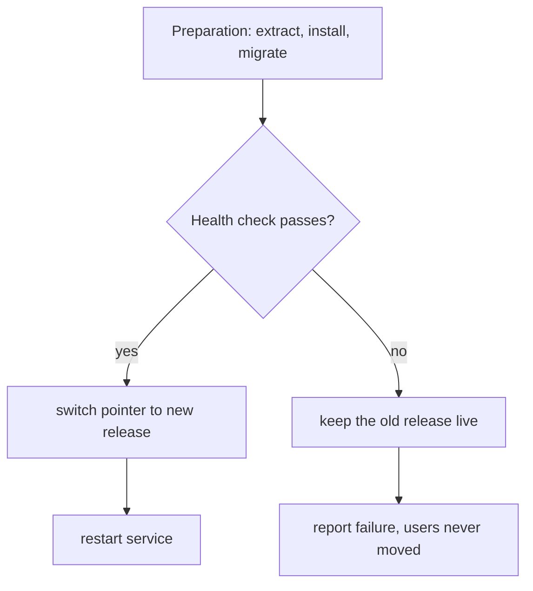

import Scenario from "../../../components/Scenario.astro";
import LevelIntro from "../../../components/LevelIntro.astro";
import Checkpoint from "../../../components/Checkpoint.astro";
import PracticeCheck from "../../../components/PracticeCheck.astro";

export const unit = {
  track: "infra-delivery",
  unitSlug: "deployment-automation",
};

<Scenario label="Two lists of steps, one of them missing a line">
  <Fragment slot="facts">
    <div class="not-prose flex flex-col gap-2 text-sm text-slate-700 dark:text-slate-300">
      <div class="flex items-center gap-1.5"><span>📝</span> <strong>Typed list</strong> — written from memory, "install" left out</div>
      <div class="flex items-center gap-1.5"><span>🤖</span> <strong>Built list</strong> — produced by one function, "install" always present</div>
      <div class="flex items-center gap-1.5"><span>🔍</span> <strong>Both</strong> — end up as plain lists of names</div>
    </div>
  </Fragment>

Both lists end up as plain lists of step names. **If a list typed by hand
and a list built by a function look identical on the page, what actually
stops the typed one from being incomplete in a way the built one cannot
be?** Predict an answer before reading on.

</Scenario>

<LevelIntro
  items={[
    "A pipeline built by one function",
    "The gated deploy, step by step",
    "A flaky check and the retry trade-off",
  ]}
/>

## What stops a built list from losing a step?

```js
function buildDeploySteps(currentRelease, newRelease) {
  return [
    `extract:${newRelease}`,
    `install-deps:${newRelease}`,
    `run-migrations:${newRelease}`,
    `switch-symlink:${currentRelease}->${newRelease}`,
    "restart-service",
  ];
}
```

Here code is the clearest vehicle, because the point is a fact about
where the list comes from. Every call returns the same five steps in the
same order, whoever is tired or hurried. A typed list can silently lose
`install-deps`; this one cannot, because no path through the function
skips that line. The only way to change the list is to edit the
function, which is a visible, reviewable change.

| Question                     | Typed from memory               | Built by `buildDeploySteps`       |
| ---------------------------- | ------------------------------- | --------------------------------- |
| Can a step vanish unnoticed? | Yes, nothing records the intent | No, the function is the record    |
| How does the list change?    | Whoever types it that day       | A reviewed edit with a name on it |
| Same steps on every run?     | Only if the person is careful   | Always                            |

<Checkpoint question="Someone edits buildDeploySteps and accidentally deletes the install-deps line, and review misses it. Is the pipeline now exactly as unsafe as the manual checklist?">

Not in the same way, even though the symptom looks identical. The manual
failure was that the steps could silently differ from one run to the
next, and nothing recorded what should have run. After the bad edit the
list is wrong, but it is wrong the same way on every run, and the change
that caused it sits in version control with an author and a date. That
is an ordinary code-review miss: still worth catching, but far more
tractable than depending on perfect memory under time pressure.

</Checkpoint>

## How does a gated deploy decide whether to switch?

L2 put the health check before the switch. Splitting the steps into
"preparation" and "the one step that touches user traffic" makes the
rule explicit: the check runs after preparation, and the switch happens
only if it passes.



On a failed check the deploy never points users at the new release, so
"rollback" here means "never switched." A real system may implement the
check with a temporary port, a preview route, or a separate process, but
the rule is the same: test before traffic depends on it.

<Checkpoint question="The gate calls the health check exactly once. If that one call fails on a release that is actually fine because the service had not finished starting, what happens, and is that right?">

The gate treats the single failure as decisive: it keeps the old release
live and reports failure, even though the new release was never broken.
That is the right behavior for the case the gate exists to catch, a
genuinely unhealthy release. It is the wrong behavior for a healthy
release that is slow to warm up, since it abandons a deploy that needed
no abandoning. One pass-or-fail call cannot tell those two apart, which
is the gap the next section addresses.

</Checkpoint>

<PracticeCheck
  track={unit.track}
  unitSlug={unit.unitSlug}
  topicId="gated-deploy"
/>

## What if the health check is flaky, not just pass or fail?

**A freshly started service may need a few moments, so its first checks
fail even on a good release. Should one failure trigger giving up?** A
more realistic check retries a few times before deciding. Assume, for
illustration, that a healthy release fails its first two checks and
passes the third, and that checks are 10 seconds apart:

| Attempts allowed | Result for a healthy-but-slow release | Result for a truly broken release | Wait before giving up |
| ---------------- | ------------------------------------- | --------------------------------- | --------------------- |
| 1                | Rolled back by mistake                | Caught                            | 10 s                  |
| 2                | Rolled back by mistake                | Caught                            | 20 s                  |
| 3                | Passes on the third check             | Caught                            | 30 s                  |
| 5                | Passes on the third check             | Caught                            | 50 s                  |

The first two rows reject a good deploy. Rows three and four pass it,
and the cost of extra attempts shows in the last column: a release that
is truly broken stays a candidate longer before the pipeline gives up.
Too few attempts roll back healthy deploys. Too many delay the verdict
on broken ones.

<PracticeCheck
  track={unit.track}
  unitSlug={unit.unitSlug}
  topicId="retry-tradeoff"
/>

## Writing the pipeline's checks yourself

Four small checks recur in a pipeline like this one: which required steps
did not run, did the ones that ran keep their order, how long to keep
retrying, and which branch the gate takes. They are short enough to write
in a few lines each, and writing them is where the edge cases show up: an
empty list of required steps, extra steps that are allowed, and stopping
at the first passing check instead of calling it every time.

<PracticeCheck
  track={unit.track}
  unitSlug={unit.unitSlug}
  topicId="pipeline-code"
/>

## This is a case, not the whole territory

Everything above used one release, one check, and a fixed 10-second gap.
**What would change if the warm-up took five checks instead of three? At
what attempt count does the pipeline start rolling back a deploy that
was actually fine? And what if the check were run against a database
migration rather than a web server: could a retry hide a real problem?**
The worked example gives you a shape; your own system decides the numbers.

## Failure modes

| Failure mode                                      | What it gets wrong                                            |
| ------------------------------------------------- | ------------------------------------------------------------- |
| Treating a wiki checklist as equal to a script    | It documents the steps but does not enforce that they all ran |
| Running the health check after the switch         | Traffic already reached the new release before anyone knew    |
| Overwriting release files in place                | Some requests read old files and some read new ones           |
| Assuming "it worked eight times" means it is safe | Safety depends on the person running it, not on the process   |
| Giving a flaky check zero retries                 | A slow but healthy deploy is abandoned for no real reason     |
