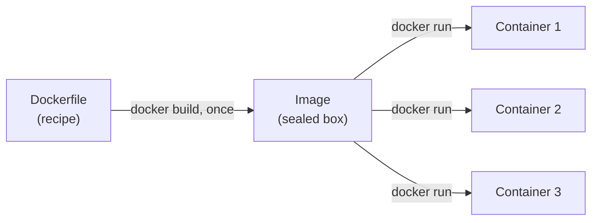
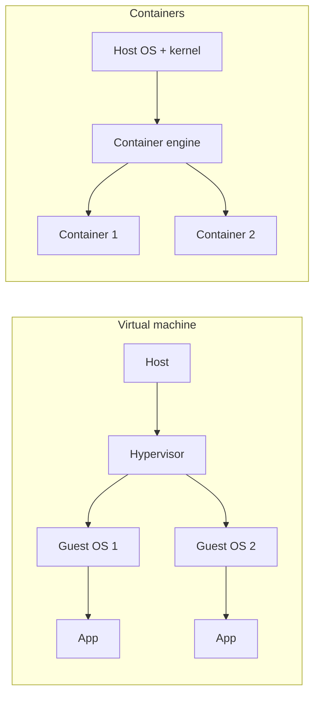

import Scenario from "../../../components/Scenario.astro";
import LevelIntro from "../../../components/LevelIntro.astro";
import PracticeCheck from "../../../components/PracticeCheck.astro";

export const unit = { track: "infra-delivery", unitSlug: "docker" };

<Scenario label="Two ways to feed a friend who lives far away">
  <Fragment slot="facts">
    

      
📝 <strong>Send a recipe</strong> — the friend cooks it with whatever their kitchen has

      
🍱 <strong>Send a packed lunchbox</strong> — sandwich, fork and napkin all inside

    

    

      

        
Recipe

        Result depends on the friend's kitchen
      

      

        
Lunchbox

        Same meal wherever it is opened
      

    

  </Fragment>

Lena wants her friend Omar to taste her soup. She texts him the recipe, and
his soup comes out thin: his stove is weaker, his pot is smaller, and he has
no bay leaf. The recipe was identical. His kitchen was not. So next time
she packs the soup in a sealed lunchbox, spoon included, and mails it.
**What changed? She stopped depending on his kitchen.**

Software has exactly this problem. An app that works on one laptop can fail
on a server because the language version or a system library differs. Docker
is the lunchbox: it packs the app together with everything it assumes about
its surroundings.

</Scenario>

<LevelIntro
  items={[
    "Dockerfile, image, container, registry",
    "Why the same image runs the same way",
    "Containers compared with virtual machines",
  ]}
/>

## What are the pieces?

| Lunchbox picture                     | Docker word | What it is                                           |
| ------------------------------------ | ----------- | ---------------------------------------------------- |
| The recipe for packing               | Dockerfile  | A short text file of build instructions              |
| The sealed lunchbox                  | Image       | The packed app plus its runtime, fixed once built    |
| A lunchbox opened and being eaten    | Container   | An image started as a running process                |
| The warehouse that stores lunchboxes | Registry    | A store where images are kept and pulled by name/tag |
| The compartments inside the box      | Layers      | The stacked pieces an image is built from            |

## Image versus container

- An **image** is built once per version and never changes afterwards.
- A **container** is a running instance of an image. Start it three times and there are three containers and still one image.
- Anything a container writes while running stays in its own top layer and disappears when the container is removed.
- Because the app and its assumptions travel inside the image, the laptop-versus-server gap closes: both run the same packed thing.

<PracticeCheck
  track={unit.track}
  unitSlug={unit.unitSlug}
  topicId="image-vs-container"
/>

## Containers versus virtual machines

- A virtual machine carries a whole guest operating system. A container carries only the app and its files and borrows the host's kernel.
- Result: containers start much faster and use less space, in return for a thinner wall between neighbours. That is a trade-off, not a defect.

<PracticeCheck
  track={unit.track}
  unitSlug={unit.unitSlug}
  topicId="containers-vs-vms"
/>

## What the next levels add

L2 looks inside an image: how layers are cached, why instruction order
decides rebuild speed, how multi-stage builds trim what ships, and how a
registry moves one exact image between machines. L3 turns the cache rule
into a function and covers what the build is actually sent.
