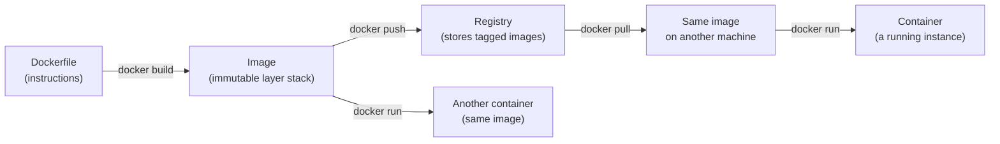
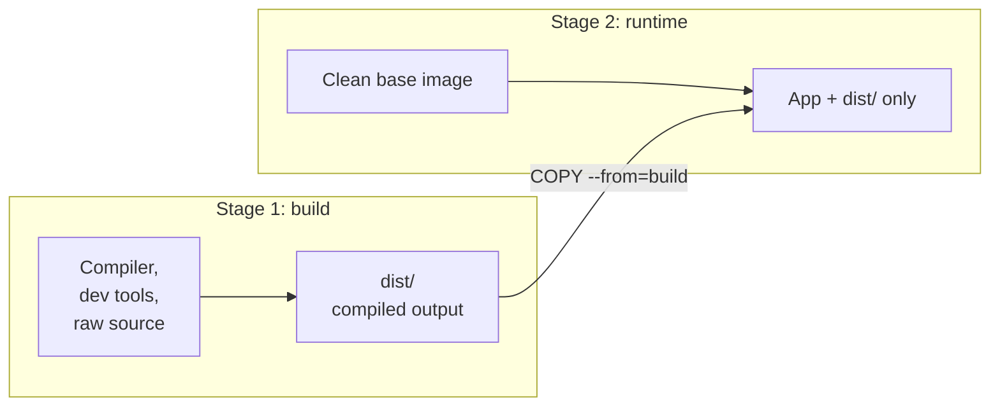

import Scenario from "../../../components/Scenario.astro";
import LevelIntro from "../../../components/LevelIntro.astro";
import Checkpoint from "../../../components/Checkpoint.astro";
import PracticeCheck from "../../../components/PracticeCheck.astro";

export const unit = { track: "infra-delivery", unitSlug: "docker" };

<Scenario label="Unpacking the whole lunchbox because one sticker changed">
  <Fragment slot="facts">
    <div class="not-prose flex flex-col gap-1.5 text-sm text-slate-700 dark:text-slate-300">
      <div class="flex items-center gap-1.5"><span>📝</span> Edited: <code>server.js</code> only</div>
      <div class="flex items-center gap-1.5"><span>📦</span> Dependencies: unchanged</div>
      <div class="flex items-center gap-1.5"><span>⏱️</span> Rebuild took about 20 s, as long as the first build (assumed numbers)</div>
    </div>
    <div class="not-prose mt-3 rounded border border-amber-300 bg-amber-50 p-1.5 text-xs dark:border-amber-800 dark:bg-amber-950">
      A one-line edit re-ran the dependency install. The install did not need to happen again, but the Dockerfile made it happen anyway.
    </div>
  </Fragment>

Imagine repacking a lunchbox that has a sandwich, a thermos and a sticker on
the lid. You change the sticker, and your helper unwraps the sandwich and
refills the thermos before putting the new sticker on. Silly, because the
sticker is on the outside. A teammate hits the same thing with Docker: they
edit one line in `server.js`, nothing in the dependencies, and
`docker build` still takes about 20 seconds, as long as the very first build.

**If the install is the expensive step and the dependencies did not change,
why did it run again?**

</Scenario>

The answer is not a caching bug. It is a Dockerfile that puts the expensive
step in the wrong place relative to what actually changes. To see why, look
at where layers sit between a Dockerfile and a running container.

<LevelIntro
  items={[
    "How a Dockerfile becomes an image, then containers",
    "What decides whether a layer reruns or is reused",
    "How multi-stage builds and registries finish the job",
  ]}
/>

## Where do layers fit between a Dockerfile and a running container?



Each important Dockerfile instruction adds one layer. As a first model,
that is accurate enough; in detail, instructions such as `CMD` or `ENV` only
update the image's metadata instead of adding files. A container adds one
thin writable layer on top of the read-only stack, and that is the only part
that disappears when the container is removed.

## What decides whether a layer reruns?

A well-ordered Node Dockerfile has five layers, from the bottom up:

```dockerfile
FROM node:20-slim                          # 1  base image
WORKDIR /app                               # 2
COPY package.json package-lock.json ./     # 3  key: those two files' content
RUN npm ci                                 # 4  key: layer 3 plus the command
COPY . .                                   # 5  key: the whole source tree
```

Each layer is cached by a fingerprint of its inputs plus the layer beneath
it. A change forces that layer and every layer above it to rebuild:

| If this changes            | Docker must rebuild                           |
| -------------------------- | --------------------------------------------- |
| Only `server.js`           | Layer 5 (the source copy)                     |
| `package.json` or lockfile | Layers 3, 4 and 5                             |
| The base image tag         | Everything after `FROM`, which is every layer |
| Nothing                    | Nothing; every layer is reused from cache     |

Here is the cost in assumed, illustrative numbers: the install takes 20 s and
the source copy plus export takes 0.5 s. With this order, a source edit costs
0.5 s and a dependency change costs 20.5 s. If `COPY . .` came before the
install, every source edit would also invalidate the install, and the
teammate's 20.5 s would be the normal cost of every edit. The interactive
demo on this page lets you move these numbers.

<Checkpoint question="A Dockerfile copies the whole project with COPY . . as its very first step, then installs dependencies. A teammate edits only a README. Will the install rerun on the next build, and why?">

Yes, and it is the same failure as the `server.js` edit, caused by an even
smaller change. The install layer sits above a copy whose input is the
entire source tree, and a README is part of that tree. Docker cannot know
the README is irrelevant to the install; it only sees that the copy layer's
inputs changed, so everything above it is invalid. The general fix is not
"ignore README edits" but the order already shown: copy only the manifest
files, install, and copy the rest of the source last.

</Checkpoint>

<PracticeCheck
  track={unit.track}
  unitSlug={unit.unitSlug}
  topicId="layer-cache-order"
/>

## What happens to the build tools once the app is shipped?

A single-stage image keeps everything it ever used: compilers, dev
dependencies and raw source. A multi-stage build uses one stage as a
workshop and a second, fresh stage as the delivery truck:



Only the line `COPY --from=build /app/dist ./dist` carries anything across.
The final image is stage 2, so it is smaller to pull and has fewer tools an
attacker could use if the container were ever compromised.

<Checkpoint question="Stage 1 writes compiled output to /app/dist. If stage 2 forgot the COPY --from=build line entirely, would /app/dist exist in the final image, and when would you find out?">

No. Each `FROM` starts a completely fresh stage and nothing from earlier
stages is carried over unless a `COPY --from` names it. The build would
still succeed, because every instruction ran fine. You would find out when
the container tried to run `node dist/server.js` and could not find it. The
same isolation is why the compiler and dev dependencies never reach the
final image either: nothing crosses by default.

</Checkpoint>

<PracticeCheck
  track={unit.track}
  unitSlug={unit.unitSlug}
  topicId="multi-stage-builds"
/>

## How does the image actually reach production?

A registry stores images by name and tag (`myapp:1.4.2`) and, underneath, by
a content digest. Pushing uploads only the layers the registry lacks;
pulling downloads only the layers the machine lacks. CI builds and pushes
one image, and every environment that pulls it gets the same bytes, which is
the fix for the laptop-versus-server gap rather than a rebuilt approximation.

| Reference               | What it points at                         | Safe to rely on for identical bytes? |
| ----------------------- | ----------------------------------------- | ------------------------------------ |
| `myapp:latest`          | Whatever was last tagged `latest`         | No, it moves                         |
| `myapp:1.4.2`           | A version label, usually not reused       | Mostly, by convention only           |
| `myapp@sha256:<digest>` | One exact image, derived from its content | Yes                                  |

<PracticeCheck
  track={unit.track}
  unitSlug={unit.unitSlug}
  topicId="registry-digests"
/>
