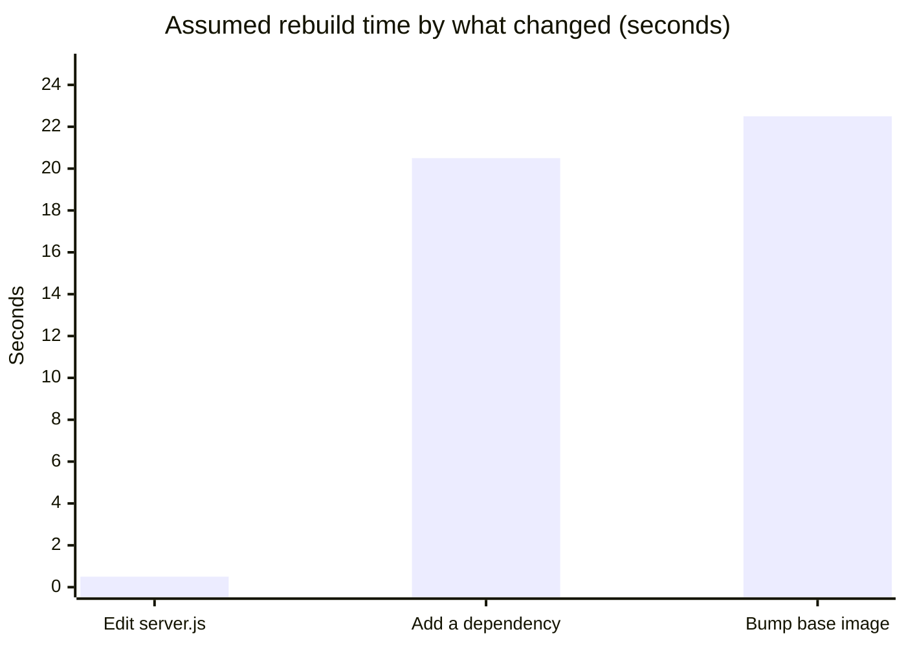
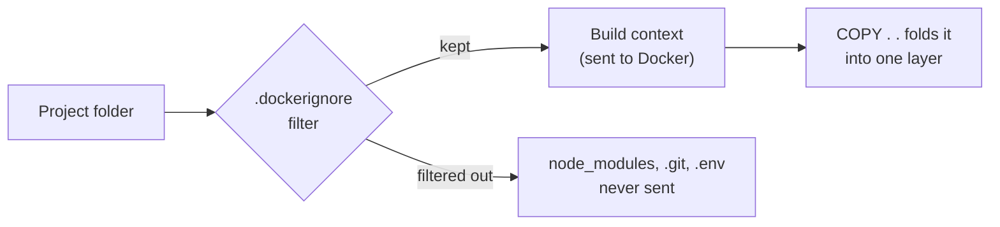

import Scenario from "../../../components/Scenario.astro";
import LevelIntro from "../../../components/LevelIntro.astro";
import Checkpoint from "../../../components/Checkpoint.astro";
import PracticeCheck from "../../../components/PracticeCheck.astro";

export const unit = { track: "infra-delivery", unitSlug: "docker" };

<Scenario label="Three edits, one Dockerfile: which one is slow?">
  <Fragment slot="facts">
    <div class="not-prose flex flex-col gap-2 text-sm text-slate-700 dark:text-slate-300">
      <div class="flex items-center gap-1.5"><span>✏️</span> <strong>Edit 1</strong> — change a line in <code>server.js</code></div>
      <div class="flex items-center gap-1.5"><span>📦</span> <strong>Edit 2</strong> — add one dependency to <code>package.json</code></div>
      <div class="flex items-center gap-1.5"><span>🧱</span> <strong>Edit 3</strong> — bump the base image's version tag</div>
    </div>
    <div class="not-prose mt-3 rounded border border-amber-300 bg-amber-50 p-1.5 text-xs dark:border-amber-800 dark:bg-amber-950">
      Same five-layer Dockerfile as L2. Predict the order of cost before reading on.
    </div>
  </Fragment>

Think of three ways to change a school lunch order. Swapping the napkin takes
a second. Swapping the sandwich filling means remaking the sandwich.
Switching to a different lunchbox means repacking everything inside it.
The cost depends on how deep the change sits in the stack. **For the same
five-layer Dockerfile as L2, which of the three edits above is cheapest, which
is most expensive, and can you say why before running anything?**

</Scenario>

L2 stated the cascade as a rule. L3 turns it into a prediction you can make
without running the build, and then looks at the other thing every build
quietly depends on: the folder it is sent.

<LevelIntro
  items={[
    "Predicting cost from the depth of a change",
    "The cache rule as a small testable function",
    "What the build context drags in",
  ]}
/>

## What does each of the three edits cost?

These are assumed, illustrative costs, not a benchmark, and they match the
defaults of the interactive demo on L2: the install takes 20 s, the source
copy plus export takes 0.5 s, and a base image pull is assumed to take 2 s.
Small steps such as `WORKDIR` and the manifest copy are treated as zero.

| Edit                    | First layer to rerun | Layers that rerun | Assumed cost          |
| ----------------------- | -------------------- | ----------------- | --------------------- |
| `server.js` only        | 5 (source copy)      | 5                 | 0.5 s                 |
| Add a dependency        | 3 (manifest copy)    | 3, 4, 5           | 20 + 0.5 = 20.5 s     |
| Bump the base image tag | 1 (`FROM`)           | 1, 2, 3, 4, 5     | 2 + 20 + 0.5 = 22.5 s |



The depth of the change decides the cost, not the size of the edit: a
one-line bump of a version tag costs the most, and a hundred-line edit to
source costs the least.

<Checkpoint question="A fourth build bumps the base image from node:20.11 to node:20.12 and changes nothing else. Which of the five layers show as cached?">

None. Layer 1 is the foundation every other layer is built on, so changing it
invalidates it, and the cascade rule says every layer above a rebuilt layer
rebuilds too, whether or not its own inputs changed. That is why a base-image
bump is the most expensive change to make casually: it throws away the whole
cache, not just the layer that technically changed.

</Checkpoint>

## Can the rule be written as a function?

Yes, and this is a case where code is the clearest vehicle, because the rule
is a tiny algorithm with one subtle point: the flag that never turns off.

1. Walk the layers from the top of the Dockerfile down.
2. A layer reruns if one of its own inputs changed.
3. Once one layer reruns, every later layer reruns too.
4. An edit to a later layer never forces an earlier one to rebuild.

```js
function computeRebuildPlan(layers, changed) {
  const rebuilt = [];
  let cascading = false;
  for (const layer of layers) {
    if (cascading || layer.inputs.some((i) => changed.includes(i))) {
      cascading = true;
      rebuilt.push(layer.name);
    }
  }
  return rebuilt;
}
```

With layers whose inputs are `image`, `pkg`, none, and `src`, changing
`pkg` returns the manifest copy, the install and the source copy: exactly
the middle row of the table above.

<PracticeCheck
  track={unit.track}
  unitSlug={unit.unitSlug}
  topicId="rebuild-plan"
/>

## What does the build get sent, and what does it fold into a layer?

Before any instruction runs, Docker receives the **build context**: the
folder you point `docker build` at. `COPY . .` then folds whatever is in that
folder into one layer and its cache key.



A `.dockerignore` works like a `.gitignore` (one pattern per line, relative to
the context root):

```
node_modules/
.git/
*.log
.env
```

| Mistake                       | What it quietly costs                                        |
| ----------------------------- | ------------------------------------------------------------ |
| No `.dockerignore`            | Large, irrelevant folders are sent and hashed on every build |
| `.git` left in the context    | The source layer's key changes with every commit             |
| `.env` left in the context    | A file of secrets can be copied into an image layer          |
| `COPY . .` before the install | Every source edit also invalidates the install (see L2)      |

<Checkpoint question="A project has a .dockerignore listing .env, and the Dockerfile still ends with COPY . . Can the image end up containing .env?">

No. The filter is applied before the build starts, so a path listed there is
never part of the context and `COPY . .` has nothing to reach. This is also
why `.dockerignore` is a security habit as well as a speed habit: it is the
one place that stops a secrets file from being copied into a layer by
accident. It does not protect a secret that was already baked into a layer in
an earlier version of the image.

</Checkpoint>

<PracticeCheck
  track={unit.track}
  unitSlug={unit.unitSlug}
  topicId="build-context-ignore"
/>

## Where else do these ideas apply?

The five-layer Node Dockerfile is one worked case, not the whole territory.
The same two ideas, "a change invalidates everything above it" and "the
context is the real input", apply to any build that stacks steps.

**What changes if the Dockerfile also has a `RUN apt-get install` step for a
native library between `FROM` and the manifest copy?** Its inputs are the
base image only, so it stays cached through both source and manifest edits
and reruns only when the base image changes. What if that step were moved
below `COPY . .` instead? And what would you expect if the project had three
services sharing one base image: how many of the three caches does one base
bump invalidate? Work these out with the table and function above before
checking them against a real build.
