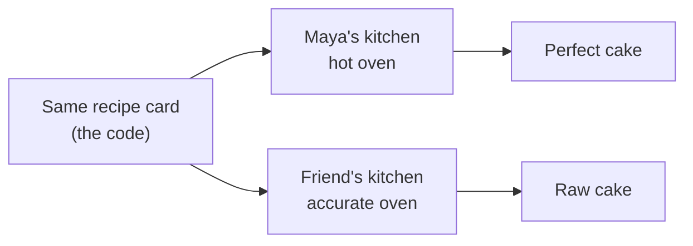
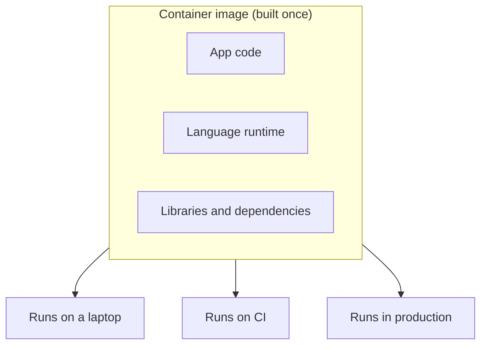

import Scenario from "../../../components/Scenario.astro";
import LevelIntro from "../../../components/LevelIntro.astro";
import PracticeCheck from "../../../components/PracticeCheck.astro";

export const unit = {
  track: "infra-delivery",
  unitSlug: "environment-parity",
};

<Scenario label="The same recipe, two kitchens, two different cakes">
  <Fragment slot="facts">
    

      
📜 <strong>The recipe</strong> — "bake at 180 degrees for 30 minutes", identical on both pages

      
🏠 <strong>Maya's kitchen</strong> — the oven runs hotter than its dial says; cake is perfect

      
🏡 <strong>Friend's kitchen</strong> — the oven is accurate; cake is raw in the middle

    

    

      
Nobody made a mistake

      the recipe silently relied on a hot oven it never mentioned
    

  </Fragment>

Maya bakes a cake from a recipe card. At home it comes out perfect every
time. She hands the card to a friend, who follows it to the letter and
gets a cake that is raw in the middle. **Same card, same ingredients, same
instructions. So whose fault is it?**

Nobody's. Maya's oven quietly runs hotter than its dial says, and her
whole routine was tuned to that without her ever noticing. The card
describes the steps. It does not describe the kitchen those steps were
tested in.

Software has exactly this problem. The code is the recipe. The laptop, the
test server, and the live server are three kitchens. "It works on my
machine" means: it works in the one kitchen whose quirks I have never had to
write down.

</Scenario>

<LevelIntro
  items={[
    "What environment drift is",
    "Containers as a packaged kitchen",
    "Why the environment belongs in the artifact",
  ]}
/>

## What is environment drift?

**If the code is identical in every place it runs, what else can differ?**
Everything around it. The word for that is **environment drift**: your
laptop, the test server, and production have slowly become different from
each other, and the code depends on that surrounding context without
declaring it.

| Hiding place     | The kitchen version                        | The software version                    |
| ---------------- | ------------------------------------------ | --------------------------------------- |
| Tool version     | A different brand of flour                 | Node 20 on a laptop, Node 18 on CI      |
| Settings         | The oven dial reads 180 but runs 200       | A timezone or locale set on one machine |
| Installed extras | A stand mixer that only one kitchen has    | A command-line tool installed by hand   |
| Leftover state   | The counter is already busy with last meal | A network port that happens to be taken |

No one chooses these differences. Each machine was set up at a different
time, by a different person or process, and they wandered apart on their
own. A code review shows what changed in the recipe. It cannot show what
the recipe quietly assumes about the kitchen.

<PracticeCheck
  track={unit.track}
  unitSlug={unit.unitSlug}
  topicId="drift-meaning"
/>

## What is a container, in one picture?

**What if, instead of mailing the recipe card, Maya shipped the finished
kitchen counter with everything on it?** That is what a container does for
software. A **container image** bundles the app together with its
language runtime, its libraries, and its dependencies into one sealed
package. Running it on a laptop, a test server, or production starts the
same bytes each time.

A container is lighter than a virtual machine (VM) because of what it
leaves out:

| Question                  | Virtual machine                     | Container                           |
| ------------------------- | ----------------------------------- | ----------------------------------- |
| What does it include?     | A whole guest operating system      | Only the app and its libraries      |
| Whose kernel does it use? | Its own                             | The host machine's kernel, shared   |
| Start-up                  | Slow (a full OS boots)              | Fast (just a process starts)        |
| Parity guarantee          | Same packaged environment each time | Same packaged environment each time |

The last row is the point of this unit. Both give you parity. A container
just gets there with less weight.

<PracticeCheck
  track={unit.track}
  unitSlug={unit.unitSlug}
  topicId="container-basics"
/>

## The principle underneath

Make the environment part of the versioned, reviewed artifact, not
something that lives in someone's memory or a setup page that goes stale.
Parity does not remove every bug. It removes one whole category, "worked
here, broke there", so that when something still fails, it is more likely
to be a genuine logic bug worth debugging.
