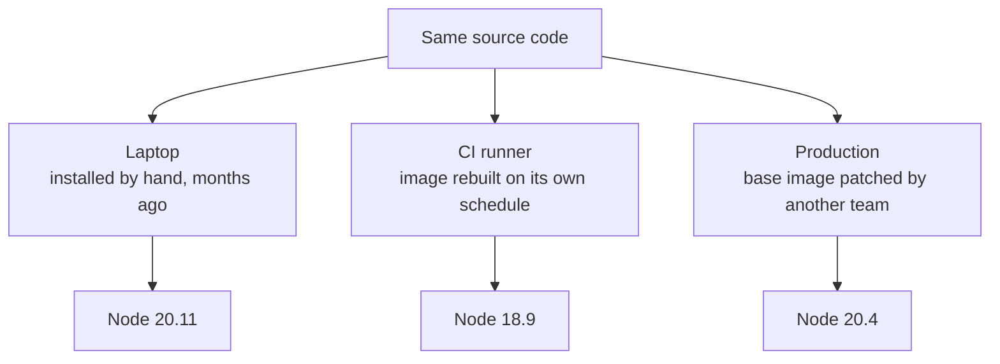
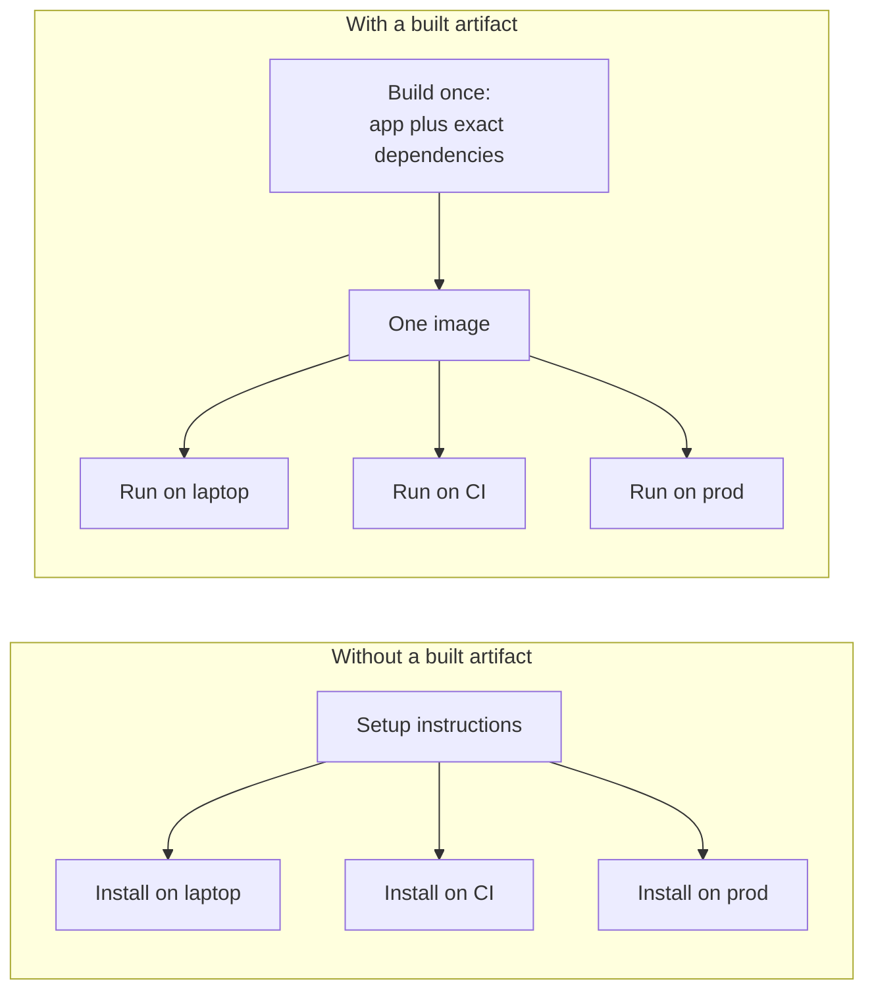
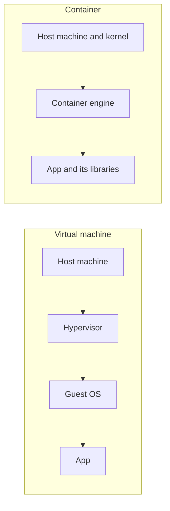

import LevelIntro from "../../../components/LevelIntro.astro";
import Checkpoint from "../../../components/Checkpoint.astro";
import PracticeCheck from "../../../components/PracticeCheck.astro";

export const unit = {
  track: "infra-delivery",
  unitSlug: "environment-parity",
};

L1 ended on a claim: the cake went wrong because of the kitchen, not the
recipe, and a container ships the kitchen along with the recipe. L2 asks
how the kitchens ended up different in the first place, and why shipping
one sealed package changes the picture instead of just moving the problem.

<LevelIntro
  items={[
    "How independent setups drift apart",
    "Resolve once, run everywhere",
    "Drift categories and their symptoms",
  ]}
/>

## Why do three machines drift without anyone deciding to?

**If nobody configured a difference on purpose, where did it come from?**
From time. Each environment is installed once and then patched on its own
schedule by its own process:

The chance that something has drifted grows with the number of places.
Assume, purely for illustration, that each independently managed
environment has a 15 percent chance of having quietly drifted from the
reference one, and that they drift independently. Then the chance that at
least one of them has is $$1 - 0.85^n$$:

| Environments (n) | Chance at least one has drifted (assumed 15% each) |
| ---------------- | -------------------------------------------------- |
| 1                | 15.0%                                              |
| 3                | 38.6%                                              |
| 6                | 62.3%                                              |
| 10               | 80.3%                                              |

The 15 percent is an assumption chosen to show the shape, not a measured
rate. The shape is the lesson: adding a staging tier or a second CI runner
raises the risk much faster than it feels like it should. The demo on this
page lets you move both numbers.

**What does drift look like when it bites?** Each category has a typical
symptom, and none of them show up in a code diff:

| Category              | Typical symptom                                          |
| --------------------- | -------------------------------------------------------- |
| Runtime version       | Code using a newer API works locally, fails on CI        |
| Settings (TZ, locale) | Dates or sorting differ on one machine only              |
| Installed tools       | A build step behaves differently depending on who ran it |
| Leftover state        | "Connection refused" because a port is already taken     |

<PracticeCheck
  track={unit.track}
  unitSlug={unit.unitSlug}
  topicId="drift-sources"
/>

## What changes when you build once and run everywhere?

**Why does a container close the gap instead of moving it somewhere else?**
Because it changes _when_ dependencies get resolved: from "every time, on
every machine" to "once, at build time".

On the left, installation happens three times, against whatever each
machine and the package registry look like that day. On the right, it
happens once, and the three places only _run_ the result. There is
nothing left to re-resolve, so nothing left to drift.

<Checkpoint question="A teammate suggests one very thorough setup script that everyone runs on their laptop, in CI, and on the production host. Same script, so same result. Does that give the parity shown on the right of the diagram?">

No. A script still runs three separate times, on three machines, each
starting from its own leftover state and seeing its own version of the
package registry on that day. It can reduce drift, but it keeps the exact
shape that causes drift: installation repeated per environment. What
defines the right-hand diagram is not that everyone follows the same
instructions. It is that dependency resolution happens once, before any
environment runs anything.

</Checkpoint>

**Does that mean every environment must behave identically in every
respect?** No. The image is identical everywhere. What differs on purpose,
such as a database address or a feature flag, is passed in when the
container starts.

| Part             | Same everywhere? | Where it comes from                 |
| ---------------- | ---------------- | ----------------------------------- |
| OS libraries     | Yes              | Baked into the image at build time  |
| Language runtime | Yes              | Baked into the image at build time  |
| Dependencies     | Yes              | Baked into the image at build time  |
| Database address | No, by design    | Passed in when the container starts |
| Feature flags    | No, by design    | Passed in when the container starts |

The difference between the two groups is visibility. A start-up setting is
written down where the container is launched and can be reviewed. Drift is
the same kind of difference arriving silently.

<Checkpoint question="Each environment pins the same image but passes a different timezone setting when it starts the container. Is that the drift problem again?">

Not by itself. The artifact is identical, and the timezone is a declared
input at the point the container starts, so a reviewer can see it and ask
whether the difference is intended. Drift is a difference nobody chose and
nobody can see. A visible, deliberate difference is configuration. (L3
shows a case where even a visible setting is a bad thing for code to lean
on silently.)

</Checkpoint>

<PracticeCheck
  track={unit.track}
  unitSlug={unit.unitSlug}
  topicId="build-once"
/>

## Do containers and VMs solve the same problem?

They deliver the same parity guarantee by different means. A VM carries a
whole guest operating system; a container shares the host's kernel.

For parity, the weight difference barely matters: what counts is that the
environment is packaged once. The isolation trade-off between the two is a
separate topic, covered in `infra-delivery/docker`.

## What L3 adds

L3 takes one real drift bug down to a single function, shows the fix that
removes the hidden dependency rather than hiding it, and looks at the few
lines of image definition where pinning decisions are made.
