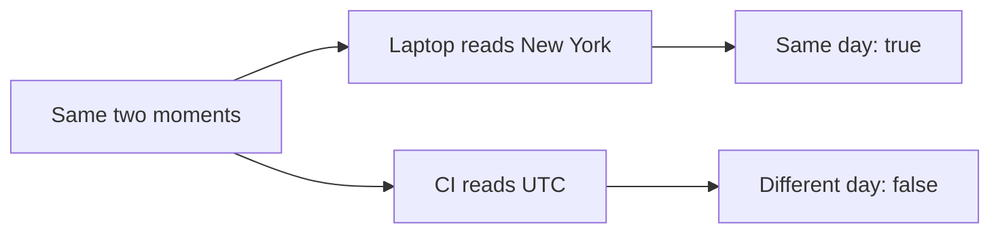
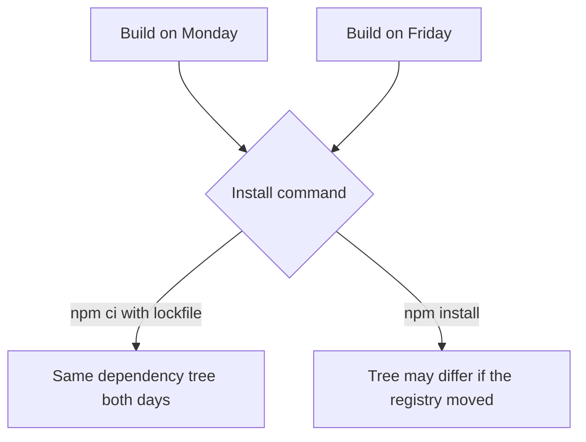

import Scenario from "../../../components/Scenario.astro";
import LevelIntro from "../../../components/LevelIntro.astro";
import Checkpoint from "../../../components/Checkpoint.astro";
import PracticeCheck from "../../../components/PracticeCheck.astro";

export const unit = {
  track: "infra-delivery",
  unitSlug: "environment-parity",
};

<Scenario label="Two clocks, one midnight, two different answers">
  <Fragment slot="facts">
    <div class="not-prose flex flex-col gap-1.5 text-sm text-slate-700 dark:text-slate-300">
      <div class="flex items-center gap-1.5"><span>💻</span> Laptop clock set to New York: both moments fall on March 14</div>
      <div class="flex items-center gap-1.5"><span>🤖</span> CI clock set to UTC: the two moments fall on different days</div>
      <div class="flex items-center gap-1.5"><span>🔍</span> The function logic did not change between runs</div>
    </div>
    <div class="not-prose mt-3 rounded border border-amber-300 bg-amber-50 p-1.5 text-xs dark:border-amber-800 dark:bg-amber-950">
      The bug is not in the comparison. It is in the clock setting the
      function silently reads from the machine.
    </div>
  </Fragment>

Picture asking two friends, one in New York and one in London, "was that
phone call yesterday or today?" about the same call. If it happened late
in the evening in New York, it was already tomorrow in London. Both friends
are right, because "today" depends on where you are standing.

A function named `isToday` has the same problem. **If its logic is
perfectly correct and the input is identical, what is left that could
possibly differ between your laptop and the CI server?**

</Scenario>

<LevelIntro
  items={[
    "A drift bug reduced to one function",
    "The image definition lines that pin the build",
    "What a container does not cover",
  ]}
/>

## Where does the "only fails in CI" bug actually live?

A background job stored a timestamp at 22:00 UTC on March 14, 2024. Five
hours later, at 03:00 UTC on March 15, a report asks `isToday` about it.
`isToday` builds a calendar date from each moment using the machine's own
timezone setting. The two moments are the same instants everywhere, but
their calendar dates are not:

| Timezone setting | Date of the stored moment | Date of "now" | Same day? |
| ---------------- | ------------------------- | ------------- | --------- |
| America/New_York | March 14                  | March 14      | Yes       |
| UTC              | March 14                  | March 15      | No        |
| Asia/Tokyo       | March 15                  | March 15      | Yes       |



Nothing in the code differs between the first and second row. An ambient
setting, not a code path, decides the answer. No amount of staring at the
comparison finds the bug.

The cure is not to set the timezone to UTC on every machine and hope. That
is still an ambient setting, one that is easy to forget on the next laptop.
The cure is to take the setting out of the machine and put it in the
function's inputs:

```js
function isToday(timestampMs, timezone, nowMs) {
  const day = new Intl.DateTimeFormat("en-CA", { timeZone: timezone });
  return day.format(timestampMs) === day.format(nowMs);
}
```

Reading this is the point: the zone and the current time both arrive as
parameters, so the same call gives the same answer on any machine. This is
the container idea applied to one function: correctness should not depend
on anything outside the thing you built and tested.

<Checkpoint question="A teammate proposes adding TZ=UTC to the CI runner's setup instead of changing isToday. Does that fix the bug or relocate it?">

It relocates it. Setting UTC on CI makes CI agree with production by
coincidence, but `isToday` still silently reads whatever the host happens
to be set to. The bug returns the moment any machine differs: a new
laptop, a future CI migration, a customer running the code in their own
region. Only the explicit parameter removes the dependency itself, rather
than getting lucky about its current value.

</Checkpoint>

<PracticeCheck
  track={unit.track}
  unitSlug={unit.unitSlug}
  topicId="ambient-input"
/>

## Which lines of an image definition decide whether the build is repeatable?

**If the image is built once, what could still make two builds of the same
source differ?** The build itself reads from outside: a base image name
and a package registry. A minimal image definition makes the decisions
visible:

```dockerfile
FROM node:20.11-bookworm-slim
COPY package.json package-lock.json ./
RUN npm ci --omit=dev
COPY . .
```

Each line pins something different:

| Line                  | What it pins                              | What it still leaves open                    |
| --------------------- | ----------------------------------------- | -------------------------------------------- |
| `FROM node:20.11-...` | A specific runtime and OS version by name | A tag can be re-pointed; a digest cannot     |
| `COPY package*.json`  | Copied before the source, for caching     | Nothing, it just orders the layers           |
| `RUN npm ci`          | The exact locked dependency tree          | `npm install` here would re-resolve versions |
| `COPY . .`            | The app's own source                      | Nothing, but never copy secrets in with it   |

Two details carry most of the weight. `npm ci` refuses to proceed if the
lockfile and the manifest disagree, where `npm install` quietly resolves
slightly different versions, which would bring back drift between builds
of one environment. And pinning by a content digest (a hash of the image)
is stronger than pinning by tag, because a tag is a label that can be moved.



<Checkpoint question="A teammate swaps npm ci for npm install in the image definition to save a step. Which guarantee has just been loosened?">

Repeatability between builds. `npm ci` installs exactly what the lockfile
records and fails loudly otherwise, so two builds of the same commit
contain the same dependencies. `npm install` can pick newer matching
versions if the registry has changed since the lockfile was written, so
Monday's image and Friday's image of the "same" commit can differ. That
is drift again, moved from between machines to between builds, and still
invisible until something built on the differing version breaks.

</Checkpoint>

## What does a container not cover?

**A team containerizes everything and declares parity solved. What can
still differ?** Anything outside the image:

| Inside the image (same everywhere) | Outside the image (can still drift)          |
| ---------------------------------- | -------------------------------------------- |
| OS libraries and language runtime  | The database schema each environment has     |
| Application dependencies           | A third-party service's behavior             |
| The app's own code                 | The host's kernel and network configuration  |
| Anything baked in at build time    | Configuration and secrets passed in at start |

Two related mistakes follow. Baking environment-specific settings or
secrets into the image forces one image per environment, which brings back
the drift containers exist to remove. And assuming the guarantee extends
to a database or a partner service means debugging the wrong layer.
Parity has to be reasoned about layer by layer.

<PracticeCheck
  track={unit.track}
  unitSlug={unit.unitSlug}
  topicId="pinning-and-limits"
/>

## This is a case, not the whole territory

The timezone bug is one function with one ambient input. **What would
change if the drift were not in your code at all, but in a payments
provider whose API returns timestamps in its own server's local time?
Would your container's parity guarantee help, and where would you put the
explicit timezone instead?** Rework the table above for that situation and
compare which rows moved and which stayed in place.
