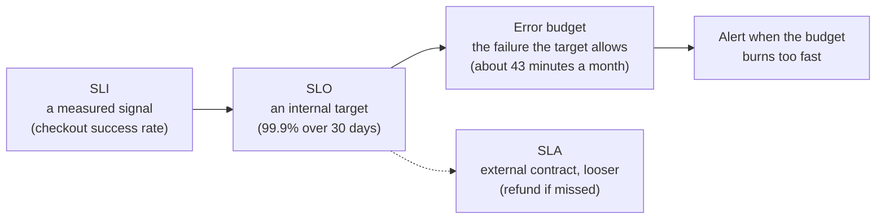

import Scenario from "../../../components/Scenario.astro";
import LevelIntro from "../../../components/LevelIntro.astro";
import PracticeCheck from "../../../components/PracticeCheck.astro";

export const unit = {
  track: "infra-delivery",
  unitSlug: "infra-observability",
};

<Scenario label="Five normal gauges, one car that will not start">
  <Fragment slot="facts">
    

      
⛽ <strong>Fuel</strong> — half full, normal

      
🌡️ <strong>Engine temperature</strong> — normal

      
🛢️ <strong>Oil pressure, battery, tyres</strong> — all normal

      
🚗 <strong>The thing you care about</strong> — does it start and get you to work?

    

    

      

        
Mornings the car fails to start (assumed)1 in 6

        

      

    

  </Fragment>

Your car's dashboard shows fuel, engine temperature, oil pressure, battery and
tyre pressure, and every needle sits in its normal zone. Yet roughly one
morning in six the car simply does not start. No warning light ever comes on,
because none of those gauges measures "will it start?" **If every gauge is
normal and the car is still failing you, what is the dashboard actually
measuring, and what should you be measuring instead?**

The gauges measure the car's _inputs_ (fuel, heat, pressure). You care about an
_outcome_: it starts, and it gets you there. A system can have healthy inputs
and a failing outcome at the same time.

</Scenario>

<LevelIntro
  items={[
    "Resource gauges versus the outcome users feel",
    "SLI, SLO and SLA in one line each",
    "Error budget and symptom-based alerting",
  ]}
/>

## The same trap, in infrastructure

Servers have the same kind of dashboard: CPU, memory, disk and network panels.
Picture a checkout service on four nodes (all numbers here are assumed for
illustration, not from a real incident). Every resource panel is in its normal
range, while one overloaded connection pool quietly rejects about 1 in 6
checkout requests. No panel crosses a threshold, so nobody is paged.

| Signal watched                    | Reading (assumed)         | Would it catch this? |
| --------------------------------- | ------------------------- | -------------------- |
| CPU utilisation, per node         | normal range              | No                   |
| Memory utilisation, per node      | normal range              | No                   |
| Disk usage                        | normal range              | No                   |
| Network throughput                | normal range              | No                   |
| Checkout success rate (user view) | 99.95% before, 83% during | Yes, immediately     |

The fix is to measure the outcome directly. Four terms give that a shape.

<PracticeCheck
  track={unit.track}
  unitSlug={unit.unitSlug}
  topicId="sli-slo-sla"
/>

## Key terms

- **SLI (service level indicator)** — a measured signal tied to what users
  experience: request success rate, a latency percentile. Not "CPU at 42%".
- **SLO (service level objective)** — an internal target on that signal, such as
  "99.9% of requests succeed over a rolling 30 days". It turns a number into a
  decision boundary.
- **SLA (service level agreement)** — an external, usually contractual promise,
  deliberately looser than the SLO, with consequences (such as refunds) if missed.
- **Error budget** — the failure an SLO permits. At 99.9% over 30 days that is
  0.1% of 43,200 minutes, which is 43.2 minutes.
- **Symptom-based alerting** — paging on the SLI burning through the budget, not
  on every raw resource metric.

This unit looks at the **infrastructure** layer: nodes, clusters, network,
saturation and deploy health. What application code logged or traced is a
separate topic. The question here is whether the platform underneath is serving
users the way it promised.

## What the next levels cover

L2 builds the SLI, SLO and SLA chain with one carried example, turns the error
budget into a decision tool, and explains why symptom alerts beat resource
alerts. L3 adds burn rate (how fast the budget is going, not just how much has
gone), a worked incident with real arithmetic, and the trade-offs in choosing
the SLO itself.
