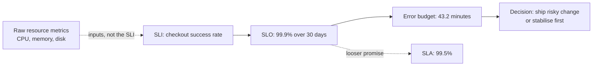
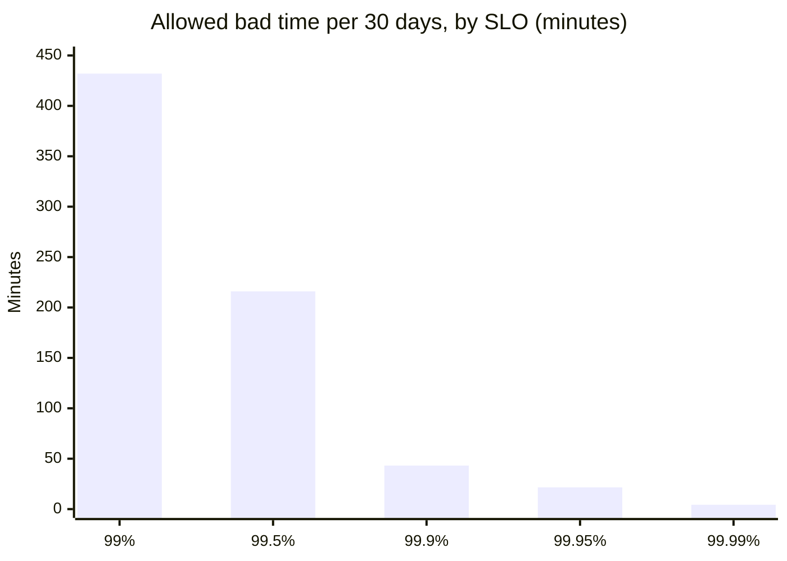

import LevelIntro from "../../../components/LevelIntro.astro";
import Checkpoint from "../../../components/Checkpoint.astro";
import PracticeCheck from "../../../components/PracticeCheck.astro";

export const unit = {
  track: "infra-delivery",
  unitSlug: "infra-observability",
};

L1's car had five normal gauges and a failing outcome. The gap was not a
missing gauge; it was that nothing connected a measurement to a target that
means something to the driver, or to a decision about when to act. This level
builds that connection.

<LevelIntro
  items={[
    "SLI, SLO and SLA, carried through one example",
    "The error budget as a spendable allowance",
    "Why alerts on the SLI beat alerts on every raw metric",
  ]}
/>

## What is the difference between a signal, a target and a contract?

**If someone says "we need 99.9% reliability", which part of that is the thing
measured, which part is the promise to ourselves, and which part is the promise
to customers?** Three different things share one number-shaped sentence.

| Term    | What it is                                            | Carried example (assumed checkout service)                     |
| ------- | ----------------------------------------------------- | -------------------------------------------------------------- |
| **SLI** | A measured signal close to user experience            | Share of checkout requests that succeed, measured every minute |
| **SLO** | An internal target on that signal                     | 99.9% succeed, over a rolling 30 days                          |
| **SLA** | An external, contractual promise, deliberately looser | 99.5% succeed, with a service credit if missed                 |

The SLA sits below the SLO on purpose. The gap is a buffer: missing your own
SLO is a warning, and you still have room to fix things before the contract is
breached. If both were 99.9%, the first you would hear of a problem is when you
already owe the customer.

The raw metrics are drawn dotted for a reason. CPU at 90% may mean nothing if
requests still succeed, and CPU at 40% meant nothing while L1's pool rejected
requests. The SLI has to sit close to what a user experiences, not close to
what is easy to instrument.

<Checkpoint question="A team sets the SLO and the SLA to the same number, 99.9%. What practical problem does that create?">

There is no buffer between "we missed our own bar" and "we are in contractual
breach". The point of an SLO tighter than the SLA is that crossing the SLO is an
early warning, giving time to slow deploys and fix things before money is owed.
With equal numbers, the first signal is also the worst outcome.

</Checkpoint>

## What does "0.1% may fail" actually let a team do this week?

**A 99.9% SLO says 0.1% of the time may be bad. How do you turn that into
something a team can plan around?**

A 30-day window has 30 × 24 × 60 = 43,200 minutes. Allowing 0.1% of that to be
bad gives 43.2 minutes. That is the **error budget**: one pool for the whole
window, drained by every incident and every rolled-back deploy, refilled when
the window rolls over. Its value is that it replaces a gut feeling about risk
with a number:

| Situation (assumed)                       | Budget left      | Reasonable call                                    |
| ----------------------------------------- | ---------------- | -------------------------------------------------- |
| Two small blips, about 5 minutes in total | 38.2 of 43.2 min | Ship the risky database migration as planned       |
| One incident already burned 35 minutes    | 8.2 of 43.2 min  | Delay it; ship only small, easily reverted changes |
| Budget fully spent with days still to go  | 0 min            | Freeze risky changes; spend the time on stability  |

Looked at the other way, the same SLO at different strictness gives very
different allowances over 30 days:

<Checkpoint question="A team burned its whole 43.2-minute budget by day 5 of a 30-day window. A director asks why a moderately risky feature is not shipping. What is the answer in budget terms?">

The window's allowance is already spent, so any further failure pushes the
service below its commitment, and the contractual SLA line gets closer too.
Shipping the same change in a month with 38 minutes left carries a very different
risk than shipping it with none. The budget is not a report card on the past; it
is the information that says whether this week is a good time to take on more
risk.

</Checkpoint>

<PracticeCheck
  track={unit.track}
  unitSlug={unit.unitSlug}
  topicId="error-budget"
/>

## Why alert on the symptom instead of every resource?

**L1 had no alert for a 40-minute failure, while a brief CPU spike absorbed by
autoscaling could page someone. What is wrong with where the alerts are
attached?**

Alerting on every raw metric fails in two directions at once. It misses real
problems that never breach a resource threshold (the connection pool), and it
fires on fluctuations that never touched a user (a CPU spike gone in 30
seconds). **Symptom-based alerting** attaches the page to the SLI itself,
specifically to whether the SLI is burning the budget at a rate that matters. A
success rate falling from 99.95% to 83% is one clear alert; twelve resource
panels with no breach is none.

| Alert on...                 | Catches the pool failure | Fires on harmless spikes | Tells you who is hurt |
| --------------------------- | ------------------------ | ------------------------ | --------------------- |
| Each raw resource threshold | No                       | Often                    | No                    |
| The SLI burning the budget  | Yes                      | Rarely                   | Yes                   |

Alert fatigue is trust erosion, the same way flaky tests erode trust in a CI
pipeline (see `testing-quality`): an alert that cries wolf gets muted, and then
a real one is muted with it.

<PracticeCheck
  track={unit.track}
  unitSlug={unit.unitSlug}
  topicId="symptom-alerting"
/>

L3 adds the missing piece: knowing not just how much budget is gone, but how
fast it is going.
