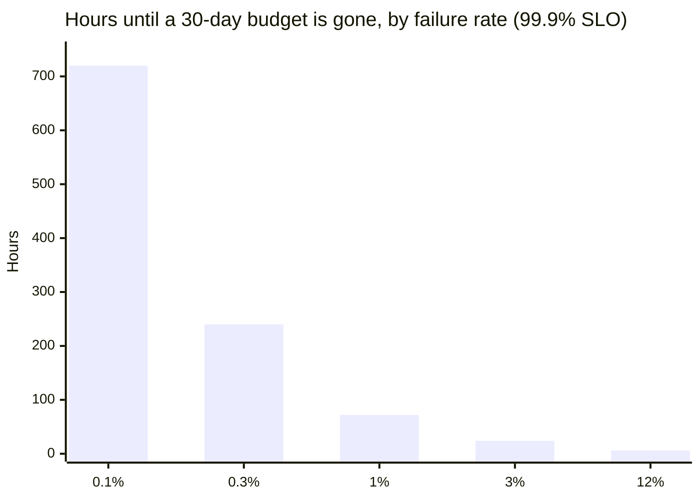
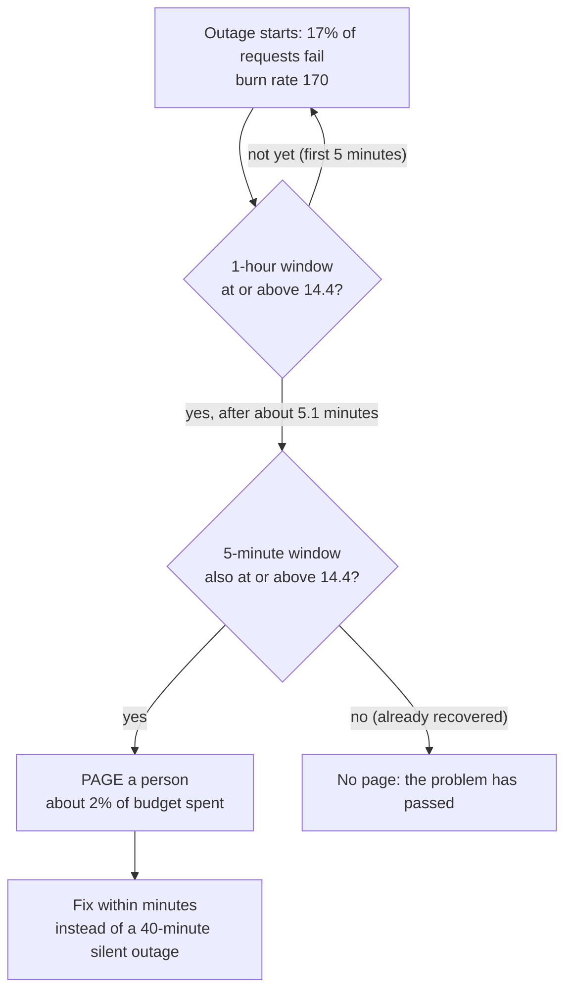

import Scenario from "../../../components/Scenario.astro";
import LevelIntro from "../../../components/LevelIntro.astro";
import Checkpoint from "../../../components/Checkpoint.astro";
import PracticeCheck from "../../../components/PracticeCheck.astro";

export const unit = {
  track: "infra-delivery",
  unitSlug: "infra-observability",
};

<Scenario label="Three ways to use up a 30 GB phone allowance">
  <Fragment slot="facts">
    

      
🐢 <strong>1 GB a day</strong> — lasts exactly the 30 days

      
🚶 <strong>3 GB a day</strong> — gone on day 10

      
🔥 <strong>5 GB an hour</strong> — gone in 6 hours

    

    

      Same allowance every time. The <em>rate</em> decides whether you
      need to act now or can check back next week.
    

  </Fragment>

You have a 30 GB data allowance for the month. If someone tells you "you have
used 2 GB so far", is that alarming? It depends entirely on how quickly those 2
GB went. Two gigabytes over two days is a pace that will last the month; 2 GB in
the first twenty minutes is a pace that will not last the afternoon.
**If the amount used is the same, what extra number tells you whether to react
now?**

An error budget behaves exactly like that allowance. The extra number is the
**burn rate**: how many times faster than "just lasts the whole window" the
budget is draining right now.

</Scenario>

<LevelIntro
  items={[
    "Burn rate: speed of spending, not just amount spent",
    "Multi-window paging, worked on a full incident",
    "Trade-offs when choosing the SLO itself",
  ]}
/>

## What is burn rate, and how does it map to time-to-empty?

**How do you turn "the checkout success rate is 97%" into "how urgent is this"?**

Burn rate is the observed failure ratio divided by the failure ratio the SLO
allows. For a 99.9% SLO the allowed ratio is 0.001, so a 0.3% failure rate is a
burn rate of 3, and a 12% failure rate is a burn rate of 120. A burn rate of 1
spends the budget exactly over the whole window. Time to empty is the window
length divided by the burn rate; for a 30-day (720-hour) window:

| Observed failure rate | Burn rate | Budget gone in | Share of the month's budget per hour |
| --------------------- | --------- | -------------- | ------------------------------------ |
| 0.1%                  | 1         | 720 hours      | 0.14%                                |
| 0.3%                  | 3         | 240 hours      | 0.42%                                |
| 1%                    | 10        | 72 hours       | 1.39%                                |
| 3%                    | 30        | 24 hours       | 4.17%                                |
| 12%                   | 120       | 6 hours        | 16.7%                                |

The demo below uses this exact formula. Drag the error rate up and watch the
time to empty collapse, and try the SLO target and window as well.

<Checkpoint question="A service is at burn rate 3 and the amount of budget used so far is only 2%. A second service is at burn rate 120 with the same 2% used. Which needs a person now, and why?">

The second one. Both have spent the same amount, but at burn rate 120 the whole
month's budget is gone in about 6 hours, while at burn rate 3 it lasts 10 days. The
amount used so far describes the past; the burn rate describes how soon the
future runs out, and that is what decides urgency.

</Checkpoint>

<PracticeCheck
  track={unit.track}
  unitSlug={unit.unitSlug}
  topicId="burn-rate"
/>

## Worked example: the L1 outage, with and without symptom alerting

**How early would a burn-rate alert have caught L1's checkout failure, and what
would that have saved?** All traffic and durations below are assumed for
illustration. The service has a 99.9% SLO over 30 days (43,200 minutes, budget
43.2 minutes), and the outage fails 17% of checkout requests, steady, for 40
minutes.

Page rule used here (one common recipe; the thresholds are choices, not laws):
page when the burn rate is at least 14.4 over the last hour **and** at least
14.4 over the last 5 minutes. A burn rate of 14.4 sustained for one hour uses
14.4 / 720 = 2% of the month's budget.

| Step                             | Calculation                                                   | Result                  |
| -------------------------------- | ------------------------------------------------------------- | ----------------------- |
| Burn rate during the outage      | 0.17 / 0.001                                                  | 170                     |
| Hourly window reaches 14.4       | needs 1.44% failures averaged over 60 min; 0.0144 / 0.17 × 60 | after about 5.1 minutes |
| 5-minute window                  | fully inside the outage by then                               | already above 14.4      |
| Budget spent if paged at 5.1 min | 5.1 min × 0.17 ≈ 0.86 budget-minutes                          | about 2.0% of 43.2      |
| Budget spent if found at 40 min  | 40 min × 0.17 = 6.8 budget-minutes                            | about 15.7% of 43.2     |
| Time to empty at this burn rate  | 720 hours / 170                                               | about 4.2 hours         |

Without the alert, the same outage runs the full 40 minutes and consumes about
eight times as much budget. The resource dashboards never could have helped,
because none of them measured the SLI.

<Checkpoint question="The rule needs both the 1-hour window and the 5-minute window to be high. A brief blip fails 12% of requests for 3 minutes, then recovers. Does it page, and what does each window say?">

It does not page. Averaged over 5 minutes, the blip is 0.12 × 3 / 5 = 7.2%
failures, a burn rate of 72, so the short window alone would have fired. Averaged
over the hour it is 0.12 × 3 / 60 = 0.6%, a burn rate of 6, below 14.4. The long
window confirms that a meaningful amount of budget really is being lost; the short
window confirms it is still happening now. Requiring both stops pages for blips
that are already over, and stops pages that keep ringing after the fix.

</Checkpoint>

## How loose or strict should the SLO be?

**If a tighter SLO means better reliability, why not set 99.99% everywhere?**

Because the number also fixes the price. Each extra nine shrinks the allowance
by a factor of ten, and that has to be paid for with redundancy, slower and
more careful deploys, and more on-call attention.

| SLO    | Allowed bad time per 30 days |
| ------ | ---------------------------- |
| 99%    | 7.2 hours                    |
| 99.5%  | 3.6 hours                    |
| 99.9%  | 43.2 minutes                 |
| 99.99% | 4.32 minutes                 |

| SLO set...     | What goes wrong                                                                                              |
| -------------- | ------------------------------------------------------------------------------------------------------------ |
| **Too loose**  | False confidence: users hurt for hours a month and the budget still shows green                              |
| **Too strict** | Unmeetable given real failure modes (the team stops trusting it), or shipping slows to avoid touching budget |

A 99.99% target allows 4.32 minutes a month, which a single slow rollback can
use up. A 99% checkout SLO is technically met while 7.2 hours of failed
purchases a month go uncounted as a problem. The right target comes from what
users need and what the platform can actually sustain, not from what sounds good
on a slide.

<PracticeCheck
  track={unit.track}
  unitSlug={unit.unitSlug}
  topicId="slo-tradeoffs"
/>

## Beyond the worked example

This incident is a case, not the whole territory. The numbers (17%, 40 minutes,
14.4) and the checkout service are one instance of the pattern, and real systems
bend it in ways worth reasoning through yourself:

- What changes if the outage were **3% failures for six hours**? Work out the
  burn rate, when each window crosses 14.4, and whether this should page or open
  a ticket.
- What if the service has two SLOs, **latency and availability**, and aggressive
  retries help one while spending the other? Which budget should the shipping
  decision look at?
- What if the budget is a **rolling** 30 days rather than a calendar month? A
  fixed month hands back a clean slate on day 1 regardless of how bad day 29 was;
  a rolling window keeps a bad incident suppressing the budget until it ages out.
- What if traffic **drops to near zero overnight**? A handful of failed requests
  then make a huge failure ratio. How would you stop that from paging someone?

Pick one and work the arithmetic the way the table above does.
