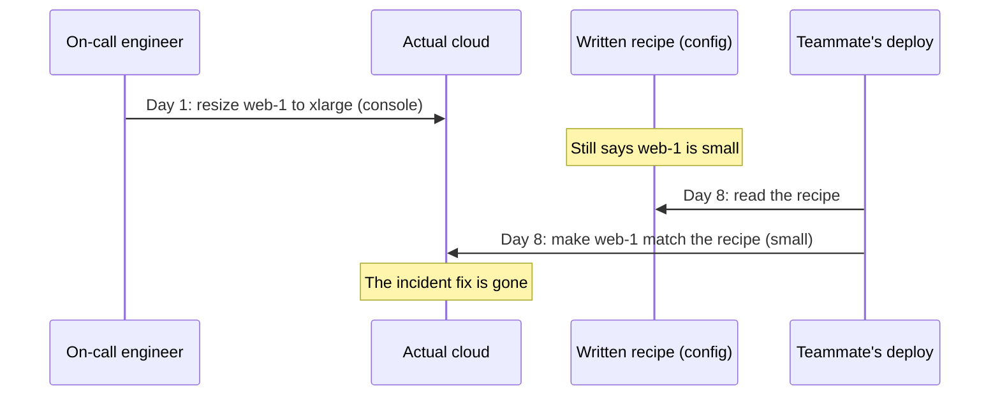

import Scenario from "../../../components/Scenario.astro";
import LevelIntro from "../../../components/LevelIntro.astro";
import PracticeCheck from "../../../components/PracticeCheck.astro";

export const unit = {
  track: "infra-delivery",
  unitSlug: "infrastructure-code",
};

<Scenario label="A server was resized by hand during an incident. A routine deploy undid it.">
  <Fragment slot="facts">
    

      
🔥 <strong>Day 1</strong> — traffic spikes; on-call clicks `web-1` from small to xlarge in the console

      
🤫 <strong>Day 1</strong> — the incident ends; the change is written down nowhere

      
🚀 <strong>Day 8</strong> — a teammate runs the documented deploy process

      
📉 <strong>Day 8</strong> — `web-1` is small again, and the next spike takes it down

    

  </Fragment>

Think of a kitchen with a written recipe. One cook tastes the sauce
during a rush, adds extra salt, and tells nobody. The next day another
cook follows the recipe word for word, and the sauce is bland again.
Neither cook did anything wrong by their own process.

The same thing happens with servers. An on-call engineer resizes `web-1`
from `small` to `xlarge` by clicking in the cloud console, which survives
the spike. Nobody records it. A week later a teammate runs the routine
deploy, exactly as documented, and `web-1` goes back to `small`.
**What is missing, so that a correct action one week can silently undo
a correct action from another week?**

</Scenario>

<LevelIntro
  items={[
    "Clicked by hand versus a written recipe",
    "Declared config, state file, and actual cloud",
    "Plan, apply, drift, and idempotency",
  ]}
/>

## Why does clicking by hand cause this?

A console click is **real but invisible**: it takes effect at once, yet
nothing records that it happened, why, or that it should last. The
teammate's deploy was not wrong. It followed the only written source of
truth, and the console change never became part of it.

| Aspect                   | Clicked by hand           | Written recipe (Infrastructure as Code) |
| ------------------------ | ------------------------- | --------------------------------------- |
| Where the change lives   | Only in the running cloud | In a file under version control         |
| Who can see it           | Whoever happens to look   | Anyone who can read the repository      |
| Can it be reviewed       | After the fact, if at all | Before it happens, as a normal change   |
| Does a later run keep it | Only by luck              | Yes, once the file says so              |

**Infrastructure as Code (IaC)** means describing the infrastructure you
want in a file kept in version control (a shared history such as Git),
and letting a tool work out and apply the difference between that file
and what is running. "What should exist" then has one home that
everyone reads.

<PracticeCheck
  track={unit.track}
  unitSlug={unit.unitSlug}
  topicId="declarative-vs-script"
/>

## Three pictures to keep apart

Almost every confusion in this unit comes from mixing up these three:

| Picture         | What it means in this unit                           | Who normally changes it            |
| --------------- | ---------------------------------------------------- | ---------------------------------- |
| Declared config | The file that says what should exist                 | People, through reviewed changes   |
| State file      | The tool's memory of what it last created or updated | The tool, after an apply           |
| Actual cloud    | The real servers and databases running right now     | The tool, or anyone with a console |

In the opening story the console click changed only the third picture.
The first two still said `small`.

<PracticeCheck
  track={unit.track}
  unitSlug={unit.unitSlug}
  topicId="three-pictures"
/>

## Five terms

- **Declarative configuration**: you describe the end state ("`web-1`
  has size `large`"), not the steps to reach it.
- **Plan**: a computed list of create, update, and delete actions needed
  to make reality match the declaration, shown before anything changes.
- **Apply**: executing a plan against the real infrastructure.
- **Drift**: the real infrastructure no longer matches what the tool
  recorded, usually because someone changed it directly.
- **Idempotency**: applying the same declaration twice leaves the same
  end state as applying it once.

<PracticeCheck
  track={unit.track}
  unitSlug={unit.unitSlug}
  topicId="iac-vocabulary"
/>

## What the next levels add

L2 shows exactly what a plan compares, why a drift check is a different
comparison, and what idempotency buys after a half-finished apply. L3
works one small example through with numbers, including the rename trap
and a reproduction of the opening story, and asks you to write the diff
yourself.
