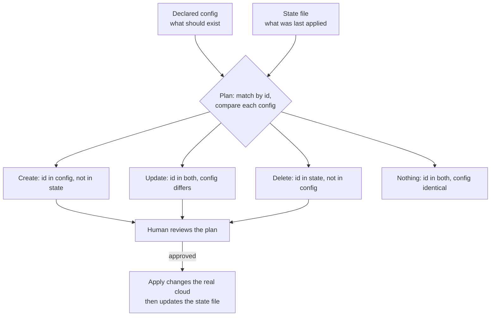
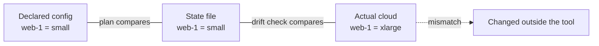

import LevelIntro from "../../../components/LevelIntro.astro";
import Checkpoint from "../../../components/Checkpoint.astro";
import PracticeCheck from "../../../components/PracticeCheck.astro";

export const unit = {
  track: "infra-delivery",
  unitSlug: "infrastructure-code",
};

L1 left one question open: the teammate's deploy never warned anyone that
`web-1` had been resized by hand. L2 works out why. It follows what a
plan compares, how that differs from a drift check, and what has to be
true for re-running an apply to be safe.

<LevelIntro
  items={[
    "Create, update, delete from two lists",
    "Plan versus drift check",
    "Why a re-run is safe",
  ]}
/>

## What does a plan actually compute?

**If a tool is about to change running infrastructure, how does it decide
what to do?** It compares two lists, matched up by resource id: what the
config declares, and what the state file says was last applied.

| Where the id appears | Config identical? | Plan action |
| -------------------- | ----------------- | ----------- |
| Config only          | not applicable    | Create      |
| Config and state     | no                | Update      |
| Config and state     | yes               | Nothing     |
| State only           | not applicable    | Delete      |

The plan is shown before anything runs because "3 to create, 1 to update,
0 to delete" is exactly what a reviewer needs. An accidental delete, such
as a block removed from the wrong file, is visible here, before it
touches a real database.

<Checkpoint question="A plan shows 2 to create, 1 to update, and 0 to delete. What does the 0 tell you about the config compared with the state file?">

Every resource the tool remembers creating is still named in the config.
Nothing has been removed from that file since the last apply. The delete
list is the one a reviewer reads most carefully, because it is the only
list that can destroy running infrastructure, and it fills automatically
the moment a block disappears or is renamed.

</Checkpoint>

<PracticeCheck
  track={unit.track}
  unitSlug={unit.unitSlug}
  topicId="plan-classification"
/>

## Is a drift check just the plan again?

**The console resize in L1 changed the real cloud. Would a plan have
shown it?** In the model this unit uses, no. A plan compares config with
state, and neither of those changed. A drift check compares a different
pair.

| Comparison                 | Question it answers                                 | A mismatch usually means               |
| -------------------------- | --------------------------------------------------- | -------------------------------------- |
| Config against state       | Does what I asked for match what the tool last did? | Someone edited the config, as intended |
| State against actual cloud | Does the tool's memory still match reality?         | Something changed outside the tool     |

Without a state file there is nothing to compare reality against. A
script of commands has no memory of what it did last time. Real tools
often refresh from the cloud as part of planning, which folds both
comparisons into one command. The two questions stay separate, though:
the first mismatch is expected, the second is a warning.

How long can such a mismatch sit unnoticed? Only as long as the gap
between checks. A check that runs every 7 days can miss a change made
right after it for up to 7 days. The demo on this page lets you
move that interval.

<Checkpoint question="In L1 the console change happened on day 1 and the deploy ran on day 8. If a drift check had run every night, what would have been different on day 2?">

Someone would have been told that `web-1` no longer matches the tool's
record. That is a prompt to either copy the new size into the config, or
to undo the change on purpose. Either way the incident fix becomes a
decision a person made, instead of something a routine deploy reverses
by accident a week later.

</Checkpoint>

<PracticeCheck
  track={unit.track}
  unitSlug={unit.unitSlug}
  topicId="drift-vs-plan"
/>

## Why must re-running an apply be safe?

**An apply creates 2 of 5 resources, then the network drops. What does a
re-run have to do?** Create only the 3 that are missing and leave the 2
that exist alone. That is what idempotency means in practice: running
twice reaches the same end state as running once. It does not mean the
first run does nothing.

| Approach                                | Re-run after partial failure                         |
| --------------------------------------- | ---------------------------------------------------- |
| Script that runs `create-server` always | May duplicate the 2 that already exist, or error out |
| Declaration plus diff against state     | Plan lists only the 3 still missing                  |

A diff-based plan gives this property for free, because it is computed
from the current situation each time. An imperative script only gets it
by adding a careful existence check to every step.

<Checkpoint question="Someone says an idempotent apply must change nothing, even if the config was edited between two runs. What is wrong with that?">

The guarantee is about identical input. If the config changed between the
runs, the second run should change things, since that is its purpose.
Idempotency says that running the same declaration again leaves the same
end state, so the repeat is a no-op only when nothing else has moved.

</Checkpoint>

<PracticeCheck
  track={unit.track}
  unitSlug={unit.unitSlug}
  topicId="idempotency"
/>

## Failure modes at this level

- Calling a Git-tracked script of cloud commands "Infrastructure as Code".
  Version control is not the same as declaring an end state.
- Making a "temporary" console edit in an incident and never copying it
  into the config. That is the opening story.
- Approving a plan without reading its delete list.
