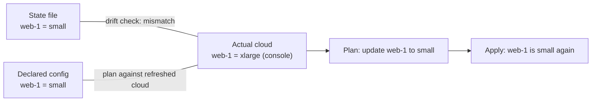

import Scenario from "../../../components/Scenario.astro";
import LevelIntro from "../../../components/LevelIntro.astro";
import Checkpoint from "../../../components/Checkpoint.astro";
import PracticeCheck from "../../../components/PracticeCheck.astro";

export const unit = {
  track: "infra-delivery",
  unitSlug: "infrastructure-code",
};

<Scenario label="Someone tidied a name in the config. The plan says one thing is deleted and one is created.">
  <Fragment slot="facts">
    <div class="not-prose flex flex-col gap-2 text-sm text-slate-700 dark:text-slate-300">
      <div class="flex items-center gap-1.5"><span>✏️</span> <strong>Edit</strong> — id `web-1` becomes `web-1-primary`, nothing else changes</div>
      <div class="flex items-center gap-1.5"><span>📋</span> <strong>Plan</strong> — 1 to create, 0 to update, 1 to delete</div>
      <div class="flex items-center gap-1.5"><span>❓</span> <strong>Question</strong> — is that the same server, renamed?</div>
    </div>
  </Fragment>

A teammate renames one id in the config for tidiness. The size is
untouched, so to a human this is obviously the same server. **Why does
the plan describe it as destroying one thing and building another?**

</Scenario>

<LevelIntro
  items={[
    "An id-based diff, worked with numbers",
    "The rename trap and dependencies",
    "Reproducing the opening drift",
  ]}
/>

## How does the diff match things up?

The plan engine from L2 fits in a dozen lines. Here the code is worth
reading, because the whole rename trap lives in one detail: resources are
matched by `id` and nothing else. Each resource is just `{ id, size }`.

```js
function planIds(desired, current) {
  const have = new Map(current.map((r) => [r.id, r.size]));
  const want = new Map(desired.map((r) => [r.id, r.size]));
  return {
    create: desired.filter((r) => !have.has(r.id)).map((r) => r.id),
    update: desired
      .filter((r) => have.has(r.id) && have.get(r.id) !== r.size)
      .map((r) => r.id),
    delete: current.filter((r) => !want.has(r.id)).map((r) => r.id),
  };
}
```

Worked through with a two-resource setup, a first apply, and three
later edits. The counts are what `planIds` returns for each input:

| Step | Declared config                  | State file               | Plan (create / update / delete) |
| ---- | -------------------------------- | ------------------------ | ------------------------------- |
| 1    | web-1 small, db-1 medium         | empty                    | 2 / 0 / 0                       |
| 2    | web-1 small, db-1 medium         | web-1 small, db-1 medium | 0 / 0 / 0                       |
| 3    | web-1 large, db-1 medium         | web-1 small, db-1 medium | 0 / 1 / 0                       |
| 4    | db-1 medium only                 | web-1 small, db-1 medium | 0 / 0 / 1                       |
| 5    | web-1-primary small, db-1 medium | web-1 small, db-1 medium | 1 / 0 / 1                       |

Step 2 is idempotency shown rather than asserted: after the first apply
records two resources, planning the same declaration finds nothing to do.

<Checkpoint question="In step 3 only the size changed, so it is an update. In step 5 only the id changed. Why is that not an update too?">

The engine decides "same resource" from the id alone. A different id has
no entry in the state map, so the new name is a create, and the old name
has no entry in the declared map, so it is a delete. For a stateless
server this is a short outage at worst. For a database, applying that
plan would destroy the data behind the old id.

</Checkpoint>

<PracticeCheck
  track={unit.track}
  unitSlug={unit.unitSlug}
  topicId="rename-is-replace"
/>

## How does the opening story reproduce?



Two comparisons use the same live snapshot and give different verdicts.
The drift check, state against cloud, says "something changed this
outside the tool". The plan, config against the refreshed cloud, says
"set it back to small", which is an ordinary update. The update is not
malicious: the tool obeys the only written source of truth it has, and
the incident fix never reached it. The state file is what turns the
second kind of gap into a flagged anomaly rather than one more routine
update.

<Checkpoint question="The drift check flags web-1 and the plan wants to set it back to small. Which one action keeps the incident fix alive?">

Change the declared size to `xlarge` in the config and review it like any
other change, before any apply. Applying first would undo the fix. Deleting
the state file would hide the warning and leave the config still saying
`small`.

</Checkpoint>

<PracticeCheck
  track={unit.track}
  unitSlug={unit.unitSlug}
  topicId="drift-reproduction"
/>

## Writing the diff yourself

Here writing the code is the understanding: the practice and domain-check
exercises ask you to implement small pieces of this diff, such as listing
the ids to create, or the ids that drifted. Notice how each is one filter
over one of the two lists.

<PracticeCheck
  track={unit.track}
  unitSlug={unit.unitSlug}
  topicId="plan-diff"
/>

## This is a case, not the whole territory

The table above uses two resources and one setting. Real tools also
handle ordering, partial failures, and many resource types. **Extend it:
suppose `web-1` reads the address of `db-1`, and one plan both deletes
and recreates `db-1`. Is it safer to delete `db-1` and then create
`web-1`, or to create the new `db-1` first and then update `web-1`? What
would change if `db-1` held data that could not be re-created?** Work out
your own ordering, then compare it with what happens to the data and the
downtime in each case.

## Failure modes

| Failure mode                                     | What it gets wrong                                           |
| ------------------------------------------------ | ------------------------------------------------------------ |
| Renaming an id without a move operation          | Looks like delete plus create, which may destroy data        |
| "Temporary" console edits never copied to config | The next routine apply reverts them, as in the opening story |
| Approving a plan without reading deletes         | The one list that can lose real infrastructure goes unseen   |
| Reading idempotency as "does nothing"            | Only a repeat of identical input is a no-op                  |
