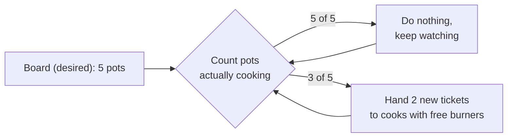

import Scenario from "../../../components/Scenario.astro";
import LevelIntro from "../../../components/LevelIntro.astro";
import PracticeCheck from "../../../components/PracticeCheck.astro";

export const unit = {
  track: "infra-delivery",
  unitSlug: "orchestration-basics",
};

<Scenario label="A kitchen has an order board, three cooks, and one cook goes home sick">
  <Fragment slot="facts">
    

      
📋 <strong>The board says</strong> — 5 bowls of soup must be cooking at all times

      
👩‍🍳 <strong>Three cooks</strong> — each has 4 burners, so 12 burners in total

      
🤒 <strong>8pm</strong> — one cook leaves; her 2 pots of soup go cold

      
🧭 <strong>The dispatcher</strong> — counts pots, sees 3 instead of 5, hands 2 new tickets to the other cooks

    

    

      
Nobody asked the dispatcher to react to the sick cook

      the board states the goal; the dispatcher keeps closing the gap
    

  </Fragment>

A small restaurant has an order board with one standing rule: "5 pots of
soup cooking at all times". Three cooks share the kitchen, and each cook
has 4 burners. At 8pm one cook goes home sick, and the two pots on her
burners go cold. Nobody shouts "the soup is down". Instead, the
dispatcher glances at the board, counts three pots where the board says
five, and hands the two missing tickets to the cooks still on shift.
**Now picture the same kitchen with no dispatcher and no board, only
cooks who each remember their own pots. Who notices the gap, and when?**

</Scenario>

<LevelIntro
  items={[
    "Desired state versus what is running",
    "The loop that closes the gap",
    "Who decides where each pot goes",
  ]}
/>

The kitchen is the whole unit in miniature. Swap the words and it is a
software cluster:

| In the kitchen                | In a cluster                                        |
| ----------------------------- | --------------------------------------------------- |
| A pot of soup                 | A running container (usually wrapped in a pod)      |
| A cook with 4 burners         | A node: a machine with a fixed amount of CPU/memory |
| The order board               | The desired state: "5 copies of this app"           |
| The dispatcher's counting     | The reconciliation loop                             |
| Picking which cook gets a pot | The scheduler                                       |

## Why is one machine not enough, and many machines not automatic?

**A team starts containers by hand on two servers. At 3am one server
crashes. What is missing?** Not more servers and not better containers.
Nothing is comparing "what should be running" to "what is running", so
the gap sits there until a paged engineer logs in. Running one container
is easy; keeping the right number alive across machines that can vanish
is a different job.

<PracticeCheck
  track={unit.track}
  unitSlug={unit.unitSlug}
  topicId="orchestration-problem"
/>

## What is the loop, and what does it compare?

- **Desired state** — the declared target, such as "5 replicas".
- **Actual state** — what is observed running right now.
- **Reconciliation loop** — compare the two forever; act only when they differ. Most passes find nothing to do.
- **Self-healing** — the visible effect: lost containers are rescheduled without a human noticing first.

Self-healing is not magic. It depends on spare room existing somewhere,
which is the lesson L3 turns into numbers.

## Who decides where each pot goes?

The **scheduler** picks a **node** for each new **pod** (the smallest
placeable unit: one or more containers that always travel together). It
looks at each node's remaining CPU and memory and at what the pod asks
to reserve. If no node has enough room left, the pod waits as
`pending`. The orchestrator reports the gap but cannot create burners.

<PracticeCheck
  track={unit.track}
  unitSlug={unit.unitSlug}
  topicId="cluster-vocabulary"
/>

## What this unit covers next

L2 opens the loop and the scheduler: how a pass avoids double-ordering
replacements, and why spreading pots across cooks beats filling one cook
first. L3 runs real numbers on a small cluster and finds exactly how
much spare capacity a single failure needs.
