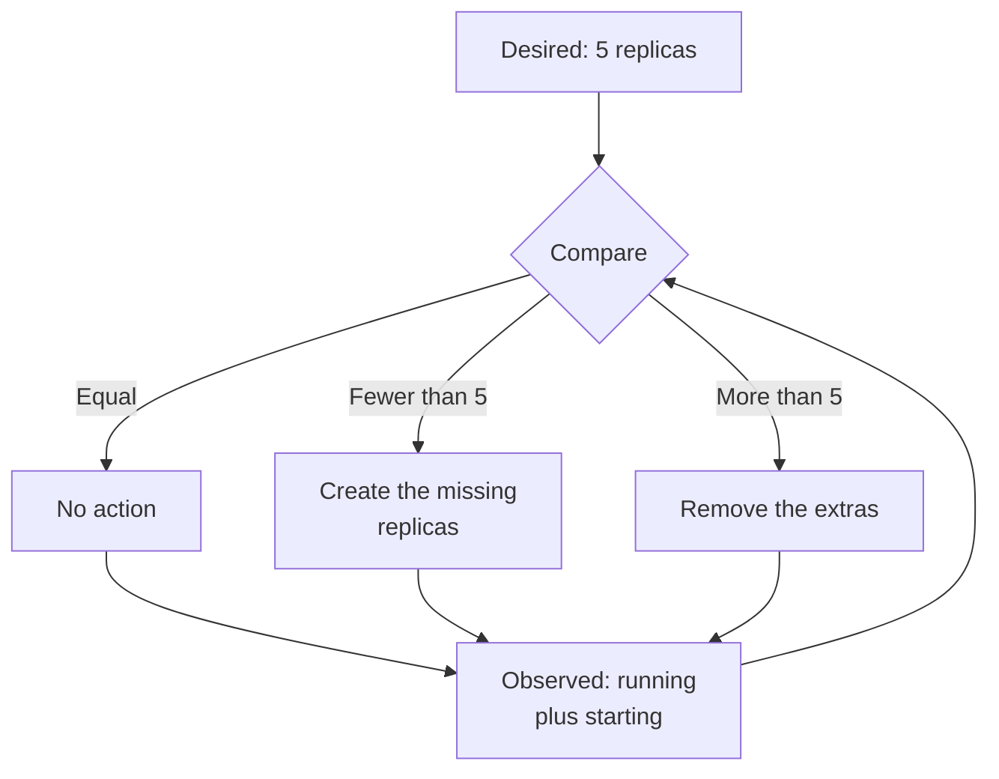
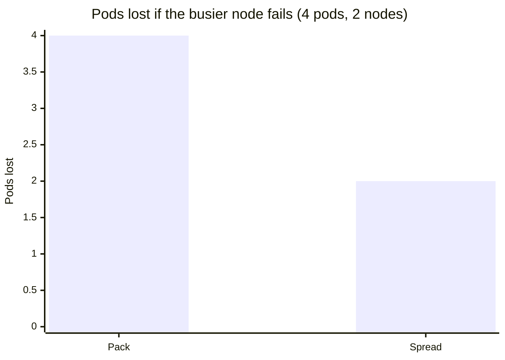

import LevelIntro from "../../../components/LevelIntro.astro";
import Checkpoint from "../../../components/Checkpoint.astro";
import PracticeCheck from "../../../components/PracticeCheck.astro";

export const unit = {
  track: "infra-delivery",
  unitSlug: "orchestration-basics",
};

L1's kitchen had a dispatcher who counted pots against the board and handed
out tickets. L2 opens both halves of that job: how the counting avoids
ordering twice, and how the ticket-handing decides which cook gets a pot.

<LevelIntro
  items={[
    "The compare-and-act cycle",
    "Resource requests and the fit check",
    "Spreading versus packing",
  ]}
/>

## How does a loop find a gap nobody reported?

**If no human is watching, how does a dead node's workload ever get
noticed?** The orchestrator never waits for a report. It repeats one cycle
forever: read the declared target, observe what is running, and act only
on the difference.

Most passes end at "Equal" and do nothing. The cycle starts from the
system noticing a gap, not from a person noticing one, which is why
recovery can begin without anybody awake.

<Checkpoint question="The loop finds 2 replicas missing and orders 2 replacements. Ten seconds later, before those have finished starting, it compares again. Does it order 2 more?">

No, provided the observed state counts replicas that are scheduled but still
starting. If it only counted fully running ones, every pass would see the
same gap and keep piling on duplicates faster than they could start. The
loop's value depends on comparing against the true current picture,
including work already in flight, and not against a snapshot taken before
its own last action.

</Checkpoint>

<PracticeCheck
  track={unit.track}
  unitSlug={unit.unitSlug}
  topicId="reconcile-loop"
/>

## What does the scheduler need to know to place a pod?

**A pod arrives asking for 2 CPU and 4 GB of memory. Which node can take
it?** The scheduler compares the pod's _request_, a reservation, against
each node's remaining unreserved capacity. A request is a promise not to
overbook, like reserving seats before a trip, not a measurement of what
the pod is using this second.

| Node (4 CPU, 8 GB)            | Reserved so far | Remaining    | Fits a 2 CPU / 4 GB pod? |
| ----------------------------- | --------------- | ------------ | ------------------------ |
| node-a, empty                 | 0 CPU / 0 GB    | 4 CPU / 8 GB | Yes                      |
| node-b, one such pod          | 2 CPU / 4 GB    | 2 CPU / 4 GB | Yes, exactly             |
| node-c, two such pods         | 4 CPU / 8 GB    | 0 CPU / 0 GB | No                       |
| node-d, 3 CPU / 1 GB reserved | 3 CPU / 1 GB    | 1 CPU / 7 GB | No: CPU is short         |

The last row shows that both dimensions must fit. Plenty of memory does
not rescue a pod that lacks CPU. And node-c stays full even if its two
pods are idling at a fraction of their requests, because the reservation,
not the usage, is what the scheduler counts.

<PracticeCheck
  track={unit.track}
  unitSlug={unit.unitSlug}
  topicId="scheduler-requests"
/>

## Among the nodes that fit, which one wins?

**Four small pods (1 CPU each) arrive for two empty nodes with 4 CPU each.
Fill one node first, or alternate?** The two policies leave the same total
free room but a very different blast radius when a node dies.

| Policy                              | Placement | Worst single-node failure loses |
| ----------------------------------- | --------- | ------------------------------- |
| Pack: fill the fullest node first   | 4 + 0     | 4 of 4 pods (100%)              |
| Spread: pick the most free capacity | 2 + 2     | 2 of 4 pods (50%)               |

Packing is not wrong: it leaves whole nodes empty, which can be switched off
to save money. Spreading trades that efficiency for a smaller loss per
failure and for free room on every node, which is exactly what
rescheduling needs.

<Checkpoint question="With both nodes empty and equal, does the spread choice for the very first pod matter?">

Barely: either node is equally good for one pod. Spreading pays off over many
placements, because choosing the node with the most remaining room keeps free
capacity balanced as pods accumulate. That balance decides how much room each
node has later, when it must absorb a failed neighbour's pods.

</Checkpoint>

<PracticeCheck
  track={unit.track}
  unitSlug={unit.unitSlug}
  topicId="spread-vs-pack"
/>

## What changes compared with doing it by hand?

| Responsibility                  | By hand (two servers)                 | With an orchestrator                          |
| ------------------------------- | ------------------------------------- | --------------------------------------------- |
| Noticing a node died            | A person, or an external alert        | The next comparison finds the gap             |
| Choosing where replacements go  | A person checks capacity by guesswork | The scheduler checks every node's remaining   |
| When there is no spare capacity | Discovered mid-incident               | Replicas stay `pending`, and the gap is shown |

An orchestrator cannot manufacture burners. If every surviving node is
full, the loop still sees the gap and still cannot close it. That is why
unused headroom has to be planned, and L3 puts numbers on it.
