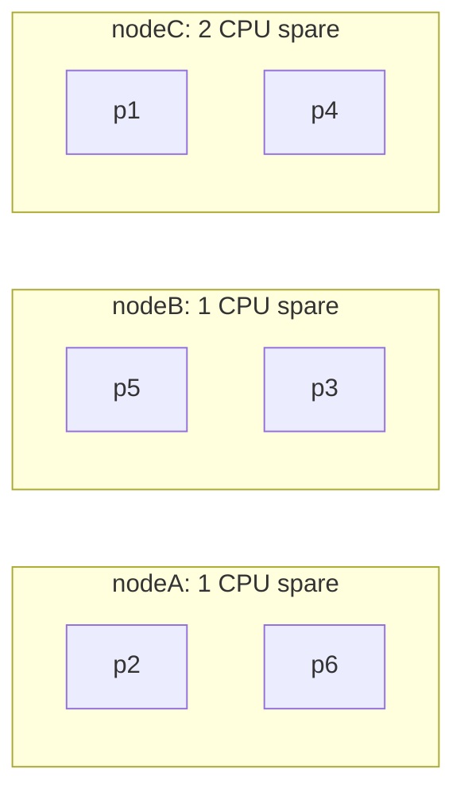
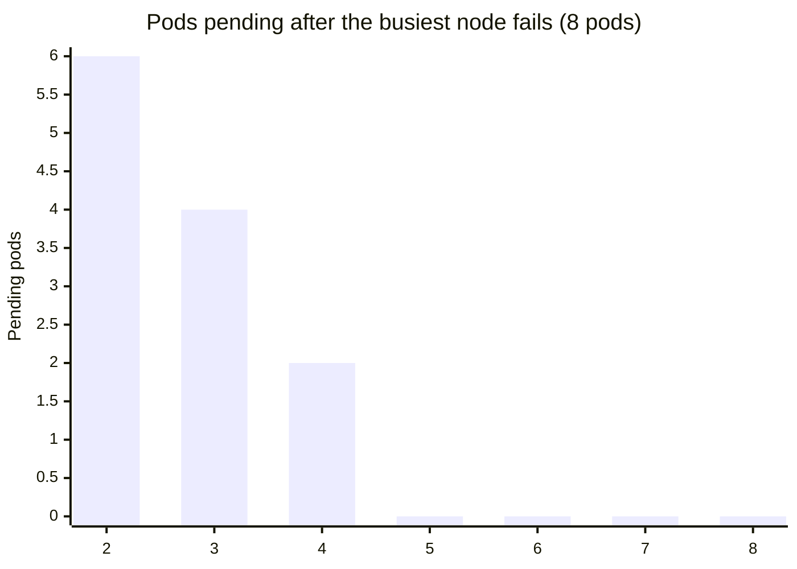

import Scenario from "../../../components/Scenario.astro";
import LevelIntro from "../../../components/LevelIntro.astro";
import Checkpoint from "../../../components/Checkpoint.astro";
import PracticeCheck from "../../../components/PracticeCheck.astro";

export const unit = {
  track: "infra-delivery",
  unitSlug: "orchestration-basics",
};

<Scenario label="The same dispatcher, a kitchen with spare burners and a kitchen without">
  <Fragment slot="facts">
    

      
🟢 <strong>Kitchen A</strong> — 3 cooks, 4 burners each, 6 pots, some burners free

      
🔴 <strong>Kitchen B</strong> — 2 cooks, 4 burners each, 4 big pots using every burner

      
🤒 <strong>Both</strong> — one cook leaves mid-service

      
🎯 <strong>Question</strong> — same dispatcher, same rules: which kitchen recovers?

    

  </Fragment>

Both kitchens have a flawless dispatcher who counts pots every minute. A
cook leaves each of them. **If the dispatcher is equally diligent in both,
will both kitchens end up with every pot cooking again, or does "the
dispatcher is working correctly" stop meaning "dinner is back on"?**

</Scenario>

<LevelIntro
  items={[
    "A scheduling pass done by hand",
    "Recovery with and without spare room",
    "How many nodes a single failure really needs",
  ]}
/>

## What does one scheduling pass look like?

The scheduler's rule from L2 is short: take pods biggest first, keep nodes
that fit on both CPU and memory, and choose the fit with the most free CPU
(then memory). Here is Scenario A, three nodes of 4 CPU / 8 GB and six pods:

| Pod | Request      | Chosen node | Node left after |
| --- | ------------ | ----------- | --------------- |
| p2  | 2 CPU / 2 GB | nodeA       | 2 CPU / 6 GB    |
| p5  | 2 CPU / 1 GB | nodeB       | 2 CPU / 7 GB    |
| p1  | 1 CPU / 2 GB | nodeC       | 3 CPU / 6 GB    |
| p4  | 1 CPU / 2 GB | nodeC       | 2 CPU / 4 GB    |
| p3  | 1 CPU / 1 GB | nodeB       | 1 CPU / 6 GB    |
| p6  | 1 CPU / 1 GB | nodeA       | 1 CPU / 5 GB    |

Final spare room: nodeA 1 CPU / 5 GB, nodeB 1 CPU / 6 GB, nodeC 2 CPU /
4 GB. No node is packed, and none is empty.

## Scenario A: nodeC fails

nodeC took p1 and p4 down with it (1 CPU / 2 GB each, 2 CPU / 4 GB in
total). The loop's next pass sees two missing pods and runs the same rule
against the survivors, which have 1 CPU / 5 GB and 1 CPU / 6 GB left:

| Lost pod | Survivors that fit | Chosen | Result |
| -------- | ------------------ | ------ | ------ |
| p1       | nodeA, nodeB       | nodeB  | placed |
| p4       | nodeA              | nodeA  | placed |

Nothing is `pending`. The recovery worked because the survivors' spare
CPU (2 in total) matched the 2 CPU being rescheduled, and it left them
at 0 CPU spare. A second failure right after would find no room.

<Checkpoint question="If nodeC had been carrying four pods of the same size as p1 and p4 instead of two, would the same logic still recover everything?">

Not necessarily. The scheduler and the loop are identical; only the
arithmetic changes. Four lost pods ask for 4 CPU, while the survivors still
offer only 2 CPU between them, so at least two of the four would remain `pending`.
Recovery was never a property of the loop alone. It was a property of the
loop plus enough free room.

</Checkpoint>

<PracticeCheck track={unit.track} unitSlug={unit.unitSlug} topicId="headroom" />

## Scenario B: the cluster that was packed to the brim

Two nodes of 4 CPU / 8 GB and four pods of 2 CPU / 4 GB: every burner is
in use, with zero headroom. Spread puts p1 and p3 on nodeA, p2 and p4 on
nodeB. Now nodeB fails.

| Step                   | nodeA left   | Pending pods |
| ---------------------- | ------------ | ------------ |
| Before the failure     | 0 CPU / 0 GB | none         |
| nodeB fails            | 0 CPU / 0 GB | p2, p4       |
| Loop retries, any pass | 0 CPU / 0 GB | p2, p4       |

The loop is running perfectly and reporting the gap truthfully on every
pass, yet the app stays half down. **The loop only redistributes spare
capacity; it never creates any.** A status like "reconciling" therefore
means "retrying against a limit it cannot remove", not "about to finish".
Only a new node, or freeing something else, ends the stall.

<Checkpoint question="Hours after nodeB failed in Scenario B the dashboard still says the loop is reconciling p2 and p4. Is it stuck?">

Not in the sense of being broken: it really does compare and retry each
cycle. But every retry reaches the same answer, because nodeA has no CPU or
memory left. Nothing in the loop's own behaviour will change that, so the
useful reading of the status is "constrained", and the fix lives outside the
loop: add capacity or free some.

</Checkpoint>

## How many nodes does a single failure need?

**Eight pods at 2 CPU / 4 GB each, nodes of 4 CPU / 8 GB. How many nodes
before losing the busiest node still leaves nothing pending?** Each node
holds 2 pods, so 8 pods need 4 nodes just to run. Losing one of those four
removes 2 pods and leaves 3 full nodes, so 2 pods stay `pending`. A fifth
node is the first that gives a survivor set with enough room. These are
the exact outputs of the interactive demo for this unit (drag the node
count to confirm):

| Nodes | Pending before the failure | Pending after the busiest node fails |
| ----- | -------------------------- | ------------------------------------ |
| 2     | 4                          | 6                                    |
| 3     | 2                          | 4                                    |
| 4     | 0                          | 2                                    |
| 5     | 0                          | 0                                    |

Below 4 nodes the cluster is short even before anything breaks, and at
exactly 4 it runs but cannot survive a loss. The extra node is the price of
tolerating one failure. This is a case, not the whole territory: it
assumes identical pods, identical nodes, and a failure of the busiest node
only.

**Extend it:** keep the 4-node cluster but make the same 8 pods half the size
(1 CPU / 2 GB). How much of the cluster do they now use, and can it
survive a node loss without a fifth node? What if two nodes can fail at once, or a pod
type can only run on certain nodes? Reason from the arithmetic before
checking anything.

## Failure modes

| Failure mode                                      | What it gets wrong                                                             |
| ------------------------------------------------- | ------------------------------------------------------------------------------ |
| Assuming the orchestrator guarantees recovery     | It guarantees detection and an attempt; recovery needs spare room to exist     |
| Packing every node to 100% to save money          | Removes exactly the headroom that makes a single failure survivable            |
| Treating `pending` as a blip that will fix itself | A pod stays pending until capacity is added or freed                           |
| Adding "some more" nodes and calling it fixed     | Only helps if the added room covers the specific failure being planned for     |
| Confusing spreading with fault tolerance          | Spreading shrinks the blast radius; it does not replace actual spare capacity  |
| Ignoring the second failure                       | Scenario A recovered to 0 CPU spare, so one more loss would leave pods pending |

## Can you write the placement rule yourself?

The whole Scenario A table came from one small decision, repeated: given
one pod and the nodes' remaining room, which node wins, or is there none?

| Step | Rule                                                           |
| ---- | -------------------------------------------------------------- |
| 1    | Keep only nodes with enough CPU and enough memory for the pod  |
| 2    | If none remain, the pod stays pending                          |
| 3    | Otherwise choose the most free CPU; break a tie by free memory |
| 4    | If still tied, the node listed first wins                      |

Writing it as a function is the best way to feel how little there is to it,
and how cleanly the outcomes in this level follow from it.

<PracticeCheck
  track={unit.track}
  unitSlug={unit.unitSlug}
  topicId="pick-node"
/>
