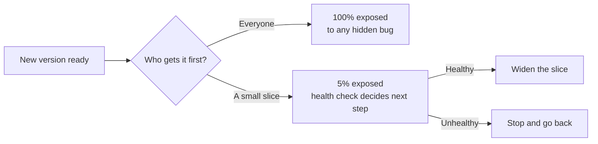

import Scenario from "../../../components/Scenario.astro";
import LevelIntro from "../../../components/LevelIntro.astro";
import PracticeCheck from "../../../components/PracticeCheck.astro";

export const unit = {
  track: "infra-delivery",
  unitSlug: "progressive-delivery",
};

<Scenario label="A cook has a new soup recipe and 200 diners waiting. Do you serve everyone the first bowl, or let a few taste it first?">
  <Fragment slot="facts">
    

      
🍲 <strong>The soup</strong> — a new recipe nobody has tasted outside the kitchen

      
🍽️ <strong>The room</strong> — 200 diners waiting for their bowl

      
🥄 <strong>The taste test</strong> — 10 diners get a small bowl first

    

    

      

        
Served in the taste test10 of 200 (5%)

        

      

    

  </Fragment>

The kitchen tested the recipe on a quiet afternoon and it tasted fine.
But the evening crowd orders differently, and one ingredient turns bitter
in a way the kitchen test never showed. **If you serve all 200 at once and
it is bitter, 200 people are unhappy. If 10 taste it first, how many
people does the same mistake reach, and what do you do next?**

Ten unhappy diners and 190 untouched bowls is the same mistake with a
smaller price tag. Software shipping has exactly this choice, and the
"diners" are real users on real traffic.

</Scenario>

<LevelIntro
  items={[
    "Why real traffic finds what tests miss",
    "Canary, blue-green, feature flag",
    "Which job each technique does",
  ]}
/>

## The software version of the taste test

Some bugs only show up under real user traffic: real data, real habits,
real scale. Staging cannot fully copy those. Progressive delivery does
not try to prevent such a bug; it controls **how many users meet it
before someone notices**. Here, **traffic** means the real requests
arriving at the production system.

To see the size of the difference, assume (for illustration only) 100,000
users and a bug that takes the same 20 minutes to notice either way, and
that it breaks the new version for every user who reaches it:

| Rollout choice          | Users who reach the new version | Users who hit the bug |
| ----------------------- | ------------------------------- | --------------------- |
| All at once             | 100,000                         | 100,000               |
| Canary at 5%, then halt | 5,000                           | 5,000                 |

The bug, the code, and the detection time are identical. Only the share
of traffic that reached the new version changed; in the canary row the
other 95,000 users never leave the old version.

## Three techniques, three different jobs

These are not three names for the same safety net. Each one answers a
different question:

| Technique    | The question it answers                            | The plain picture                                                   |
| ------------ | -------------------------------------------------- | ------------------------------------------------------------------- |
| Canary       | How many users try the new version first?          | Ten diners taste the soup before the other 190 are served           |
| Blue-green   | How fast can we switch back to the known-good one? | Two full kitchens; the dining room is moved from one to the other   |
| Feature flag | Is this one behavior switched on right now?        | One dish on the menu can be crossed out without closing the kitchen |

A canary limits who is hurt. Blue-green makes going back quick. A flag
lets one behavior be turned off while the rest of the new version stays
live. Picking the wrong one leaves the real risk uncovered.

<PracticeCheck
  track={unit.track}
  unitSlug={unit.unitSlug}
  topicId="three-tools-three-jobs"
/>

## Key terms

- **Progressive delivery** — rolling a change out in stages and checking
  health at each stage, instead of giving it to everyone at once.
- **Canary deployment** — sending a small, defined share of production
  traffic to the new version first, and widening it only if it looks
  healthy.
- **Blue-green deployment** — keeping two complete, identical production
  environments and moving all traffic from one to the other, so moving
  back is a single switch.
- **Feature flag** — a runtime toggle that turns a piece of code on or
  off while the app is already running, with no new deploy.
- **Blast radius** — how many users a mistake can reach.

## What the next levels cover

L2 shows the staged-rollout model behind a canary and what a feature flag
separates from a deploy. L3 shows how users are placed into a stable
canary slice, why one bug can hide from a percentage canary, and how the
halt rule works.
