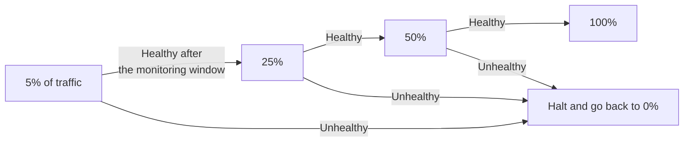
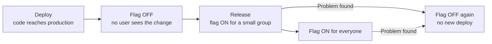

import LevelIntro from "../../../components/LevelIntro.astro";
import Checkpoint from "../../../components/Checkpoint.astro";
import PracticeCheck from "../../../components/PracticeCheck.astro";

export const unit = {
  track: "infra-delivery",
  unitSlug: "progressive-delivery",
};

L1 ended with three techniques that answer three different questions.
This level opens up two of them: how a canary moves from a small slice to
everyone, and how a feature flag separates shipping code from turning it on.

<LevelIntro
  items={[
    "Stages and health gates",
    "Choosing the right health signal",
    "Deploy versus release with a flag",
  ]}
/>

## How does a canary go from a taste to the whole room?

**If ten diners liked the soup, do you now serve all 190 the same bowl
immediately?** Not quite: ten people tell you about ten people. A canary
widens in steps, and each step has to earn the next one.

Each arrow is a real gate, not a wait. Three terms are worth fixing in
your head:

- **Monitoring window** — how long you watch a stage before judging it.
- **Error rate** — bad requests divided by total requests.
- **Threshold** — the agreed limit; crossing it halts the rollout.

**Why start at 5% instead of 50% to finish sooner?** Because the point is
to keep exposure small while the evidence is still thin. With an
illustrative 100,000 users, a bug caught at the first stage touches
5,000 people; caught at a 50% start it touches 50,000.

| Stage | Share of 100,000 users (illustrative) | Users who would hit a bug that gets caught here |
| ----- | ------------------------------------- | ----------------------------------------------- |
| 5%    | 5,000                                 | 5,000                                           |
| 25%   | 25,000                                | 25,000                                          |
| 50%   | 50,000                                | 50,000                                          |
| 100%  | 100,000                               | 100,000                                         |

<Checkpoint question="A canary has been healthy at 25%. The next stage is 50%. Why does 50% still need its own health check instead of trusting the 25% result?">

Because "healthy at 25%" is evidence about the 25% slice and the load it
generated, not about everyone else. A bug can depend on volume or on a
user group that was thin in the first slice, so it can pass at one stage
and appear at the next. That is why every step is gated separately.

</Checkpoint>

<PracticeCheck
  track={unit.track}
  unitSlug={unit.unitSlug}
  topicId="staged-gates"
/>

### What should "healthy" actually measure?

**If the new version never crashes, is it healthy?** Not necessarily. The
bitter soup did not stop the kitchen; it quietly made food worse. A
canary that only watches for crashes misses that whole family of bugs.

| Signal                                         | Catches                    | Misses                                     |
| ---------------------------------------------- | -------------------------- | ------------------------------------------ |
| Server crashes / HTTP 5xx rate                 | Outages, thrown exceptions | Wrong answers returned with a success code |
| Product-quality metric (clicks, empty results) | Quietly worse behavior     | Anything the metric does not measure       |
| Latency                                        | Slow code paths            | Correct but unhelpful results              |

A good gate combines a technical signal with at least one signal tied to
what the feature is for. For a recommendation change, that could be the
share of pages that come back with an empty recommendation list.

## What does a feature flag separate from a deploy?

**If the new code is already on the servers, are users already using it?**
Only if you let them. A flag splits two events that used to happen
together:

| Event   | What changes                         | How fast it can be undone                            |
| ------- | ------------------------------------ | ---------------------------------------------------- |
| Deploy  | Which code is running                | As slow as another deploy (or an environment switch) |
| Release | Which users the behavior is shown to | As fast as flipping the flag                         |

That is why a flag is the right tool for one risky behavior inside a
larger change: you can turn that one dish off without taking the whole
menu down. The limit is the other side of the coin: a flag only guards
code that was written behind it. A broken database migration or a
bad infrastructure change is not behind any flag.

<Checkpoint question="A change is deployed with its new checkout path behind a flag that is OFF. Orders start failing. Are users affected by the new path, and what is the fastest fix?">

No user is affected by the new path, because the flag is off and the old
path is serving everyone; the failing orders have another cause. Had the
flag been ON, switching it off would be the fastest fix, since it needs
no deploy. The flag only helps for the behavior it actually guards.

</Checkpoint>

<PracticeCheck
  track={unit.track}
  unitSlug={unit.unitSlug}
  topicId="flags-and-decoupling"
/>

## Where this goes wrong

- **Treating one technique as all three.** Blue-green alone still sends
  100% of traffic to a bug; it only makes going back quick. A canary
  alone still needs some way to actually go back.
- **Moving through stages on a timer.** A stage that advances "after 10
  minutes" with no health check is progressive delivery in name only.
- **Watching the wrong signal.** Crash counts will not see a feature that
  works but returns bad results.
- **Forgetting old flags.** A flag left in the code long after rollout is
  another branch someone has to understand and test.
