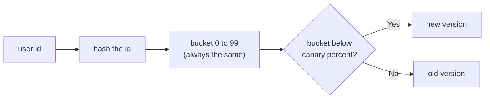
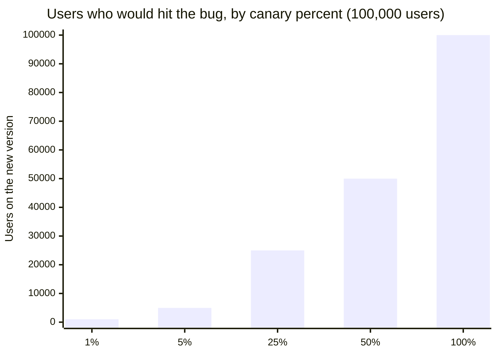

import Scenario from "../../../components/Scenario.astro";
import LevelIntro from "../../../components/LevelIntro.astro";
import Checkpoint from "../../../components/Checkpoint.astro";
import PracticeCheck from "../../../components/PracticeCheck.astro";

export const unit = {
  track: "infra-delivery",
  unitSlug: "progressive-delivery",
};

<Scenario label="Ten diners taste the soup. If the same diner is handed the new soup at one table and the old soup at the next, what did you learn?">
  <Fragment slot="facts">
    <div class="not-prose flex flex-col gap-2 text-sm text-slate-700 dark:text-slate-300">
      <div class="flex items-center gap-1.5"><span>🧑‍🍳</span> <strong>The goal</strong> — a small slice gets the new version, in steps, for a 100,000-user rollout</div>
      <div class="flex items-center gap-1.5"><span>🔁</span> <strong>Problem 1</strong> — a user must not flip between versions on every request</div>
      <div class="flex items-center gap-1.5"><span>🎯</span> <strong>Problem 2</strong> — a bug affecting 1 user in 100 may hide inside an average</div>
      <div class="flex items-center gap-1.5"><span>🛑</span> <strong>Problem 3</strong> — something automatic must decide when to stop</div>
    </div>
  </Fragment>

L2 described the stages as percentages. But "5% of traffic" has to be
made of specific people, and if the same person bounces between old and
new, their complaints cannot be traced to either version. **How do you pick
a slice that stays put, widens without reshuffling, and still reveals a
problem that only touches a few users?**

</Scenario>

<LevelIntro
  items={[
    "Stable slices by hashing a user id",
    "A bug that hides in an average",
    "The halt rule as a rate, not a count",
  ]}
/>

## How do you keep the same users in the canary slice?

**Why not flip a coin on every request?** Because then one user sees both
versions in one session, and your numbers mix the two. The fix is to
turn the user id into a fixed bucket from 0 to 99 and compare the bucket
with the current percentage:



This is one of the cases where the code is the point, so here it is,
minimal:

```js
function hashUserId(userId) {
  let hash = 0;
  for (let i = 0; i < userId.length; i++) {
    hash = (hash * 31 + userId.charCodeAt(i)) >>> 0;
  }
  return hash;
}

function assignVersion(userId, canaryPercent) {
  return hashUserId(userId) % 100 < canaryPercent ? "new" : "old";
}
```

No per-user record is stored anywhere; the id itself decides. Running
this exact hash on three made-up ids gives these buckets and assignments
(computed, not estimated):

| User id   | Bucket | At 5% | At 50% | At 100% |
| --------- | ------ | ----- | ------ | ------- |
| user-42   | 40     | old   | new    | new     |
| user-7    | 77     | old   | old    | new     |
| user-1001 | 94     | old   | old    | new     |

Read across a row: once a user turns "new", they stay "new" as the
percentage grows. Raising the percentage only adds buckets; it never
removes any.

<Checkpoint question="A rollout moves from 5% to 25%. Can a user who was on the new version at 5% be moved back to the old version at 25%, and why?">

No. A user's bucket never changes; only the threshold it is compared
against grows. A bucket below 5 is also below 25. The only users who
change are those whose bucket is in the newly included range (5 to 24),
and they move from old to new.

</Checkpoint>

<PracticeCheck
  track={unit.track}
  unitSlug={unit.unitSlug}
  topicId="sticky-bucketing"
/>

### How big is each slice, really?

Running the same hash on ids `user-1` through `user-100000` gives the
real slice sizes. They are close to the nominal percentage, not exactly
equal, because a hash spreads ids only approximately evenly:

| Canary percent | Users on the new version (computed) |
| -------------- | ----------------------------------- |
| 1%             | 990                                 |
| 5%             | 4,957                               |
| 25%            | 24,988                              |
| 50%            | 49,988                              |
| 100%           | 100,000                             |



The slider demo for this unit uses the exact percentage instead of the
hash, so its numbers (5,000 at 5%) sit a little off these; the shape is
the same.

## Why can a bug hide from a percentage canary?

**Suppose the bug only breaks users in one region that makes up 1% of all
users. Does a bigger canary make the problem easier to see?** Work it out
with the assumption that every affected user triggers one failed request
and everyone else triggers none:

| Canary percent | Canary users | Affected users in canary (1%) | Overall canary error rate |
| -------------- | ------------ | ----------------------------- | ------------------------- |
| 5%             | 5,000        | about 50                      | 50 / 5,000 = 1%           |
| 25%            | 25,000       | about 250                     | 250 / 25,000 = 1%         |
| 100%           | 100,000      | about 1,000                   | 1,000 / 100,000 = 1%      |

The rate is stuck at 1% because the canary is a fair sample: it holds the
same 1% share of affected users at every size. If the halt threshold is
2%, nothing ever trips, even at 100%, where 1,000 users are broken. The
same canary looked at by region would show something very different: in
the affected region, 50 of the 50 canary users fail, a 100% error rate.

<PracticeCheck
  track={unit.track}
  unitSlug={unit.unitSlug}
  topicId="segment-blind-spot"
/>

## How does the halt rule decide?

**A stage sees 20 errors. Should it halt?** The count alone cannot tell
you. Twenty errors in 1,000 requests is a lot; twenty in 10,000 is not.
The rule compares a rate to a threshold, and it needs one guard for the
case with no traffic:

| Errors | Requests | Error rate | Threshold | Halt?                      |
| ------ | -------- | ---------- | --------- | -------------------------- |
| 50     | 1,000    | 5%         | 2%        | Yes                        |
| 5      | 1,000    | 0.5%       | 2%        | No                         |
| 20     | 1,000    | 2%         | 1%        | Yes                        |
| 20     | 10,000   | 0.2%       | 1%        | No                         |
| 0      | 0        | undefined  | any       | No (nothing to judge from) |

<Checkpoint question="Two canary stages both record exactly 20 errors, with a 1% threshold. Stage A had 1,000 requests, stage B had 10,000. Does the same count halt both?">

No. Stage A's rate is 20 / 1,000 = 2%, above 1%, so it halts. Stage B's
rate is 20 / 10,000 = 0.2%, below 1%, so it continues. The same raw count
means something different depending on the traffic it came from, which is
why the rule is written as a rate.

</Checkpoint>

<PracticeCheck
  track={unit.track}
  unitSlug={unit.unitSlug}
  topicId="halt-rule"
/>

## What this case does and does not cover

This unit followed one case: a uniform bug, one hash scheme, one halt
rule. It is a case, not the whole territory. Other systems bucket by
account, region, or request instead of by user, widen on a timer or by
hand, and watch a mix of signals. **Try extending it yourself.** What
changes if the bug only hits users on one mobile app version? What if
the canary slice is chosen by account instead of user and one huge
account holds 40% of traffic? What would you add to the halt rule so the
1% region bug above would stop the rollout?

## Failure modes

| Failure mode                                 | What it gets wrong                                                        |
| -------------------------------------------- | ------------------------------------------------------------------------- |
| Random assignment per request                | The same user sees both versions; signals from the two versions are mixed |
| Judging by raw error count                   | A count means nothing without the traffic it came from                    |
| Only an overall rate                         | A bug in a small segment is averaged away and never crosses the threshold |
| Advancing on elapsed time alone              | No evidence is gathered; the stage is a delay, not a check                |
| Dividing by zero when a stage has no traffic | An empty stage looks like an error rate of "not a number" and can misfire |
