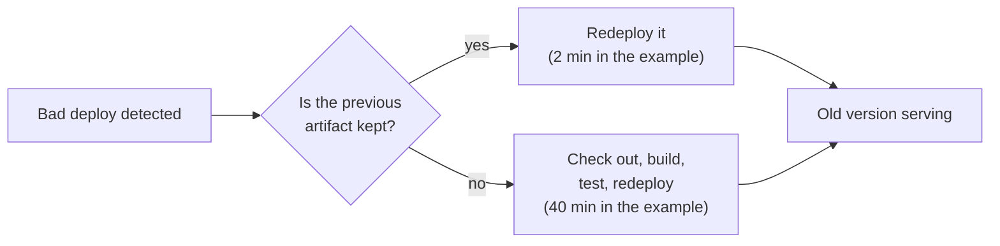

import Scenario from "../../../components/Scenario.astro";
import LevelIntro from "../../../components/LevelIntro.astro";
import PracticeCheck from "../../../components/PracticeCheck.astro";

export const unit = {
  track: "infra-delivery",
  unitSlug: "rollback-strategy",
};

<Scenario label="Your editor's undo button is instant. A deploy's 'undo' took 40 minutes. Why?">
  <Fragment slot="facts">
    

      
↩️ <strong>Undo button</strong> — instant, because the editor kept the previous state

      
🔥 <strong>The bad deploy</strong> — 1 request in 8 fails (12.5%), at 1,200 requests per minute (assumed example numbers)

      

        

          Rebuild the old version from source
          40 min · 6,000 failed requests
        

        

          

        

      

      

        

          Redeploy a kept, ready artifact
          2 min · 300 failed requests
        

        

          

        

      

    

  </Fragment>

You type a bad paragraph, press undo, and it is gone in a blink. Undo is
instant because the editor never threw away the previous version: it is
already sitting there, ready to be put back. Now imagine undo worked by
retyping the whole document from your first draft. Same button, same
intention, a very different wait.

A deploy has the same two possible undos. At 1:58am a release makes 1 request
in 8 fail. One team presses "roll back" and a ready copy of the previous
version is serving traffic again in 2 minutes. Another team has to rebuild
the previous version from source and takes 40 minutes. **Same bug, same
decision to roll back. What did the first team do before the incident that the
second team did not?**

</Scenario>

<LevelIntro
  items={[
    "What makes a rollback fast",
    "Why reverting code is not always safe",
    "Who decides to roll back",
  ]}
/>

## Why is one undo instant and the other slow?

The speed gap is decided before anything goes wrong, by whether the previous
version still exists as something that can run, or only as source code that has
to be rebuilt first.

The cost of waiting is easy to count. With the assumed numbers, every minute
the bad deploy stays live fails 1,200 × 12.5% = 150 requests:

| Path                         | Minutes live | Failed requests |
| ---------------------------- | ------------ | --------------- |
| Rebuild from source          | 40           | 6,000           |
| Redeploy a kept artifact     | 2            | 300             |
| Difference (the preparation) | 38           | 5,700           |

Drag the interactive demo on this level to see how the total moves as the
rollback time, request rate and error rate change.

<PracticeCheck
  track={unit.track}
  unitSlug={unit.unitSlug}
  topicId="ready-artifact"
/>

## Key terms

- **Rollback** — returning to the previous known-good deployed version, as
  opposed to a **roll-forward** that ships a new fix on top of the bad version.
- **Deployable artifact** — the built, ready-to-run output of a deploy (a
  container image, a compiled binary), as opposed to the source it came from.
- **Backward-compatible migration** — a database change that both the old and
  the new code can run against, which is what makes a code rollback safe.
- **Health check** — an automated signal (error rate, latency) used to judge
  whether a deploy is behaving.
- **Rollback trigger** — the condition that starts a rollback: automatic (a
  health check crosses a threshold) or manual (a person decides).

## The three things a rollback needs

| Need                | The question it answers                               | What goes wrong without it                                  |
| ------------------- | ----------------------------------------------------- | ----------------------------------------------------------- |
| Fast                | Is the old version ready to run, or must it be built? | A 40-minute rebuild while the bug keeps failing requests    |
| Safe                | Does the old code still work with today's database?   | The rollback causes a second, different outage              |
| Correctly triggered | Who or what decides to pull the trigger, and when?    | Noise rolls back healthy deploys, or real failures sit idle |

A rollback strategy is a plan made before the incident, because deciding at
1:58am what "roll back" even means for this system is when it is most likely
to be decided badly.

## What the next levels cover

L2 builds the model: why a kept artifact is the fast path, the database
migration trap that makes "just redeploy the old code" unsafe, when to roll
forward instead, and the line between automatic and manual triggers. L3 works
a health-check decision through real windows of traffic, shows how tuning it
trades flapping against slowness, and rewrites an unsafe migration as a safe
one.
