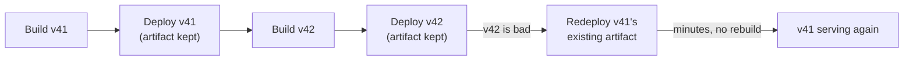
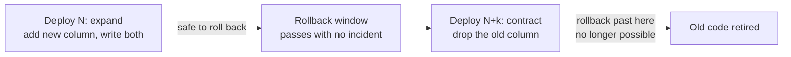
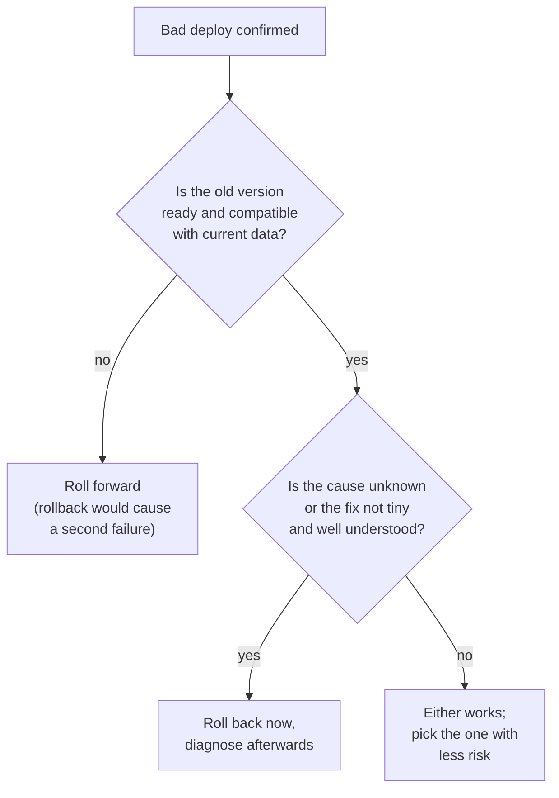
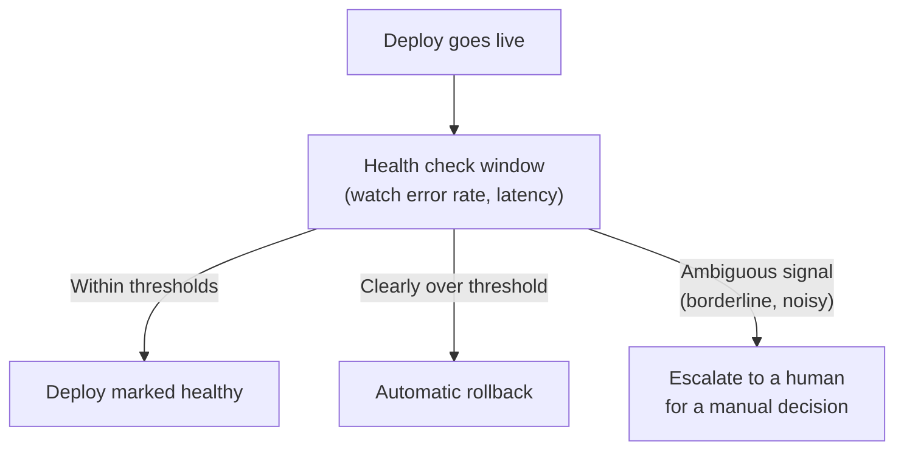

import LevelIntro from "../../../components/LevelIntro.astro";
import Checkpoint from "../../../components/Checkpoint.astro";
import PracticeCheck from "../../../components/PracticeCheck.astro";

export const unit = {
  track: "infra-delivery",
  unitSlug: "rollback-strategy",
};

L1 showed that two teams with the same bug can differ by a factor of 20 in
recovery time, decided before the incident. This level works through what
that preparation consists of: what makes reverting fast, what makes it safe,
when reverting is the wrong move, and who decides to pull the trigger.

<LevelIntro
  items={[
    "Fast: kept artifacts, not rebuilds",
    "Safe: the database migration trap",
    "Roll back or roll forward, and who triggers",
  ]}
/>

## What actually makes a rollback fast

**If the old code still exists in version control, why did the rebuild path
take 40 minutes instead of being instant?** Because "the code exists" and "a
running version is ready to serve traffic" are different things. Between them
sits a build step (compile, bundle, containerize) that is a normal cost when
shipping forward and an unwelcome tax when repeated urgently during an
incident.

The fix follows from how a mature pipeline already works: every deploy's
artifact is kept for a retention window after it is superseded, under an
immutable version tag. A rollback is then the ordinary deploy mechanism aimed
at an older tag.

Blue-green deployments and feature flags are two layers of the same idea.
Blue-green keeps a whole previous environment warm, so rolling back is
switching traffic back. Turning a feature flag off is a rollback with no
redeploy at all. Neither is a separate idea from "keep the old thing ready".

<Checkpoint question="A team deletes old container images after every successful deploy to save storage, keeping only the running version. Is their next rollback fast or slow, and why?">

Slow. Deleting the previous artifact turns a rollback into a rebuild, even
though the source is still in version control. They traded a small, predictable
storage cost for a large, unpredictable delay paid during an incident.

</Checkpoint>

## The database migration trap

**If a kept artifact fixes speed, is redeploying the old code always a safe
rollback?** No, and this is the trickiest part. Application code and its
database are deployed on different schedules but must agree at every moment,
including the moment right after a rollback.

Take a bad deploy that, alongside a code change, ran a migration dropping a
column the old code still reads:

| Step                                  | Code version | Schema state                  | Result                                              |
| ------------------------------------- | ------------ | ----------------------------- | --------------------------------------------------- |
| Before the deploy                     | v41 (old)    | has `legacy_status` column    | working                                             |
| Bad deploy: v42 ships, migration runs | v42 (new)    | `legacy_status` dropped       | v42 never reads that column, so it looks fine       |
| Naive rollback: redeploy v41          | v41 (old)    | `legacy_status` still dropped | v41 reads `legacy_status` on every request: crashes |

The rollback replaced one failure (a bug in v42) with a worse one (v41
crashing against a schema it no longer matches).

**Does that mean avoiding migrations during risky deploys?** No. It means
writing them so both code versions can run against the same schema for as
long as a rollback might still happen. The standard way is **expand-contract**:
first add the new column and ship code that writes both, removing nothing; drop
the old column only in a later, separate deploy, after the rollback window has
passed.

| Migration pattern                                    | Rollback-compatible?          | Why                                                                          |
| ---------------------------------------------------- | ----------------------------- | ---------------------------------------------------------------------------- |
| Drop a column the old code still reads               | No                            | Old code errors reading a column that no longer exists                       |
| Rename a column in place                             | No                            | Old code wants the old name, new code the new one; a rollback breaks one     |
| Add a new nullable column the old code ignores       | Yes                           | Old code never references it                                                 |
| Expand-contract: add new, write both, drop old later | Yes (during the expand phase) | Both versions read and write correctly until the old column is retired later |

<Checkpoint question="A team wants to rename a column from `status` to `order_status`. What is the rollback-safe way, versus the unsafe way?">

The unsafe way is a straight rename: whichever code version does not match the
new name breaks the moment the migration runs. The safe way spreads it across
deploys: add `order_status`, ship code that writes both columns, and drop
`status` only in a later deploy once a rollback to before the new column
existed is no longer realistic. No single deploy has one code version depending
on something the other lacks.

</Checkpoint>

<PracticeCheck
  track={unit.track}
  unitSlug={unit.unitSlug}
  topicId="migration-trap"
/>

## Roll back, or roll forward?

**If the old version is ready and the schema is compatible, is rolling back
always the right call?** Not always. A roll-forward ships a new fix on top of
the bad version. The choice turns on a few concrete facts:

| Situation                                                     | Better move  | Why                                                           |
| ------------------------------------------------------------- | ------------ | ------------------------------------------------------------- |
| Cause unknown, old version ready and compatible               | Roll back    | Restores service first; diagnosis can happen without pressure |
| Migration already dropped data the old code needs             | Roll forward | Redeploying the old code would crash against the new schema   |
| New-format data already written that the old code cannot read | Roll forward | A rollback would leave unreadable records behind              |
| One-line, well-understood bug with a tested fix ready to ship | Either       | Compare the risk of a fast fix against a known-good state     |

Rolling back is the default because it returns to something already known to
work. Roll forward is the exception, chosen when going back is itself unsafe.

<PracticeCheck
  track={unit.track}
  unitSlug={unit.unitSlug}
  topicId="rollback-vs-forward"
/>

## Automatic vs. manual rollback triggers

**Once a rollback is fast and safe, who or what decides to do it?** The rebuild
path in L1 lost time not only rebuilding but also being noticed and diagnosed
by a person. A **health check** (error rate or latency watched continuously
after every deploy) can close that gap:

It is not "always automate" because signals differ in certainty. A sharp,
sustained spike of 500 errors right after a deploy is a well-understood
signature, safe to act on at once. A mild latency uptick that might be the
deploy or might be unrelated traffic is exactly where an automatic rollback
risks reverting a good deploy over noise. L3 works through where to set that
line.

## Failure modes at this level

- **Treating "we have version control" as "we can roll back fast".** Source
  history is not a ready-to-run artifact.
- **Assuming code rollback is always safe.** A non-backward-compatible
  migration turns "redeploy the old version" into a second outage.
- **Rolling back by reflex when the data has already changed.** Past the point
  where new-format data exists, going back can be worse than going forward.
- **Automating every trigger, or none.** An ambiguous signal handed to a
  machine risks false rollbacks; an unambiguous one left to a slow human
  process wastes the speed a fast mechanism was built for.
